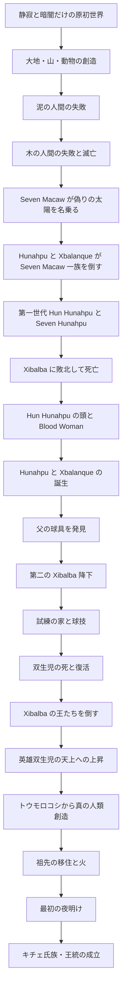

# 『ポポル・ヴフ』物語総合報告

## 概要

『ポポル・ヴフ（Popol Vuh / Popol Wuj）』は、グアテマラ高地のキチェ・マヤに伝わる創世神話・英雄譚・祖先史・王統史をまとめた重要な文書である。

この作品は、一人の英雄だけを描く物語ではない。世界がまだ暗闇と水だけだった時代から始まり、神々による創造、人類創造の失敗、偽りの太陽を名乗る存在との戦い、二世代の球技者と冥界 Xibalba の対決、トウモロコシから造られた人類の誕生、そしてキチェ人の祖先・移住・王統へと続いていく。

本報告では、原典の複雑な構成を理解しやすくするため、物語をおおむね時間順に再構成する。

---

## 1. 世界がまだ何もなかった時代

物語の最初、世界にはまだ人間も動物も大地もない。

存在するのは暗闇、静寂、水、そして空である。

創造に関わる神々は互いに相談し、言葉によって世界を形作る。

代表的な存在として以下が挙げられる。

- Heart of Sky
- Huracan
- Feathered Serpent / Sovereign Plumed Serpent
- Creator / Maker と呼ばれる創造神群

神々が言葉を発すると大地が現れ、山、谷、森、植物が生まれる。

続いて動物たちが造られる。

しかし神々には一つの目的があった。

自分たちを認識し、名前を呼び、記憶し、感謝する存在を造ることである。

動物たちは声を持っていたが、人間のような言葉で神々を称えることができない。

そこで神々は「人間」を造ろうとする。

---

## 2. 最初の人類創造 ― 泥の人間

最初に造られた人間は泥や土からできていた。

しかし泥の身体は脆く、形を保てない。

動くこともうまくできず、増えることも難しく、言葉も不完全だった。

神々が求めていた存在にはならなかったため、この創造は失敗と判断される。

---

## 3. 二度目の人類創造 ― 木の人間

次に神々は木から人間を造る。

木の人間たちは歩き、話し、子孫を増やすことができた。

外見上はかなり人間に近い。

しかし彼らには「心」がない。

自分たちを造った神々を覚えず、感謝せず、祈ることもしない。

そのため、神々は木の人間も失敗作と判断する。

やがて大洪水や災害が起こり、木の人間の世界は破壊される。

伝承では、彼らが使っていた道具や飼っていた動物まで反逆し、人間たちを襲う。

ここで「現在の人類以前の時代」は一度終わる。

---

## 4. 真の太陽が存在しない世界

木の人間が滅びた後も、世界はまだ完成していない。

太陽は昇っておらず、世界は薄暗い。

その時代に現れるのが Seven Macaw（Vucub Caquix / Wuqub' Kaqix）である。

Seven Macaw は宝石のように輝く歯や装飾品を持ち、自分自身こそ太陽であり月であると宣言する。

しかし彼は本当に世界を照らしているわけではない。

彼の輝きは、宝石・富・装飾・虚勢によって作られた偽りの光である。

Seven Macaw は「偽りの太陽」「偽りの神性」を象徴する存在である。

---

## 5. Seven Macaw と二人の息子

Seven Macaw には二人の息子がいる。

- Zipacna
- Cabrakan

二人もまた圧倒的な力を持つ。

Zipacna は山や大地を動かすほどの力を持ち、Cabrakan は山々を破壊する力を誇る。

Seven Macaw 一家は、自らの力や輝きを根拠に世界の支配者であるかのように振る舞う。

しかし、本来の創造の秩序から見れば、彼らはまだ完成していない世界に現れた「間違った支配者」である。

---

## 6. 英雄双生児 Hunahpu と Xbalanque

Seven Macaw 一家を倒す役割を担うのが、英雄双生児 Hunahpu と Xbalanque である。

二人は Seven Macaw が自分を太陽と月だと称することを許さない。

吹き矢で木の上にいる Seven Macaw を攻撃する。

攻撃は成功するものの、Seven Macaw は Hunahpu の腕を奪って反撃する。

そこで双生児は力比べをやめ、策略に切り替える。

老人と老婆に協力してもらい、治療者を装って Seven Macaw に近づく。

そして、Seven Macaw の誇りの象徴である輝く歯や装飾を「治療」の名目で取り除く。

輝きを失った Seven Macaw は威光を失い、最終的に倒される。

この場面では、英雄たちが単純な腕力ではなく、知恵と策略で強敵を倒すという作品全体の特徴が示されている。

---

## 7. Zipacna の物語

Zipacna は巨大な力を持ち、四百人の若者たちと対立する。

若者たちは Zipacna を恐れ、罠にかけて殺そうとする。

しかし Zipacna は罠を見破り、逆に若者たちを死に追いやる。

この事件を知った Hunahpu と Xbalanque は Zipacna を討つことを決める。

二人は巨大な蟹に似せた餌を作り、Zipacna を狭い場所へ誘い込む。

Zipacna は巨大な力を持つが、双生児はその力と欲望を逆に利用し、罠によって倒す。

---

## 8. Cabrakan の物語

Cabrakan は「山を破壊できる」と自慢するほどの怪力を持つ。

Hunahpu と Xbalanque は彼の傲慢さを利用する。

二人は Cabrakan に近づき、食物に仕掛けを施して力を弱らせる。

最終的に Cabrakan も倒される。

こうして Seven Macaw 一家は排除され、偽りの太陽と傲慢な力の時代は終わる。

---

## 9. 物語は一世代前へ戻る

ここで物語は時間をさかのぼる。

Hunahpu と Xbalanque がなぜ冥界 Xibalba と戦うことになるのかを理解するためには、彼らの父と叔父の物語が必要だからである。

第一世代の球技者は以下の二人である。

- Hun Hunahpu / One Hunahpu
- Vucub Hunahpu / Seven Hunahpu

二人は優れた球技者であり、球技場で頻繁にプレーしていた。

その音は地下世界 Xibalba まで響く。

---

## 10. Xibalba ― 死の世界

Xibalba は死・病・苦痛・恐怖と結びついた地下世界である。

そこには複数の冥界の王が存在し、代表的な支配者として One Death と Seven Death が登場する。

Xibalba の最大の特徴は「欺瞞」である。

敵を正面から倒すよりも、偽物、罠、危険な椅子、暗闇、試練などを用いて相手を失敗させる。

冥界の王たちは、地上から聞こえてくる球技の音を不快に感じ、第一世代の二人を Xibalba へ招く。

---

## 11. 第一世代の敗北

Hun Hunahpu と Seven Hunahpu は Xibalba へ向かう。

そこへ至る道には危険な川や分岐がある。

Xibalba の宮殿では、木で作られた偽物の王が置かれている。

二人はそれを見抜けず、偽物に挨拶してしまう。

さらに熱く焼けた椅子へ座らされ、嘲笑される。

夜になると松明と葉巻を渡され、「朝まで使い切らずに返せ」と命じられる。

しかし二人は課題に失敗する。

その結果、二人は処刑される。

Hun Hunahpu の頭は切り落とされ、ひょうたんの木へ置かれる。

すると木には多くの実が生り、その中に頭蓋骨が紛れ込んで見分けがつかなくなる。

---

## 12. Blood Woman と死者の子

Xibalba に住む女性 Blood Woman / Blood Moon / Xquic は、禁じられたひょうたんの木に興味を持つ。

彼女が木に近づくと、Hun Hunahpu の頭蓋骨が話しかける。

頭蓋骨は彼女の手のひらに唾液を吐く。

その瞬間、Blood Woman は子を宿す。

これは物語全体でも非常に重要な場面である。

死んだ者の肉体は滅びても、その生命は子孫を通じて続く。

「死の中から新しい生命が生まれる」というテーマが、ここで明確に示される。

---

## 13. Blood Woman の脱出

Blood Woman の妊娠が発覚すると、Xibalba の王たちは彼女を処刑するよう命じる。

使者のフクロウたちは、彼女を殺して心臓を持ち帰るよう命令される。

しかし Blood Woman は彼らを説得する。

そして木から出る赤い樹液を使い、心臓に見える偽物を作る。

フクロウたちは偽物の心臓を Xibalba へ持ち帰り、Blood Woman を逃がす。

彼女は地上へ向かう。

---

## 14. 第二世代の英雄双生児誕生

Blood Woman は Hun Hunahpu の母の家へたどり着き、双子を産む。

それが Hunahpu と Xbalanque である。

二人は父の血を受け継ぎ、同時に母を通して Xibalba ともつながっている。

つまり英雄双生児は「地上」と「冥界」、「生命」と「死」の両方に関係する存在である。

---

## 15. 幼少期と猿になった兄たち

双生児は成長の過程で、年長の兄弟・従兄弟にあたる者たちから嫉妬される。

しかし Hunahpu と Xbalanque は策略によって立場を逆転させる。

相手を木の上へ誘導し、最終的に猿へ変えてしまう。

ここでも二人は単なる戦士ではなく、知恵・罠・状況判断を使う英雄として描かれる。

---

## 16. 父の球具

双生児はやがて、父たちが残していた球や球技用具を発見する。

そして球技場でプレーを始める。

その音は再び Xibalba へ届く。

かつて父と叔父を招いたのと同じように、Xibalba の王たちは今度は Hunahpu と Xbalanque を招く。

ここで物語は「父の世代と同じ運命をもう一度たどる」という構造になる。

ただし第二世代は、第一世代とは違う。

父たちが失敗した場所で、同じ失敗を繰り返さない。

---

## 17. 第二の Xibalba 降下

Hunahpu と Xbalanque は Xibalba へ向かう。

道や罠は父たちの時代とほぼ同じである。

しかし二人は、Xibalba が「力」より「欺き」によって相手を倒す世界だと理解している。

偽物の王を見抜き、本物の王たちの名前を調べ、罠を避ける。

第一世代が Xibalba のルールを知らずに敗北したのに対し、第二世代はルールそのものを理解し、それを逆利用する。

---

## 18. Xibalba の試練の家

翻訳によって名称や順序に差があるが、英雄双生児は複数の「試練の家」に入れられる。

代表的なものは以下である。

### Dark House

完全な暗闇に包まれた家。

光を奪われ、松明などに関する課題を課される。

### Cold House

猛烈な寒さに満ちた家。

環境そのものが敵となる。

### Jaguar House

飢えたジャガーがいる家。

双生児は動物の習性を利用して生き延びる。

### Razor House

刃や剃刀が動き回る家。

二人は刃の攻撃を直接受けず、策略によって切り抜ける。

### Fire / Hot House

火や高熱に満ちた家。

通常なら焼き尽くされる環境を耐える。

### Bat House

危険な蝙蝠のいる家。

ここで Hunahpu は大きな危機に陥る。

外の様子を確認しようとした瞬間、蝙蝠の怪物 Camazotz に首を切り落とされる。

Hunahpu の頭は球技の球として使われる。

Xbalanque は植物や動物の助けを使い、状況を逆転して Hunahpu を復活させる。

---

## 19. 球技は「死のルール」との戦い

Xibalba の球技は単なるスポーツではない。

命、支配、生贄、死の秩序そのものが賭けられている。

Xibalba の王たちはルールを操作し、罠を使う。

Hunahpu と Xbalanque もまた、公平な競技だけで勝とうとはしない。

相手の仕掛けを見抜き、そのルールを逆に利用する。

そのため、英雄双生児の本当の強さは「最強の戦士であること」ではなく、「死の世界の仕組みを理解し、それを書き換えること」にある。

---

## 20. 双生児、自ら死を選ぶ

Xibalba の王たちは何度も双生児を殺そうとする。

Hunahpu と Xbalanque は、最後には自分たちが殺されることさえ計画の一部にする。

二人は自分たちの遺体がどのように扱われるべきかを事前に考えた上で、死を受け入れる。

二人は処刑され、焼かれ、遺灰を水へ捨てられる。

Xibalba の王たちは勝利したと思う。

しかし、これは双生児の策略であった。

二人は水から再び姿を現す。

死を避けたのではない。

一度死んだ上で、死のルールを超えたのである。

---

## 21. 死と復活の芸人

復活した双生児は、すぐに正体を明かさない。

貧しい放浪芸人のような姿で Xibalba に現れる。

二人は不思議な芸を見せる。

- 建物を壊して元に戻す
- 生き物を殺して蘇らせる
- 互いを殺し、再び蘇らせる

その噂を聞いた Xibalba の王たちは、二人を宮殿へ招く。

死の王たちは芸に魅了され、自分たちにも同じことをしてほしいと願う。

双生児は要求に応じる。

しかし Xibalba の王を殺した後、彼らを復活させない。

死を支配していると思っていた王たちが、今度は自分自身の死から逃れられなくなる。

---

## 22. Xibalba の敗北

Hunahpu と Xbalanque は、自分たちの正体を明かす。

自分たちが、かつて Xibalba に殺された Hun Hunahpu の息子であることを告げる。

ここで第一世代の敗北に対する復讐が完成する。

ただし、この勝利の意味は単なる復讐以上である。

Xibalba の権威は制限され、死・病・恐怖が世界全体を支配することはできなくなる。

英雄双生児は死そのものを消すのではなく、「死にも限界がある」という新しい秩序を作る。

---

## 23. 天上への上昇

Xibalba に勝利した Hunahpu と Xbalanque は天へ昇る。

一般的な要約では、二人は太陽と月などの天体的存在になると説明される。

ここで Seven Macaw の物語と対応する。

物語の前半では Seven Macaw が偽りの太陽を名乗っていた。

しかし英雄双生児が偽りの光を倒し、冥界を越え、死と復活を経験した後に、ようやく本当の宇宙秩序が成立する。

---

## 24. 真の人類 ― トウモロコシから造られた人々

宇宙の秩序が整った後、神々は再び人間創造に取り組む。

今度の材料は、黄色いトウモコシと白いトウモロコシである。

トウモロコシを挽き、人間の身体が造られる。

ついに神々が望んでいた人間が誕生する。

最初の四人の男性は、代表的な英訳では以下のように呼ばれる。

- Balam Quitze / Jaguar Quitze
- Balam Acab / Jaguar Night
- Mahucutah / Not Right Now
- Iqui Balam / Dark Jaguar

彼らは話し、聞き、歩き、働き、神々を理解する。

しかし新しい問題が起きる。

---

## 25. 完璧すぎる人間

最初の四人は、あまりにも優れていた。

遠くの世界まで見通し、天地のことをほとんど理解できるほどの知識と視力を持っていた。

神々は、人間が神と区別できなくなることを恐れる。

そこで人間の視力や認識能力を曇らせ、世界のすべてを完全には理解できないようにする。

この場面は『ポポル・ヴフ』における人間観をよく表している。

人間は無知すぎても完成しない。

しかし神と同じほど完全でも人間ではない。

人間とは、理解する能力を持ちながら、同時に限界を持つ存在である。

その後、四人の妻となる女性たちも現れ、人類が繁栄していく。

---

## 26. 祖先、火、移住

ここから物語は神話から祖先史へ変化していく。

最初の人々は氏族を形成し、それぞれの神や象徴を持つ。

重要な神格の一つとして Tohil が登場する。

Tohil は火、供犠、共同体の守護などと深く関係する。

祖先たちはまだ完全な夜明けを待っており、寒さと暗闇の中で生活する。

火を得ることは単なる生活技術ではなく、神との契約や共同体の所属とも結びつく。

祖先たちは土地を移動し、新しい居住地を探す。

その過程で氏族が分かれ、土地と神々との関係が整理されていく。

---

## 27. 最初の夜明け

長い暗闇の後、ついに太陽が昇る。

これは単なる自然現象ではない。

物語の最初から待ち続けていた「正しい宇宙秩序の完成」である。

Seven Macaw が偽りの光を名乗った時代から始まり、英雄双生児が死を越え、トウモロコシから真の人類が生まれ、ようやく本物の夜明けが訪れる。

---

## 28. 神話からキチェ人の歴史へ

『ポポル・ヴフ』後半では、物語の性質が大きく変わる。

中心になるのは以下の内容である。

- 祖先
- 氏族
- 移住
- 土地
- 戦争
- 婚姻
- 神への奉仕
- 供犠
- 王位継承
- 王族の系譜

つまり、世界創造の物語がそのままキチェ人自身の歴史へ接続する。

「自分たちの現在の社会は、創世以来続く宇宙秩序の一部である」という構造になっている。

---

## 29. 物語全体の流れ

---

## 30. 主要人物一覧

| 名称 | 役割 | 象徴・意味 |
|---|---|---|
| Heart of Sky | 創造神群の中心 | 宇宙秩序・創造 |
| Feathered Serpent | 創造に関わる神格 | 形成・生命 |
| Seven Macaw | 偽りの太陽 | 虚栄・偽の神性 |
| Zipacna | Seven Macaw の息子 | 暴力的な大地の力 |
| Cabrakan | Seven Macaw の息子 | 破壊的な力・傲慢 |
| Hun Hunahpu | 第一世代の球技者 | 父・死・継承 |
| Seven Hunahpu | 第一世代の球技者 | 第一世代の失敗 |
| Blood Woman | 英雄双生児の母 | 死から生まれる生命 |
| Hunahpu | 英雄双生児 | 知恵・再生・秩序回復 |
| Xbalanque | 英雄双生児 | 策略・再生・秩序回復 |
| One Death / Seven Death | Xibalba の主要支配者 | 死・欺瞞・恐怖 |
| Camazotz | Bat House の蝙蝠的存在 | 断頭・夜・死 |
| Tohil | キチェ祖先に関わる神 | 火・契約・共同体 |
| 最初の四人 | トウモロコシ人間 | 現在人類の祖先 |

---

## 31. 作品全体を貫くテーマ

### 31.1 創造は一度では完成しない

神々でさえ最初から完璧な世界を造れるわけではない。

泥の人間、木の人間という失敗を経験し、最後にトウモロコシ人間へ到達する。

### 31.2 記憶することが人間性である

木の人間が失敗した最大の理由は、創造者を記憶しないことだった。

『ポポル・ヴフ』そのものも、祖先と世界の始まりを忘れないための「記憶の物語」と考えることができる。

### 31.3 力より知恵

Hunahpu と Xbalanque は、強敵を正面から力だけで倒すことは少ない。

相手の傲慢、欲望、習性、ルールを利用する。

英雄の本当の武器は知恵である。

### 31.4 死は終点ではない

Hun Hunahpu の死から子供が生まれる。

Hunahpu は首を失っても戻る。

双生児は自ら死んで復活する。

この「死と再生」は、地中に埋められた種が再び芽を出すトウモロコシの循環とも重なる。

### 31.5 人間はトウモロコシからできている

最終的に成功した人類はトウモロコシから造られる。

トウモロコシは単なる食べ物ではなく、人間の身体と祖先そのものに結びつく神聖な存在である。

### 31.6 偽りの光と本物の光

Seven Macaw は宝石の輝きによって太陽を名乗る。

しかし真の夜明けは、偽神の排除、冥界での勝利、死と再生、真の人類創造を経た後に訪れる。

「輝いて見えるもの」と「本当に世界を照らすもの」は違うという対比がある。

---

## 32. 二世代の対照

| 要素 | 第一世代 | 第二世代 |
|---|---|---|
| 球技者 | Hun Hunahpu / Seven Hunahpu | Hunahpu / Xbalanque |
| Xibalba からの招待 | 受ける | 受ける |
| 偽物の王 | 見抜けない | 見抜く |
| 試練 | 失敗 | 突破 |
| 死 | 敗北としての死 | 計画に組み込まれた死 |
| 結果 | Xibalba に殺される | Xibalba の王を倒す |

この対照は英雄双生児編の中心である。

第二世代は父の運命から逃げるのではない。

父が歩いたのと同じ道を、もう一度自分たちで歩く。

そして同じ場所で異なる選択をすることで、失敗した物語を別の結末へ書き換える。

---

## 33. ゲーム化に適した章構成

### 序章：まだ太陽のない世界

- 原初世界
- 大地と動物の創造
- 泥の人間
- 木の人間
- 大洪水

### 第一章：偽りの太陽

- Seven Macaw 登場
- 吹き矢による攻撃
- Hunahpu の腕を奪われる
- 老人と老婆の策略
- Seven Macaw 撃破

### 第二章：山を動かす者

- Zipacna
- 四百人の若者
- 巨大蟹の罠
- Cabrakan
- Seven Macaw 一族の終焉

### 第三章：父たちの敗北

- Hun Hunahpu と Seven Hunahpu
- 球技
- Xibalba からの招待
- 偽物の王
- 試練失敗
- 処刑

### 第四章：死者の子

- ひょうたんの木
- Blood Woman
- 奇跡の妊娠
- 偽物の心臓
- 地上への脱出
- 英雄双生児誕生

### 第五章：英雄の成長

- 年長の兄弟との対立
- 猿への変身
- 父の球具発見

### 第六章：冥界への道

- Xibalba の使者
- 地下世界へ降下
- 危険な川
- 偽物の王

### 第七章：試練の家

- Dark House
- Cold House
- Jaguar House
- Razor House
- Fire House
- Bat House

Bat House で Hunahpu が断頭される場面を大きな物語転換点にできる。

### 第八章：死の球技

- Hunahpu の頭を球として使う
- Xbalanque の逆転策
- Xibalba の王たちとの最終的な知恵比べ

### 第九章：死ぬことが勝利になる

- 双生児が死を受け入れる
- 処刑
- 火葬
- 遺灰
- 水中からの再生

### 最終章：死を騙す者

- 放浪芸人として再登場
- 死と復活の芸
- Xibalba の王を誘い込む
- One Death / Seven Death を殺す
- 正体を明かす
- Xibalba の権力を制限する

### エピローグ：最初の夜明け

- 双生児の天上への上昇
- トウモロコシ人間の創造
- 最初の四人
- 人間の知覚が制限される
- 祖先の旅
- 火
- 本物の太陽が昇る

---

## 34. ゲーム化する際の中心テーマ

『ポポル・ヴフ』を単なる「マヤ神話を使ったアクションゲーム」にすると、原典の最も強い魅力が失われる。

中心に置くべきなのは以下の構造である。

> **父が死に敗れた道を、子がもう一度歩き、同じ運命を別の結末へ変える。**

この構造を中心にすれば、Xibalba は単なる地獄ではなく「父の失敗が残る場所」になる。

球技場は単なる競技施設ではなく「世代を越えて運命が再演される場所」になる。

双生児の復活も単なる魔法ではなく、トウモロコシ、祖先、記憶、死と再生という作品全体の主題につながる。

---

## 35. 名称・翻訳上の注意

『ポポル・ヴフ』には複数の翻訳が存在するため、固有名詞には大きな表記差がある。

例：

- Popol Vuh / Popol Wuj
- Xibalba / Xib'alb'a
- Vucub Caquix / Wuqub' Kaqix / Seven Macaw
- Hun Hunahpu / One Hunahpu
- Vucub Hunahpu / Seven Hunahpu
- Blood Woman / Blood Moon / Xquic
- Balam Quitze / Jaguar Quitze

ゲーム制作段階では、以下の三種類を分けて管理すると安全である。

1. ゲーム内正式名
2. 日本語表示名
3. 原語・研究用表記

---

## 結論

『ポポル・ヴフ』全体は、次の流れとして整理できる。

1. 世界は暗闇と水だけだった。
2. 神々が大地と生命を造った。
3. 泥の人間と木の人間は失敗した。
4. Seven Macaw が偽りの太陽を名乗った。
5. Hunahpu と Xbalanque が Seven Macaw 一族を倒した。
6. その双生児の父と叔父は、以前 Xibalba に敗北して殺されていた。
7. 死んだ父から新しい生命が生まれ、英雄双生児が誕生した。
8. 二人は父と同じ球技を行い、父と同じように Xibalba へ招かれた。
9. 今度は罠を見抜き、試練を突破した。
10. 二人は自ら死に、復活した。
11. 死と復活の力を利用して Xibalba の王たちを倒した。
12. 宇宙の秩序が整った後、黄色と白のトウモロコシから真の人類が造られた。
13. 人類は祖先、氏族、土地、火、神々との関係を築いた。
14. 最後に本物の夜明けが訪れ、キチェ人の歴史へつながっていった。

『ポポル・ヴフ』は世界の始まりを語る創世神話であると同時に、父から子へ記憶と生命が受け継がれ、死を越えて物語が書き換えられていく壮大な世代継承の物語でもある。

---

## 参考資料

- [波波爾・烏 - Wikipedia 中文](https://zh.wikipedia.org/zh-tw/%E6%B3%A2%E6%B3%A2%E7%88%BE%C2%B7%E7%83%8F)
- [Creation Story of the Maya - Smithsonian National Museum of the American Indian](https://maya.nmai.si.edu/the-maya/creation-story-maya)
- [The Hero Twins - Mesoweb](https://www.mesoweb.com/features/twins/twins_text.html)
- [Popol Vuh: Sacred Book of the Quiché Maya People - Allen J. Christenson / Mesoweb](https://www.mesoweb.com/publications/Christenson/PopolVuh.pdf)
- [Popol Vuh Original Text Transcription - Mesoweb](https://www.mesoweb.com/publications/Christenson/PV-Original.pdf)

---

## 調査上の注意

- Wikipedia は全体構造と文献史の導入確認に使用した。
- Smithsonian National Museum of the American Indian の資料で、トウモロコシ人間、英雄双生児、Xibalba、太陽と月へ至る創世物語の概要を確認した。
- Mesoweb の Hero Twins 資料と Christenson 訳を、英雄双生児編の詳細確認の中心資料とした。
- Britannica は調査時に HTTP 403 で取得できなかったため、検証済み根拠には含めていない。
- 試練の家の順序、固有名詞の訳、英雄双生児と天体の対応などには翻訳・研究上の差異があるため、正式なゲーム設定に採用する際は基準とする翻訳版を決めて再確認する必要がある。
