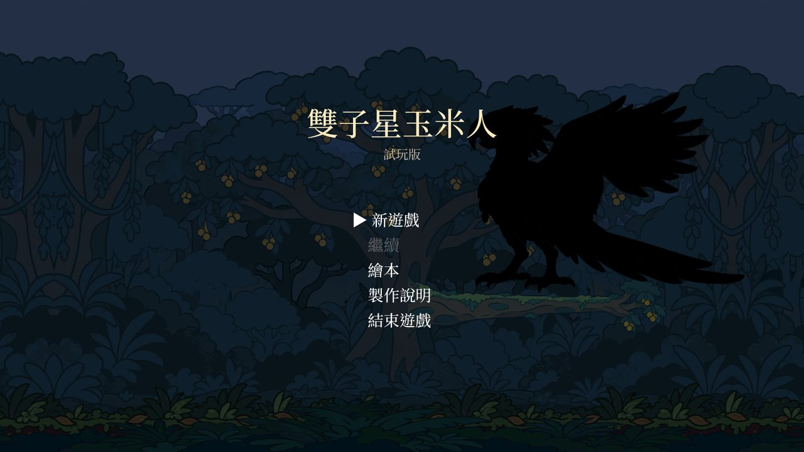
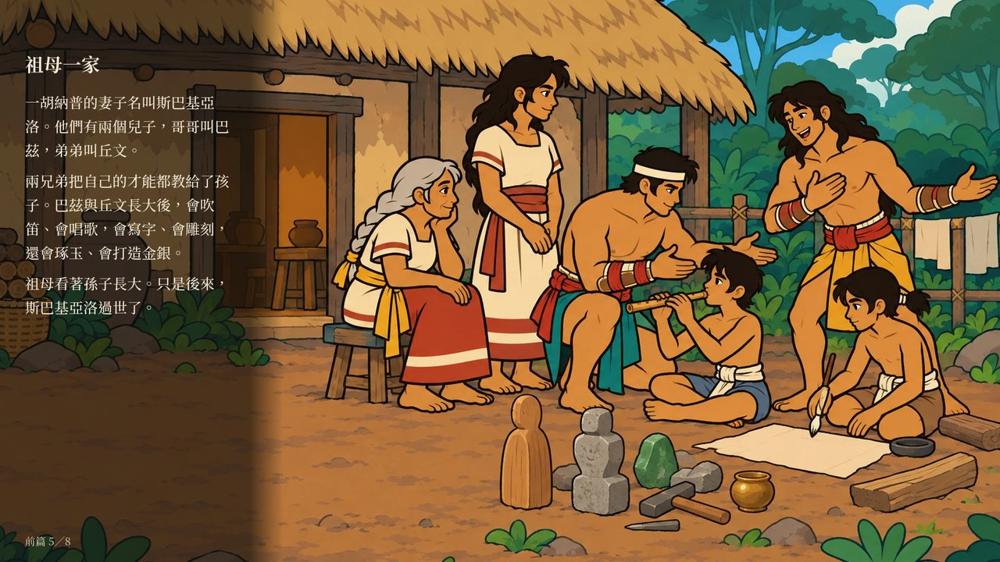
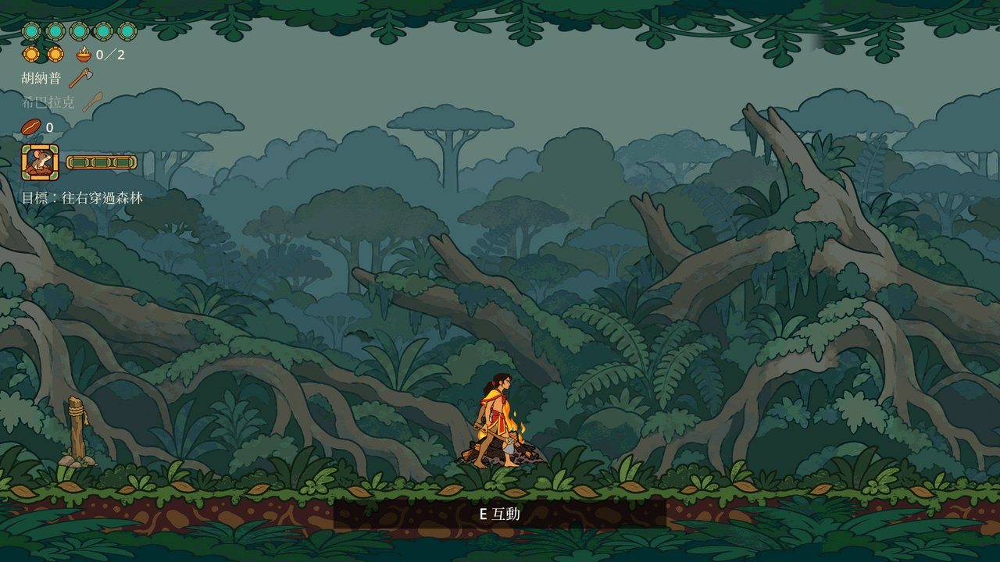

# 雙子星玉米人 Twin Stars of Maize

> **English summary** — *Twin Stars of Maize* is a 2D side-scrolling action-exploration game (metroidvania-style vertical slice) inspired by the Hero Twins cycle of the K'iche' Maya narrative tradition. **The game is in Traditional Chinese only.** This is v0.1.0, an early playtest build: one forest area, one boss, and an eight-page picture-book prologue.
>
> **AI disclosure:** all art (characters, scenery, props, illustrations) and all audio (sound effects, ambience, music) were generated with AI (OpenAI ChatGPT / Codex) and reviewed one by one by the author before use. The code was written by the author together with AI.
>
> **Source and adaptation:** based on Allen J. Christenson's English translation (cross-checked with Dennis Tedlock's). This is an adaptation, not a faithful retelling of the original text.
>
> **License:** code (`game/**/*.gd`, `tools/`) MIT; art, audio and documents all rights reserved — see [LICENSE](LICENSE) and [LICENSE-ASSETS.md](LICENSE-ASSETS.md). Feedback is welcome via [Issues](../../issues).

## 這是什麼

以馬雅 K'iche' 族英雄雙胞胎的故事為題材的 2D 橫向捲軸動作探索遊戲（惡魔城類型）的**垂直切片試玩版**。兩兄弟在森林裡開墾、和動物交換、對抗自稱太陽的巨鳥。包含：

- 繪本前篇 8 頁（第一次開新遊戲時會問要不要先讀）
- 祖母家、田地、森林 6 間與 3 條支路
- 一場 Boss 戰（三段）與片尾

## 下載與遊玩

到 [Releases](../../releases/latest) 下載：

| 平台 | 檔案 | 第一次打開 |
|---|---|---|
| Windows 10／11（64 位元） | `TwinStarsOfMaize-v0.1.0-windows.zip` | 解壓後執行 `TwinStarsOfMaize.exe`。若出現「Windows 已保護您的電腦」，按「其他資訊」→「仍要執行」（本程式沒有付費的程式碼簽章） |
| macOS：Intel 機型 11 以上、Apple 晶片機型 13 以上 | `TwinStarsOfMaize-v0.1.0-macos.zip` | 解壓後打開「雙子星玉米人」。第一次會被擋下（沒有 Apple 公證）：到「系統設定」→「隱私權與安全性」，往下找到這個 App，按「仍要打開」。或在終端機執行 `xattr -dr com.apple.quarantine 雙子星玉米人.app` 後再打開 |
| 網頁版 | [直接在瀏覽器玩](https://isbrian.github.io/twin-stars-of-maize/) | 建議用桌機的 Chrome／Edge／Firefox；第一次載入約 70 MB。網頁版沒有「結束遊戲」 |

存檔在本機（網頁版存在瀏覽器裡）。建議用手把遊玩。

## 操作

| 動作 | 手把 | 鍵盤＋滑鼠 |
|---|---|---|
| 移動 | 左搖桿 | A／D 或 ←／→ |
| 跳躍（按住跳得更高） | A | Space |
| 翻滾 | B | Shift |
| 攻擊（球具＝招架） | X | 滑鼠左鍵 |
| 換人 | Y | Tab |
| 吹箭 | RT（右搖桿瞄準） | 滑鼠右鍵（朝游標） |
| 治療 | 十字鍵上 | R |
| 互動（休息、兌換、撿東西） | 十字鍵下 | E |
| 動物技能 | 十字鍵左／右 | Q／F |
| 暫停選單 | Start | Esc |
| 選單 | 上下選、攻擊鍵（或 Enter）確認、翻滾鍵返回 | |

第一次需要某個操作時，畫面下方會出現按鍵提示。

## 已知問題

- 這是試玩版，只有一個區域。
- HUD 的幾處排版還在調整。
- Windows 版作者沒有實機測過，歡迎回報。

## 回饋

請開 [Issue](../../issues/new/choose)，選「試玩回饋」。

## AI 使用說明

- **美術**（角色、場景、物件、繪本插圖）與**音訊**（音效、環境音、配樂）由 AI 生成（OpenAI ChatGPT／Codex），每一項都經作者審核後採用。
- **程式**由作者與 AI 協作完成。
- 遊戲內「製作說明」與片尾有同樣的說明。

## 原典與改編

故事依據 Allen J. Christenson 的英譯本，並參照 Dennis Tedlock 的英譯本。本作是**改編**，不是原典的忠實重述；改編的取捨記在 [CULTURAL_PRINCIPLES.md](CULTURAL_PRINCIPLES.md)。遊戲標題刻意不使用聖典的名稱。

## 授權

- 程式（`game/` 裡的 `.gd`）與工具（`tools/`）：[MIT](LICENSE)
- 美術、音訊、文件：保留所有權利，見 [LICENSE-ASSETS.md](LICENSE-ASSETS.md)
- 字型 Noto Serif TC／Noto Serif：SIL Open Font License 1.1（授權文字在字型旁）
- 引擎 [Godot Engine](https://godotengine.org)（MIT）；引擎與它內含的第三方函式庫的授權聲明，附在每個下載檔與網頁版的 `THIRD_PARTY_NOTICES.txt`

## 開發

用 Godot 4.7.2 開 `game/`。開發流程（規格 → 計畫 → 實作 → 審查 → 試玩）的文件都在 `todo/`、`report/`、`docs/`；遊戲本身的說明在 [game/README.md](game/README.md)。
