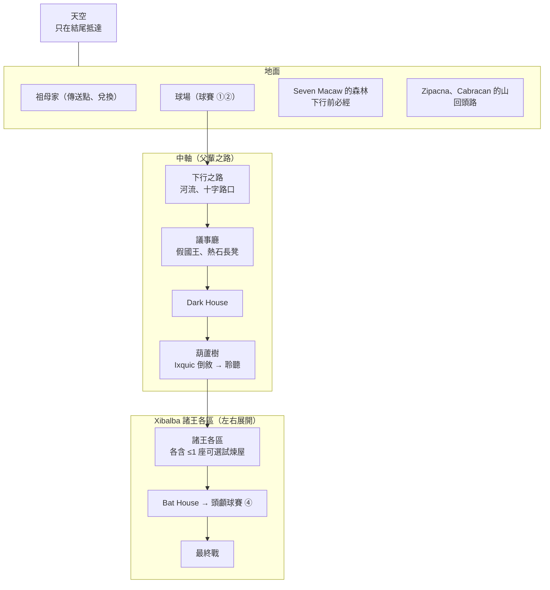

# 專案願景 v0.1：惡魔城版（內部代號：波波爾·烏）

> **建立日期**：2026-10-01
> **來源**：MV-DESIGN-001 惡魔城版設計定調，十個議題（A～J）的定案結果；逐題的選項、理由與連帶影響見 [討論紀錄](docs/design/MV-DESIGN-001_討論紀錄.md)
> **前身**：舊企劃（線性五幕、敘事解謎）的 VISION.md，保留在舊倉庫 tag [`linear-plan-v0.1`](https://github.com/isbrian/Game-Popol-Vuh/blob/linear-plan-v0.1/VISION.md)

## 概要

本文件是所有設計取捨的最上層依據。議題討論出現衝突時，以本文件的三條設計支柱與 [CULTURAL_PRINCIPLES.md](CULTURAL_PRINCIPLES.md) 裁決。

正式標題：雙子星玉米人（Twin Stars of Maize）；「波波爾·烏」只是內部代號，不作為遊戲標題。

---

## 1. 定位與前提

| 項目 | 決定 |
|---|---|
| 類型 | 2D 橫向捲軸惡魔城（Metroidvania） |
| 專案性質 | 作品集為主，保留上架販售的可能 |
| 製作者 | 一人；程式自己寫，美術與音訊交由 ChatGPT 生成，本人審查整合；片尾註明 AI 生成 |
| 引擎 | Godot 4（[ADR-0001](docs/adr/0001-game-engine-godot.md)） |
| 平台 | PC 下載版（Windows／macOS），鍵盤＋手把 |
| 文字語言 | 繁體中文、英文；日文留待上架前（角色只發出非語言的聲音） |
| 目標玩家 | ① 作品集觀看者（評審、業界人士）；② 喜歡 2D 動作、惡魔城的玩家 |
| 預備知識 | 假設玩家對馬雅神話零基礎；背景由遊戲內繪本前篇補足（見第 7 節） |
| 暴力尺度 | 不見血：戰鬥擊中以光、碎片、聲音表現，敵人倒下化為灰燼或剪影消散；關鍵死亡用剪影、切黑與聲音；內容約束在青少年可玩 |
| 總時數 | 主線約 3～3.5 小時，全收集約 4.3 小時 |

**保留上架可能的連帶事項**：ChatGPT 生成素材的商用條款已確認可行（MV-LEGAL-001，見 [AI 素材條款與揭露](docs/legal/AI素材條款與揭露.md)）——須在下載頁／商店頁明示 AI 生成、上架時依平台申報；純 AI 生成的素材不受著作權保護，受保護的是本人的創作部分；文化審閱從嚴。

---

## 2. 一句話 pitch

> 父親空手走進冥界 Xibalba，被愚弄致死。雙胞胎兒子帶著他藏起的球具重走同一條路，一路打穿整座冥界；但能打倒神的，只有計謀。

### 玩家玩完要帶走的感受

> 「父親輸掉的每一步，都成了我們打贏的理由。」

---

## 3. 為什麼是惡魔城

選擇這個類型的理由，依重要性排序。所有取捨以此排序為準：

1. 動作手感與 Boss 戰
2. 新能力打開舊路
3. 探索相連的地圖
4. 作品集辨識度

---

## 4. 三條設計支柱

| 支柱 | 意思 | 判準 |
|---|---|---|
| 1. 父親的路，兒子的反擊 | 父輩走過並失敗的中軸，子代重走並識破；同一場景，父輩沉重、子代機智 | ① 中軸上每個鏡像點都要有「被騙 ↔ 識破」的對照；② 同一場景兩代給出相反的情緒；③ 分支區域不受此限 |
| 2. 戰鬥靠技巧 | 勝負取決於讀招、走位、時機；數值只增加容錯，不增加輸出 | ① 攻擊力永遠不成長；② 如果某項數值升級讓讀招變得不必要，就砍 |
| 3. 計謀勝過力量 | 原典中雙胞胎從不靠力量取勝，計謀永遠是更好的贏法 | ① 原典 Boss 如果能硬打過去，就改設計；② 自創 Boss 要有計謀解法（傷害手感時可簡化或砍）；③ 每座試煉屋都要能靠計謀或準備品過關 |

### 支柱衝突時的裁決

| 範圍 | 優先 |
|---|---|
| 中軸與父輩序章 | 支柱 1 |
| 原典角色與原典場景（原典 Boss、試煉屋、球賽） | 支柱 3 |
| 自創內容（一般戰鬥、試煉屋挑戰、平台） | 支柱 2 |

---

## 5. 核心循環

| 層級 | 內容 |
|---|---|
| 秒級 | 移動、跳躍、翻滾、攻擊、換人、吹箭、動物技能 |
| 分鐘級 | 房間戰鬥 → 平台與能力門 → 偶爾的知識門（聆聽找假牆、鏡像點識破） |
| 區域級 | 探索諸王一區 → 可選試煉屋（治療次數）→ 交織式 Boss（破綻 → 設局）→ 覺醒新能力 → 帶著能力回頭開舊路 |
| 全作級 | 父輩序章 → 地面（Seven Macaw）→ 中軸鏡像點 → 葫蘆樹（聆聽）→ 諸王各區 → Bat House → 流浪藝人期（游泳）→ 最終戰 → 告別、升天 |

推進以能力門為主，知識門集中在原典場景，比例約 7:3。

---

## 6. 系統摘要

細節與每個決定的理由見 [討論紀錄](docs/design/MV-DESIGN-001_討論紀錄.md) 對應議題。

### 6.1 主角與操作（議題 E）

| 項目 | 決定 |
|---|---|
| 父輩序章 | 操控一胡納普，七胡納普跟隨；不能換人 |
| 子代主篇 | 雙胞胎 Hunahpu／Xbalanque，場上一人、一鍵換人（戰鬥中可即時換） |
| 兩人差異 | 各持一個武器槽；各有專屬開路能力——Hunahpu 空中與速度，Xbalanque 力量與地形；翻滾、聆聽、下劈共通 |
| Ixquic | 葫蘆樹倒敘中的可操作角色，潛行為主、可短暫自衛 |

按鍵配置見討論紀錄議題 E6（方案 A，原型階段微調）。

### 6.2 戰鬥（議題 B）

| 項目 | 決定 |
|---|---|
| 手感參考 | 《Hollow Knight》為主；借《死亡細胞》的翻滾無敵幀與快節奏、敵人前搖讀招、武器搭配 |
| 武器 | 5 把，純側向選擇（沒有更強的武器）。原典器物：吹箭、斧頭、掘棒、球具；從 Xibalba 奪來：Blade House 的刀刃 |
| 吹箭 | 常駐、獨立按鍵；低傷害、無限；專門打斷前搖、觸發弱點、打落物件與觸發機關；雙搖桿自由瞄準 |
| 防禦 | 翻滾（無敵幀）；球具的攻擊改為招架／彈反 |
| 空中 | 所有近戰武器都有側攻、上攻、下劈；下劈打中會彈起 |
| 動物技能 | 2 個技能槽（兄弟共用），消耗技能資源、武器命中回充；夥伴為兔子、蚊子、切葉蟻、隼、老鼠，皆在地圖上以交換取得 |
| 聆聽 | 免費，代價是只能慢走、不能跳、不能射吹箭（沿用 PROTO-001 規則）；戰鬥中只管找弱點，不管讀招 |
| 治療 | 按一下、約 1 秒硬直；次數用完後同一鍵改用祖母的補血道具 |
| 一般敵人 | 中等密度（每房 1～4 隻），約 12～15 種；地面為 Seven Macaw 的假光造物，Xibalba 為原典生物＋諸王僕從；休息後重生 |

### 6.3 成長（議題 A）

| 項目 | 決定 |
|---|---|
| 會成長的 | 血量上限、治療次數、技能資源上限；**攻擊力不成長** |
| 成長幅度 | 全收集約為初始 2 倍（例：血量 5→10、治療 2→5，數字由原型決定） |
| 來源分工 | 地圖藏點 → 血量碎片；試煉屋 → 治療次數；Boss → 覺醒新能力＋技能資源上限；祖母 → 消耗品 |
| 祖母兌換 | 以可可豆換消耗型補血「素面陶碗裝的熱湯」（有攜帶上限）與試煉屋準備品（Dark House 的紅羽毛與螢火蟲、Jaguar House 的骨頭） |
| 貨幣 | 可可豆，打怪掉落＋地圖拾取；死亡不損失 |

### 6.4 開路能力（議題 F）

能力是雙胞胎自身的神通逐步覺醒，都來自原典中雙胞胎做過的事；打倒 Boss 是覺醒的時機。

| 能力 | 給誰 | 原典依據 | 取得 |
|---|---|---|---|
| 聆聽 | 共通 | Ixquic 在葫蘆樹下聽見頭顱說話（改編） | 中軸葫蘆樹，Ixquic 倒敘後 |
| 二段跳 | Hunahpu | 自創 | 打倒 Seven Macaw |
| 讓工具自己動，遠端破壞障礙 | Xbalanque | 開墾田地時斧頭自己砍樹 | 打倒 Seven Macaw |
| 空中衝刺 | Hunahpu | 自創 | 打倒家中奪命組 |
| 攀爬 | Xbalanque | 名字中的 balam（美洲豹） | 打倒化骨組 |
| 讓植物長高，長出平台 | Xbalanque | 讓樹長高困住兩個哥哥 | 打倒流血組 |
| 縮小，穿過窄道 | Hunahpu | Bat House 躲進吹箭筒 | Bat House 事件 |
| 游泳、水中行動 | 共通 | 死後化為魚人重生 | 流浪藝人期（打開收尾探索） |

區域順序、能力門與 Zipacna、Cabracan 的定位（入口用攀爬、只給技能資源上限）見 [MV-LEVEL-001 關卡設計](docs/design/MV-LEVEL-001_關卡設計.md)。

### 6.5 Boss（議題 C）

| 項目 | 決定 |
|---|---|
| 原典 Boss | Seven Macaw（地面必經）、Zipacna 與 Cabracan（回頭路）、Xibalba 諸王（先做 3 組，擊退不擊殺）、一死神與七死神（最終戰） |
| 自創 Boss | 只有試煉屋的最終挑戰；可硬扛，用計謀打倒有特殊演出與額外獎勵 |
| 原典 Boss 結構 | 交織式：武器與技能累積破綻 → 破綻滿時觸發設局要素 → 打掉一段血條。諸王組 2 段（一人一段輪流上場），其餘 3 段 |
| 設局教學 | Seven Macaw 用視覺線索教「設局」；諸王起才用聆聽找弱點：破綻滿時諸王躲進自己模樣的木頭人偶之間，聆聽聽出心跳的真身再用吹箭射中（諸王共用模板見 [MV-BOSS-002](docs/design/MV-BOSS-002_家中奪命組設計.md) 第 1 節） |
| 美術 | 視覺語言、尺寸、戰鬥訊號、HUD 見 [ART_SPEC.md](ART_SPEC.md) |
| 死亡蝙蝠（內部代稱 Camazotz） | 顯示名稱依基準譯本為「死亡蝙蝠」。不可打倒。撐過一夜的蝙蝠群生存戰 → 假黎明、聆聽顯示安全 → 玩家親手讓 Hunahpu 探頭 → 斬首；之後 Xbalanque 一夜獨行，靠動物找來南瓜做成暫時的頭 |
| 最終戰 | 表演即戰鬥：諸王在高處觀看、不親自出手；戰鬥累積「著迷度」，完成三段原典表演（狗 → 房子 → 兄弟）後諸王自己要求被殺。原典第三段「獻祭一個人」遊戲省略，由繪本後篇完整交代 |
| 重試 | 每場 Boss 門口必有休息點；預設從第 1 段重來。分兩個場地的 Boss（Seven Macaw：nance 樹、宮殿）每個場地門口各一個休息點，以場地為單位重來（見 [Seven Macaw 設計](docs/design/MV-BOSS-001_SevenMacaw設計.md) 第 6 節） |

### 6.6 球賽（議題 C7）

全作唯一新增的輕量系統。側視擊球，沿用移動操作，攻擊鍵擊球。四場：① 父輩地面（教學）→ ② 子代地面（同一座球場的鏡像）→ ③ Xibalba 第一場（識破藏刃的球、拒用並改用自己的球，之後故意輸球、賭四碗花）→ ④ 頭顱球賽（把球打出場外，兔子冒充球引開諸王，取回真頭，最後打碎南瓜）。不比分數，每場目標依原典事件而定。

### 6.7 死亡、存檔與輔助（議題 I）

| 項目 | 決定 |
|---|---|
| 死亡 | 回到最近的休息點（篝火）；敵人重生、用掉的道具不回來；可可豆不損失 |
| 存檔 | 休息時自動存檔，3 個欄位；通關後解鎖 Boss 重戰 |
| 輔助選項 | Boss 段落保留、受到傷害調整、遊戲速度調整、聲音視覺化、球賽與平台挑戰可跳過 |
| 沿用規則 | 父輩序章失誤時傳來 Xibalba 的笑聲；鏡像點失敗閃現父輩下場、兩次失敗出現父輩殘影；被奪走的死亡畫面切走，自己選擇的死亡不切走 |

---

## 7. 世界結構與故事範疇

### 世界：一條垂直的路（議題 G）

| 項目 | 決定 |
|---|---|
| 形狀 | 垂直分層：地面在上，中軸往下穿過下行之路到 Xibalba，諸王各區從中軸左右展開 |
| 中軸 | 父輩序章走過的路就是子代 Xibalba 的主幹；鏡像點構圖兩代完全相同；識破後接伏兵群戰 |
| 試煉屋 | 譯名依 Christenson：House of Darkness（文件中簡稱 Dark House）在中軸、Bat House 在主線；可選三座各在一區：Blade House（家中奪命組）、Jaguar House（化骨組）、House of Fire（流血組）；House of Cold 不做（MV-LEVEL-001） |
| 諸王 3 組 | 依序：家中奪命組（Sweepings Demon、Stabbings Demon）→ 化骨組（Bone Staff、Skull Staff）→ 流血組（Flying Scab、Gathered Blood）（MV-LEVEL-001） |
| 快速移動 | 祖母家＋每區一個固定傳送點；以「隼的棲架」包裝：隼飛來帶路（MV-ART-002） |
| 方向的意義 | 父輩往下、Ixquic 往上逃、子代往下、結尾一路往上穿過整張地圖到天空 |

### 故事範疇（議題 D、J）

| 原典段落 | 惡魔城版 |
|---|---|
| 創世（泥人、木人） | 不做（繪本前篇以一兩頁交代「世界還沒有真正的太陽」） |
| 父輩下行、失敗、處刑 | 父輩序章（約 20 分）：球賽 ①、兄弟對練 → 藏起球具 → 空手下行 → 議事廳 → Dark House 失敗 → 處刑 |
| 少年時期（開墾田地、老鼠、哥哥變猴子） | 地面開頭的短事件（取得斧頭、掘棒、球具藏處、第一隻動物夥伴）＋覺醒時的閃回 |
| Seven Macaw | 地面必經 Boss |
| Zipacna、Cabracan | 回頭路 Boss（可砍） |
| Ixquic、雙胞胎出生 | 葫蘆樹倒敘（約 10 分） |
| Xibalba 試煉、Bat House、頭顱球賽 | 主篇 |
| 主動赴死、重生、表演 | 流浪藝人期＋最終戰 |
| 與父親告別、升天 | 結局：在父輩被處死的球場與父親告別 → 玩家操作一路往上到天空 → 第一道真光、影子出現 |
| 玉米人、祖先遷徙 | 不做 |

### 敘事方式

| 項目 | 決定 |
|---|---|
| 對白 | 角色幾乎不說話（動作、手勢、非語言聲音）；系統文字（UI、兌換、說明、操作提示）另計 |
| 字卡 | 區域標題、叫出諸王名字、片尾改編說明 |
| 繪本 | 故事文本另做繪本：前篇（世界、人物、Xibalba，講到父輩在地面打球為止）第一次開始前可選擇閱讀；後篇（完整原典故事，標出改編處）通關解鎖。遊戲內為主，下載頁另附 PDF（後篇標明含劇透） |
| 世界規則 | 沿用 [WORLD_AND_STORY.md](WORLD_AND_STORY.md)：有光無影、真光才有影子；真實有聲、虛假空洞 |

---

## 8. 規模與縮減順序

| 項目 | 規模 |
|---|---|
| 區域 | 約 7 個：地面、中軸、諸王 3 區、Bat House 一帶、最終區 |
| 原典 Boss | 7 場（Seven Macaw、Zipacna、Cabracan、諸王 3 組、最終戰），設局要素約 18 個 |
| 試煉屋挑戰 | 可選 3 座 |
| 球賽 | 4 場 |
| 武器／動物／開路能力 | 5／5／8 |
| 一般敵人 | 約 12～15 種 |

諸王先做 3 組，其餘 2 組視進度追加。

### 縮減範疇時

| 類別 | 內容 |
|---|---|
| 不能砍 | 父輩序章、中軸鏡像點、Seven Macaw、死亡蝙蝠（Camazotz）、最終戰 |
| 依序可砍 | ① 諸王組數 → ② 試煉屋數量 → ③ Zipacna／Cabracan → ④ 動物與武器數量 |

**關卡設計限制**：主線必要的能力不能綁在 Zipacna、Cabracan 身上（他們在回頭路上、且可砍）；Bat House 斬首後到南瓜頭裝上之前，地圖只能要求 Xbalanque 的能力。

---

## 9. 製作計畫

**里程碑制**，不設全作硬期限：

| 里程碑 | 內容 |
|---|---|
| 灰盒原型 | 見 [原型驗證計畫](docs/design/MV-PROTO-000_原型驗證計畫.md)：切片前 5 個原型（戰鬥手感、換人與武器、交織式 Boss、美術管線、聲音盲測）＋Seven Macaw Boss 設計；戰鬥線共用核心專案 |
| 垂直切片 | 子代地面開頭＋Seven Macaw（約 30 分）：換人、武器、吹箭、翻滾、招架、一般敵人、祖母兌換、第一場交織式 Boss。做到正式品質，作品集以它展示 |
| 其餘內容 | 依第 8 節規模推進 |

### AI 輔助的邊界

| 項目 | 由誰做 |
|---|---|
| 美術（含繪本插圖） | ChatGPT 依 ART_SPEC 生成；本人審查與整合 |
| 音效與音樂 | ChatGPT 依 AUDIO_SPEC 生成；本人審查與整合 |
| 程式 | 本人，可用 AI 輔助 |
| 文化相關內容（名稱、拼法、原典情節、圖像參考、繪本文本） | **不以 AI 產出為準**，一律對照基準譯本（Christenson 為主、Tedlock 交叉參照）與館藏來源 |

---

## 10. 參考作品

| 作品 | 參考點 |
|---|---|
| 《Hollow Knight》 | 主要手感：近戰、下劈彈跳、讀招、血量碎片、休息點 |
| 《死亡細胞》 | 翻滾無敵幀、快節奏、敵人前搖、武器與技能搭配 |
| 《月下夜想曲》 | 先操控前一代角色的序章 |
| 《隻狼》 | 破綻累積後才能給予決定性一擊（交織式 Boss 的破綻條） |

---

## 11. 主要風險

| 風險 | 應對 |
|---|---|
| 規模對一人製作偏重（以年計） | 諸王先做 3 組；縮減順序已定；垂直切片先行，確保中途停擺也有作品可展示 |
| 骨架動畫＋ChatGPT 美術能否撐起戰鬥的可讀性 | 垂直切片驗證 |
| 交織式 Boss 拖成解謎、打斷戰鬥節奏 | 支柱裁決：自創內容技巧優先；原型試玩觀察 |
| 死亡蝙蝠的假黎明被玩家視為設計不公平 | 原型階段由 Brian 試玩自評（MV-PROTO-000 PROTO-3 變更：不找外人；Brian 已知設計，判讀時要考慮偏誤） |
| 按鍵已接近上限 | 不再新增按鍵動作；新功能要共用既有按鍵 |
| 原典細節與設計不符 | 已依 Christenson 逐條核對（[MV-DESIGN-002](docs/design/MV-DESIGN-002_原典核對.md)）；新增設定時同樣先核對 |
| 保留上架可能 | 條款已確認；依七條規則揭露與留存製作紀錄；純 AI 素材無著作權，無法阻止他人複製原始素材 |

---

## 相關檔案

- [docs/design/MV-DESIGN-001_討論紀錄.md](docs/design/MV-DESIGN-001_討論紀錄.md)：逐題定案、理由、待核對與待登記清單
- [CULTURAL_PRINCIPLES.md](CULTURAL_PRINCIPLES.md)：文化詮釋原則、改編原則、改編清單
- [WORLD_AND_STORY.md](WORLD_AND_STORY.md)：世界觀與故事（舊企劃沿用，待依本文件調整）
- [POPOL_VUH_STORY_REPORT.md](POPOL_VUH_STORY_REPORT.md)：原典研究
- [todo/todo.md](todo/todo.md)：派工單
