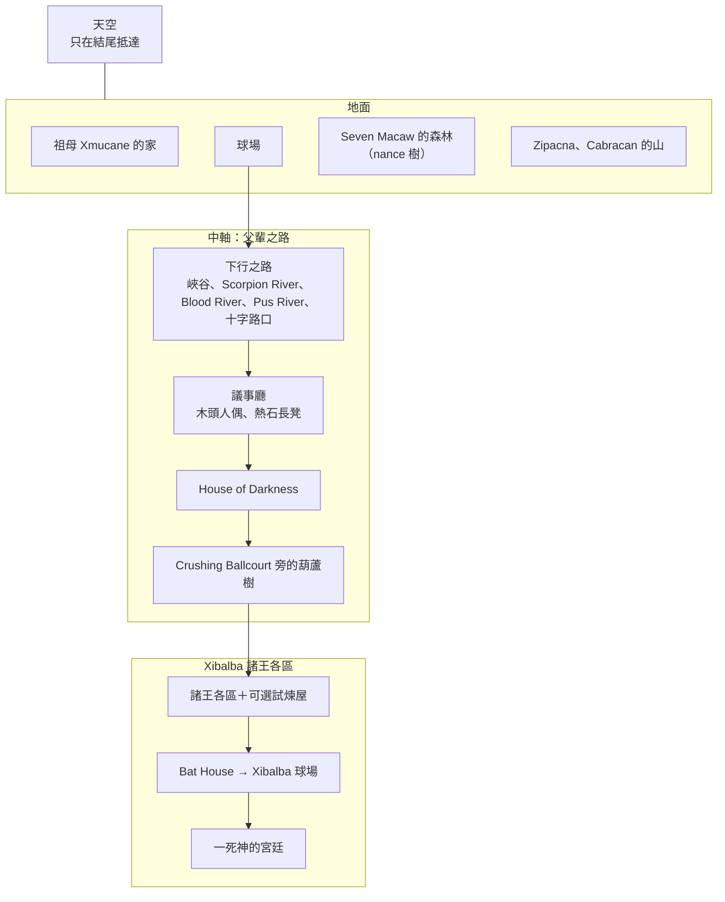

# 世界觀與故事 v0.2：惡魔城版（內部代號：波波爾·烏）

> **版本**：v0.2（MV-DOC-001，2026-10-01）——依 [VISION.md](VISION.md) 改寫為惡魔城版
> **上層依據**：[VISION.md](VISION.md)（範疇、規模、故事範疇）；[CULTURAL_PRINCIPLES.md](CULTURAL_PRINCIPLES.md)（改編原則與改編清單）
> **原典依據**：Christenson 英譯本，逐項核對見 [MV-DESIGN-002 原典核對](docs/design/MV-DESIGN-002_原典核對.md)；本文頁碼皆為該譯本電子版 PDF 頁碼
> **舊版**：舊企劃 v0.1（線性五幕）見 git 歷史（commit `aaf8757`）

## 概要

本文件定義遊戲世界的規則、地理、時間線、角色與敘事方式。玩法與系統見 VISION 第 6 節；本文件中原典沒有的設定，都已登記在 CULTURAL_PRINCIPLES 的改編清單。

---

## 1. 世界規則

### 1.1 光：有光無影，真光才有影子

| 項目 | 規則 |
|---|---|
| 全作 | 沒有影子。東西看得見，卻找不到光從哪裡來；對應馬雅抄本不畫投影的平塗畫法 |
| Seven Macaw 的假光 | 耀眼，但只是珠寶與金銀的反光，同樣不投影；他的假光造物也一樣 |
| 篝火（休息點） | 照亮周圍，但沒有影子 |
| 結尾第一道真光 | 萬物第一次有了影子；玩家直到這一刻才意識到之前少了影子 |

原典依據：Seven Macaw 自稱太陽的時代，「太陽與月亮的臉還是昏暗的」（p.76）。

### 1.2 聲音：真實有聲，虛假空洞

聆聽機制的世界觀。聲音語彙的完整規則見 [AUDIO_SPEC.md](AUDIO_SPEC.md) 第 2 節。

- 活的東西有心跳和呼吸；真實的東西會共振。
- 虛假的東西發出空洞的回音（木頭做的假國王、假光造物）。
- 危險的東西發出持續的低鳴；死者留下殘響（父輩殘影）。
- 攻擊之前必有蓄力聲（前兆），不必聆聽就聽得到。
- Xibalba 的欺騙，是讓假的東西看起來像真的，但騙不過耳朵。
- 唯一的例外是**死亡蝙蝠**：完全無聲，是規則無法解釋的未知。

---

## 2. 地理：一條垂直的路

### 下行之路（原典 p.107）

父輩依序經過：Trembling Canyon、Murmuring Canyon → **Scorpion River**（無數蠍子，未被螫）→ **Blood River**（不喝它的水才過得去）→ **Pus River** → 十字路口：紅、黑、白、黃四條路，**黑路開口說「走我，我是王的路」**，父輩因此被騙走上它（p.107）。接著在議事廳向**木頭人偶**問候「早安，一死神」、被請坐上**熱石長凳**（p.108）。子代重走同一條路，這幾處就是中軸的鏡像點。

> 文化注意：四色對應四個方位，當代儀式仍會在四方擺放對應顏色的蠟燭（p.107 註 258）。十字路口只呈現為四條有顏色的路，不做成祭壇或擺放蠟燭的場面。

### 移動方向的意義

| 誰 | 方向 |
|---|---|
| 父輩（序章） | 往下 |
| Ixquic（倒敘） | 往上逃（沿中軸倒著走） |
| 雙胞胎（主篇） | 往下，並帶著新能力往返地面 |
| 結尾 | 玩家一路往上，穿過走過的每一層，直到天空 |

---

## 3. 時間線與敘事順序

本作**按時間順序**敘事；只有 Ixquic 的段落以倒敘呈現、少年時期的部分事件以覺醒閃回呈現。

| 事件順序 | 事件 | 遊戲中的呈現 |
|---|---|---|
| 1 | 父輩在地面打球（球賽 ①）、兄弟對練；被貓頭鷹使者召喚，把球具綁在屋子上方，空手下行；在 Xibalba 被愚弄、於 House of Darkness 失敗、被處死於 Crushing Ballcourt；一胡納普的頭被放進路旁的樹，樹結出葫蘆 | 父輩序章（約 20 分） |
| 2 | Ixquic 聽聞葫蘆樹、受孕、以巴豆樹汁做假心臟騙過使者、逃到地面、生下雙胞胎 | 葫蘆樹倒敘（約 10 分），在事件 6 中觸發 |
| 3 | 雙胞胎長大：讓哥哥 One Batz、One Chouen 變成蜘蛛猴；開墾田地（工具自己工作）；抓到老鼠，得知球具藏處 | 地面開頭的短事件；變猴子以覺醒閃回呈現 |
| 4 | 擊倒 Seven Macaw；之後擊倒 Zipacna、Cabracan | Seven Macaw 為下行前必經；Zipacna、Cabracan 在回頭路（**時序改編**：原典把 Seven Macaw 父子置於太陽月亮出現之前、敘事上先於父輩） |
| 5 | 在地面球場打球（球賽 ②）；口信經蝨子 → 蟾蜍 → 蛇 → 隼送到；雙胞胎在祖母家中央種下兩株未熟的玉米作為生死之兆，下行 | 主篇開頭 |
| 6 | 重走中軸、識破父輩的陷阱；在葫蘆樹看見父親的頭 | 中軸鏡像點；葫蘆樹觸發 Ixquic 倒敘，倒敘後獲得聆聽 |
| 7 | Xibalba 第一場球賽（球賽 ③，拒用藏刃的球、故意輸）；闖試煉屋；Bat House 斬首；Xbalanque 一夜獨行；頭顱球賽（球賽 ④）換回真頭 | 諸王各區與試煉屋（順序由玩家決定，**順序改編**：原典為 Darkness → Blade → Cold → Jaguar → Fire → Bat） |
| 8 | 主動走進灼熱石坑、骨灰入河、化為魚人重生、以流浪孤兒身分四處表演 | 流浪藝人期（游泳、收尾探索） |
| 9 | 在一死神的宮廷表演、諸王要求被殺；其餘 Xibalba 投降 | 最終戰 |
| 10 | 在 Crushing Ballcourt 與父親告別；升天成為日與月；四百少年成為星座 | 結局：可操作的升天、第一道真光 |

---

## 4. 可操作身份

| 身份 | 段落 | 操作 |
|---|---|---|
| 一胡納普（七胡納普跟隨） | 父輩序章 | 不能換人；地面有球具，Xibalba 段手無寸鐵 |
| 雙胞胎 Hunahpu／Xbalanque | 主篇 | 一鍵換人；各持一個武器槽、各有專屬開路能力（見 VISION 6.1） |
| Ixquic | 葫蘆樹倒敘 | 單人；潛行為主、可短暫自衛 |

---

## 5. 角色

### 5.1 名稱原則

| 對象 | 原則 | 例 |
|---|---|---|
| 英雄與人物 | 音譯 | Hunahpu、Xbalanque、Ixquic、Xmucane |
| 諸王與神魔 | 意譯（跟隨英譯本） | One Death → 一死神；death bat → 死亡蝙蝠 |
| 父輩 | 保留數字 | 一胡納普、七胡納普：與諸王的「一／七」對照，也以「一」與兒子「胡納普」區分 |
| 英文名稱 | 依基準譯本 Christenson 的譯名；人物例外，跟繁中一樣用音譯（2026-10-07） | Blade House、Bone Staff、Cabracan；人物：Ixquic（Christenson 意譯為 Lady Blood） |

**文字語言**：繁體中文、英文；日文留待上架前（2026-10-01 定案）。英文用美式拼寫，與 Christenson 譯本一致（2026-10-07，MV-BOOK-002）。所有顯示名以 [MV-NAME-001 名稱表](docs/design/MV-NAME-001_名稱表.md) 為準（2026-10-07 定案）；ALMG 與傳統拼法的核對另立工單 MV-NAME-002。

### 5.2 兩代性格

一句話：父輩「守禮而輕信」，子代「頑皮而多疑」。

| 角色 | 性格 | 在遊戲中的體現 |
|---|---|---|
| 一胡納普 | 長兄，守禮、容易信任別人 | 序章的陷阱都利用他的禮貌：向坐著的「王」行禮、坐上讓出的長凳、整夜點著火把 |
| 七胡納普 | 永遠跟著兄長 | 兩人一起行動，所以一起上當 |
| Ixquic | 好奇、敢違抗父命 | 主動走近禁樹；第一個騙過 Xibalba 的人（假心臟），是父輩輕信與子代機智之間的橋樑 |
| Hunahpu | 大膽、急性子 | 在 Bat House 探頭看天亮了沒；被 Seven Macaw 扯斷手臂也是因為衝上前抓他 |
| Xbalanque | 沉穩、多謀 | 斬首後的一夜獨自召集動物、主導頭顱球賽的換頭計畫 |
| 祖母 Xmucane | 在遊戲中溫暖照顧雙胞胎（**角色改編**：原典 p.127 中她當時並不疼愛雙胞胎） | 兌換熱湯與準備品；雙胞胎種下的玉米再發芽時為他們焚香紀念 |

### 5.3 對手

| 角色 | 設定 | 遊戲中 |
|---|---|---|
| 一死神、七死神 | Xibalba 之首，「Death」是曆法日名；喜歡看人出醜，迷戀奇蹟與死亡表演 | 最終戰：在高處觀看、不親自出手 |
| 其餘諸王（5 組） | Flying Scab 與 Gathered Blood（使血液生病）、Pus Demon 與 Jaundice Demon（腫脹流膿、黃疸）、Bone Staff 與 Skull Staff（瘦成骨頭）、Sweepings Demon 與 Stabbings Demon（家前家後留垃圾者被刺死）、Wing 與 Packstrap（路上猝死）（p.101～103） | 選家中奪命組、化骨組、流血組 3 組做 Boss（MV-LEVEL-001），擊退不擊殺；**當代 K'iche' 人仍向他們祈禱獻祭**（p.103 註 243），屬優先審閱 |
| Gathered Blood | Ixquic 的父親（p.113），下令處死她 | 流血組是第 3 組 Boss（MV-LEVEL-001）：雙胞胎打的是外祖父，擊退不擊殺；設局可用 Ixquic 的樹汁計謀 |
| Seven Macaw | 自稱太陽，眼睛是藍綠寶石、牙齒是玉石、寶座是金銀；妻子 Chimalmat | 地面必經 Boss；手下是假光造物（改編） |
| Zipacna | Seven Macaw 長子，自稱造山者；殺了四百少年 | 回頭路 Boss |
| Cabracan | Seven Macaw 次子，自稱撼山者 | 回頭路 Boss |
| 死亡蝙蝠 | Bat House 中斬下 Hunahpu 頭的蝙蝠（Christenson 只稱 death bat；內部代稱 Camazotz） | 不說話、只有剪影、無聲，不可打倒 |
| 貓頭鷹使者 | Arrow Owl、One Leg Owl、Macaw Owl、Skull Owl（p.105） | 召喚父輩；其中的使者被 Ixquic 說服放她走；Xibalba 的一般敵人之一 |

### 5.4 夥伴與配角

| 角色 | 設定 | 遊戲中 |
|---|---|---|
| 治療者老夫婦 | Great White Peccary（祖父）與 Great White Coati（祖母），職業是拔牙蟲、治眼、接骨；祖父神與祖母神的化身（p.84、160 註 395） | Seven Macaw 一戰的設局：雙胞胎扮成他們的孫子 |
| 動物夥伴 | 老鼠（球具藏處）、蚊子（套出諸王名字）、切葉蟻（偷花）、隼（口信的最後一棒）、兔子（冒充球） | 戰鬥技能（見 VISION 6.2） |
| 長鼻浣熊 | 斬首當夜滾來 chilacayote 瓜，成為 Hunahpu 暫時的頭 | E3 劇情 |
| One Batz、One Chouen | 雙胞胎同父異母的哥哥，欺負雙胞胎後變成蜘蛛猴 | 覺醒「讓植物長高」時的閃回 |
| 四百少年 | 被 Zipacna 殺死，結尾升天成為星座 | 結局 |
| 天心 Huracan | 雙胞胎行動的授意者；斬首當夜降臨幫忙完成南瓜頭（p.80 註 165、p.160） | 只以光與聲音暗示，不具象（文化原則 2、3） |

### 5.5 視覺區分

父輩與子代的外觀要一眼可分，父輩殘影要讓人一眼認出是父親；雙胞胎以暖冷主色與身形區分。做法見 [ART_SPEC.md](ART_SPEC.md) 第 1、4 節。

---

## 6. 敘事手法

### 6.1 對白與文字

| 項目 | 做法 |
|---|---|
| 角色 | 幾乎不說話：動作、手勢、表情與非語言的聲音（雙胞胎的竊笑、諸王的嘲笑） |
| 系統文字 | UI、兌換、武器與能力說明、操作提示 |
| 字卡 | 區域標題、叫出諸王名字（蚊子情節）、片尾改編說明 |
| 繪本 | 前篇（遊戲前可讀）：世界、人物、Xibalba，講到父輩在地面打球為止，創世以一兩頁交代「世界還沒有真正的太陽」；後篇（通關解鎖）：完整原典故事，標出遊戲改編之處（包括省略的「獻祭一個人」） |

### 6.2 時間與聲音的橋

以下為演出方向的草案，細節在原型階段定。

| 轉場 | 做法 |
|---|---|
| 序章 → 主篇 | 父輩處刑（畫面切走）後，接到地面的雙胞胎；球落地的節奏（簽名動機）在兩代的球賽各出現一次 |
| 葫蘆樹 → Ixquic 倒敘 | 子代看見父親的頭時，聆聽般的寂靜中傳來頭顱的聲音，切入過去的褪色色盤 |
| 倒敘 → 主篇 | 嬰兒的哭聲淡出，回到葫蘆樹下；雙胞胎此時獲得聆聽 |
| 結局 | 與父親告別時，簽名動機以樂器重現一次 |

### 6.3 過場原則

能玩的就讓玩家玩。過場只用於：

- 被奪走的死亡（畫面切走：父輩處刑、Hunahpu 斬首、玩家死亡）
- 時代轉場（序章 → 主篇、葫蘆樹倒敘）
- 短演出（神通覺醒、假心臟、蚊子偵察、Seven Macaw 換牙）

自己選擇的死亡（主動走進石坑）**不切走**：控制權延續到火、灰、水，最後在水中重新聚成人形。

### 6.4 敘事分層

- 一條主線；可選內容（試煉屋、Zipacna 與 Cabracan、水域）不帶支線劇情，只帶原典場面。
- 世界敘事靠環境：子代在同一條路上看見父輩留下的痕跡、葫蘆樹上的頭顱、父輩殘影；依文化原則 3，不以神聖符號當背景裝飾。

---

## 相關檔案

- [VISION.md](VISION.md)：專案願景（上層依據）
- [docs/design/MV-DESIGN-001_討論紀錄.md](docs/design/MV-DESIGN-001_討論紀錄.md)：設計討論
- [docs/design/MV-DESIGN-002_原典核對.md](docs/design/MV-DESIGN-002_原典核對.md)：原典核對
- [CULTURAL_PRINCIPLES.md](CULTURAL_PRINCIPLES.md)：文化詮釋原則與改編清單
- [ART_SPEC.md](ART_SPEC.md)、[AUDIO_SPEC.md](AUDIO_SPEC.md)：美術與音訊規格
- [todo/todo.md](todo/todo.md)：派工單
