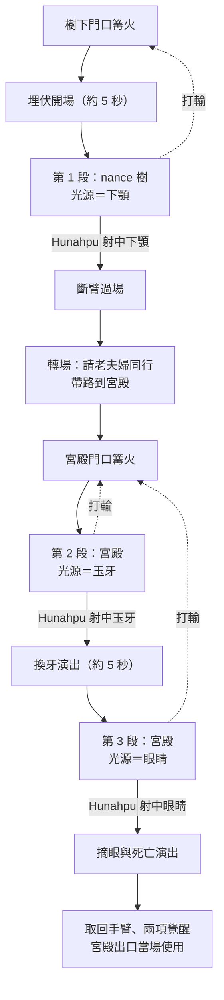

# MV-BOSS-001 Seven Macaw Boss 設計

> **建立日期**：2026-10-02（問答 2026-10-01～02）
> **上層依據**：[VISION.md](../../VISION.md) 6.2、6.4、6.5；[討論紀錄](MV-DESIGN-001_討論紀錄.md) 議題 B3、C1～C5、E1、G5；[原型驗證計畫](MV-PROTO-000_原型驗證計畫.md) 第 3 節
> **原典**：Christenson 譯本 p.77～86（另見 [原典核對](MV-DESIGN-002_原典核對.md) #13）
> **範圍**：Seven Macaw 的三段設局要素、視覺線索、破綻規則、招式表、演出、重試。數值交給 MV-PROTO-003 原型決定

## 定案（Brian，2026-10-01～02）

| 編號 | 問題 | 定案 | 理由 |
|---|---|---|---|
| BOSS-1 | 整體結構 | **「三道光」：下顎 → 玉牙 → 眼睛**，分兩個場地：第 1 段在 nance 樹，第 2、3 段在宮殿 | 照原典順序；「弱點就是發光的地方」是純視覺線索，也直接教會「假光」主題；每段拔掉一個光源，外觀與招式隨之衰退，進度一眼可見 |
| BOSS-2 | 斷臂後的 Hunahpu | **武器槽停用，吹箭仍可用** | 原典結果不變（手臂被奪、戰後裝回）；預告 Bat House「失去兄弟」；分工：弟弟近戰、哥哥射光 |
| BOSS-3 | 扯斷手臂的呈現 | **劇情固定的過場**，剪影帶過、不見血 | 「玩家親手做出避不掉的錯」留給死亡蝙蝠，第一次用才有力；過場最清楚 |
| BOSS-4 | 治療者老夫婦 | **場邊待命，設局時上前**；不受攻擊；他跪下後上前換牙、摘眼 | 雙胞胎製造機會、老夫婦執行，符合原典分工；戰鬥仍是主體；不做護送或潛行系統 |
| BOSS-5 | 破綻規則 | **近戰為主累積，吹箭射中發光弱點觸發**；滿了硬直約 4 秒；錯過退回一半 | 技巧（打出破綻）與計謀（射中弱點）輪流上場；設局由玩家親手完成；退回一半對作品集觀看者友善 |
| BOSS-6-1 | 招式之間的關係 | **招式家族、逐段變形**：衝撞、近身／投擲、光、召喚 4 個家族 | 光源被拔掉、招式隨之衰退看得見；第 1 段學會的讀招後面仍有用；共用骨架動作，動畫約 6～7 套 |
| BOSS-6-2a | 第 1 段的近戰機會 | **他下來，你上去打**：每招結束後停在打得到的位置 | 懲罰空檔的節奏清楚；不需要切片還沒有的二段跳；近戰與設局在同一處發生 |
| BOSS-6-2b | 下顎的提示 | **吃果子時微亮預告，破綻滿時最亮才觸發** | 先看到、再有機會打的兩步教學；原典畫面每輪重演；提早射中有小回報 |
| BOSS-6-2c | 假光閃耀的應對 | **背對他**；面向他的人畫面白茫約 2 秒、不扣血 | 符合「假光無影」，不用畫安全區；「不能直視自稱太陽的光」；只判斷面向，實作最便宜 |
| BOSS-6-2d | 第 1 段的召喚 | **爬行型、飛行型各最多 1 隻**；打碎不給破綻、回充技能資源；場上還有時不再召 | 種類有變化，畫面仍清楚；第 3 段才有往上加的空間 |
| BOSS-6-3a | 設局之箭由誰射 | **只有 Hunahpu 的箭能觸發；破綻滿時自動原地換成 Hunahpu** | 原典 p.82～83 射中下顎的是 Hunahpu；每段都有「弟弟打出破綻 → 哥哥射光」的交棒畫面；沒有隱藏規則 |
| BOSS-6-3b | 宮殿的場地與節奏 | **他落地狂亂，貼身戰為主** | 第 1 段「等他下來」、第 2 段「他衝過來」，節奏對比明顯；表現牙痛發狂；平地素材最省 |
| BOSS-6-3c | 玉牙的提示 | **捧著下顎哀嚎時微亮** | 和第 1 段同一套規則；原典 p.83「捧著下顎」直接變成動作；哀嚎也是近戰空檔 |
| BOSS-6-3d | 第 2 段三招 | **衝撞一律衝向寶座，撞上後震出反光柱** | 「亂打不分對象」具體化；他已經發不出光，只能借寶座的光；兩招連動、讀招清楚 |
| BOSS-6-4a | 眼睛的提示 | **光束蓄力時微亮，射中就打斷** | 吹箭的兩個用途（打斷前搖、觸發弱點）在最後一段合流；不用新增空檔動作 |
| BOSS-6-4b | 第 3 段的召喚 | **爬行型、飛行型各最多 2 隻** | 召喚家族的變形看得見；不加新種類；仍在一般房間「1～4 隻」的上限內 |
| BOSS-7a | 第 1 段到宮殿之間 | **短對話＋一小段可走的路** | 開打前先在安全處體驗斷臂狀態；老夫婦的身份與計畫先交代；宮殿門口自然成為 Boss 門口 |
| BOSS-7b | 打輸從哪裡重來 | **兩個門口各一個休息點**，以場地為單位重來 | 符合 C5「走回 Boss 房不到 10 秒」；不重看斷臂過場與轉場 |
| BOSS-8 | Chimalmat | **宮殿裡出現、不參戰，結尾隨他倒下** | 守住「誰死不能改」；原典沒寫死因，用剪影帶過；她是 Zipacna、Cabracan 的母親，先留伏筆 |
| BOSS-9a | 換牙演出 | **引擎內約 5 秒、留一句哀求** | 原典是他主動求治，「被騙」才成立；5 秒不打斷節奏；遮擋帶過、不見血 |
| BOSS-9b | 死亡演出 | **呆望、光熄滅、靜靜倒下** | 每個畫面都有原典依據；他是被拿走珠寶，不是被打碎；三道光的收束 |
| BOSS-9c | 取回手臂與覺醒 | **覺醒後馬上在宮殿出口用到** | 惡魔城類的標準教學；二段跳綁在手臂裝回，不替自創能力編造原典 |
| BOSS-9d | 開場 | **約 5 秒埋伏開場，重試時跳過** | 原典的埋伏畫面；第一個設局線索在開戰前就先看到 |

---

## 1. 整體流程

---

## 2. 共通規則

### 2.1 破綻條與血條（BOSS-5）

| 項目 | 規則 |
|---|---|
| 血條 | 三段，每段只能由設局打掉（C3）；近戰與技能不扣血，只累積破綻 |
| 累積 | 近戰命中為主；招架成功、吹箭打斷前搖、吹箭射中微亮的光源有加成；動物技能命中也算 |
| 不累積 | 打碎假光造物 |
| 滿了 | 他硬直約 4 秒，身上浮現裂紋（ART_SPEC 第 5 節），該段的光源亮到最亮 |
| 觸發 | 硬直中，Hunahpu 的吹箭射中最亮的光源 → 設局演出 → 打掉一段血條 |
| 錯過 | 4 秒內沒射中，破綻退回一半，他恢復行動 |

### 2.2 光源的兩級亮度（視覺線索）

打 Seven Macaw 時還沒有聆聽（G5），設局線索全部是視覺。

| 亮度 | 出現時機 | 射中的效果 |
|---|---|---|
| 微亮 | 每段固定的時機（見第 3 節） | 他縮一下或招式被打斷，算「吹箭打斷」的破綻加成；**不觸發設局** |
| 最亮 | 破綻滿、硬直中 | Hunahpu 射中 → 觸發設局 |

- 微亮與最亮要一眼分得出來：微亮是光源本身的小光點（同 ART_SPEC「弱點」訊號），最亮是整個光源爆亮、向外放射。
- 開場就示範一次微亮（下顎），讓第一個線索在開戰前出現。

### 2.3 設局之箭與兩兄弟（BOSS-2、BOSS-6-3a）

- **只有 Hunahpu 的吹箭能觸發設局**。Xbalanque 的箭射中最亮光源只算一般命中。
- **破綻滿時，如果場上是 Xbalanque，自動原地換成 Hunahpu**，不打斷移動與瞄準。硬直結束後不會自動換回。

| | 第 1 段 | 第 2、3 段（斷臂後） |
|---|---|---|
| Hunahpu | 武器、吹箭、翻滾 | 武器槽停用（攻擊鍵無效）；吹箭、翻滾、跳躍、治療照常 |
| Xbalanque | 武器、吹箭、翻滾 | 同左；是唯一能近戰的人 |

- 第 2、3 段 Xbalanque 拿球具時只能招架、打不出近戰傷害（E1 可隨時換武器），這是留給玩家的取捨。
- 斷臂期間 Hunahpu 能不能用動物技能，BOSS-2 沒有明定。預設照常（只停用武器槽），由 MV-PROTO-003 確認。

### 2.4 假光造物（BOSS-6-2d、6-4b）

| | 第 1 段 | 第 2 段 | 第 3 段 |
|---|---|---|---|
| 種類與上限 | 爬行型、飛行型各最多 1 隻 | 不召喚 | 爬行型、飛行型各最多 2 隻 |

- 打碎不給破綻，但回充技能資源（VISION 6.2「武器命中回充」）。
- 場上還有他召出的造物時，不會再召喚。
- 設局演出開始時清空。

### 2.5 場地亮度

- 每拔掉一個光源，場地的假光暗一階：第 1 段全亮 → 第 2 段 → 第 3 段 → 死亡後宮殿只剩火光。
- 最暗的一階也要看得清前搖訊號（MV-PROTO-003 檢查）。

---

## 3. 三段設局

| | 第 1 段 | 第 2 段 | 第 3 段 |
|---|---|---|---|
| 場地 | nance 樹 | 宮殿 | 宮殿 |
| 光源 | 下顎 | 玉牙 | 眼中寶石 |
| 微亮時機 | 降到低枝吃果子時 | 捧著下顎哀嚎、張嘴時 | 眼中寶石光束蓄力時 |
| 微亮時射中 | 痛得縮一下，吃果子中斷 | 縮一下，哀嚎中斷 | 光束被打斷 |
| 設局成功 | 他飛過樹頂摔到地上 → 斷臂過場 | 他跪下 → 老夫婦以白玉米換牙 | 他跪下 → 老夫婦摘去眼中寶石 → 死亡 |
| 之後的外觀 | 下顎受傷 | 失去玉牙（臉垮了） | 失去眼睛 |
| 原典 | p.82～83 | p.84～86 | p.86 |

---

## 4. 招式表

招式名稱都是暫定。訊號依 ART_SPEC 第 5 節：可招架＝白色圓形，不可招架＝暗紫鋸齒；可招架的招式也都能用翻滾躲。

### 4.1 招式家族（BOSS-6-1）

同一家族共用前搖骨架，逐段變形或消失。

| 家族 | 第 1 段（nance 樹） | 第 2 段（宮殿） | 第 3 段（宮殿） |
|---|---|---|---|
| 衝撞 | 斜角俯衝啄擊（不可招架） | 撞向寶座的衝撞（不可招架） | 失衡撲擊（**可招架**：衰弱到擋得住） |
| 近身／投擲 | 擲 nance 果（可招架） | 痛到亂揮翅膀（可招架） | — |
| 光 | 假光閃耀：光來自全身 | 寶座反光柱：只能借寶座的光 | 眼中寶石光束（不可招架）：只剩眼睛 |
| 召喚 | 召出假光造物 | — | 大量假光造物 |

### 4.2 各招細節

| 招式 | 段落 | 訊號 | 應對 | 之後的空檔 |
|---|---|---|---|---|
| 擲 nance 果 | 1 | 可招架 | 球具招架或翻滾 | 他降到低枝吃果子：下顎微亮，低枝是平台、跳得上去近戰 |
| 斜角俯衝啄擊 | 1 | 不可招架 | 翻滾 | 落地喘一下：地面近戰 |
| 假光閃耀 | 1 | 前搖：展翅、全身珠寶聚光（不用圓形／鋸齒，因為應對不是招架也不是翻滾） | 閃光瞬間背對他就沒事 | 面向他的角色畫面白茫約 2 秒：淡入淡出、不閃爍、不扣血，但看不清接下來的招 |
| 召出假光造物 | 1 | 攻擊前搖 | 見 2.4 | — |
| 痛到亂揮翅膀 | 2 | 可招架 | 球具招架或翻滾 | 捧著下顎哀嚎：玉牙微亮、近戰空檔 |
| 撞向寶座的衝撞 | 2 | 不可招架 | 他先繞到玩家另一側，讓玩家站在他和寶座之間，再一律衝向寶座；翻滾穿過，或跳上兩側低台 | 撞上寶座，接寶座反光柱 |
| 金銀寶座反光柱 | 2 | 落點先亮起光點 | 走位離開落點；2～3 道 | 落完後他捧著下顎哀嚎 |
| 失衡撲擊 | 3 | 可招架 | 球具招架或翻滾 | 落地不穩：近戰空檔 |
| 眼中寶石光束 | 3 | 不可招架；蓄力時眼睛微亮 | 吹箭射眼打斷；來不及就翻滾或跳過掃射高度 | 被打斷時他晃一下：近戰空檔 |
| 大量假光造物 | 3 | 攻擊前搖 | 見 2.4 | — |

### 4.3 場地配置

| 場地 | 配置 |
|---|---|
| nance 樹（第 1 段） | 樹在場地中央；他平時停在樹冠，打不到；低枝是可站的平台，吃果子時他降到這裡 |
| 宮殿（第 2、3 段） | 平地加兩側低台；一端是金銀寶座，Chimalmat 站在寶座旁的背景層；背景的火上掛著 Hunahpu 的手臂（p.83）；老夫婦在入口那一端的安全區 |

---

## 5. 演出

| 演出 | 長度 | 內容 | 重試時 |
|---|---|---|---|
| 開場（BOSS-9d） | 約 5 秒 | 雙胞胎躲進 nance 樹下的葉叢（p.82）；他從天而降，全身發光地吃果子（下顎微亮）；察覺有人、展翅，名字與血條出現 | 跳過，直接開打 |
| 斷臂（BOSS-3） | 過場 | 設局成功、他摔到地上 → Hunahpu 衝上去抓 → 反被扯下手臂 → 他捧著下顎、帶著手臂飛回宮殿。剪影、不見血。最後一個鏡頭：他把手臂掛在火上，Chimalmat 問「你帶了什麼回來？」，他答「兩個騙子射了我。這條手臂就掛在這裡，等他們來拿回去。」（p.83） | 不重播（通過第 1 段即是進度） |
| 轉場（BOSS-7a） | 短對話＋可操作 | 雙胞胎請 Great White Peccary 與 Great White Coati 同行，自己扮成他們的孫子跟在後面（p.83～84，3～4 句）；玩家帶著老夫婦走一小段路到宮殿門口 | 不重播 |
| 第 2 段開場 | 約 3 秒 | 他坐在寶座邊上牙痛哀嚎（p.84），Chimalmat 在寶座旁；他看見雙胞胎，狂亂起身 | 跳過 |
| 換牙（BOSS-9a） | 約 5 秒 | 不切鏡頭：他跪下 → 老夫婦走上前 → 他哀求一句「治我的牙」→ 老夫婦背對鏡頭擋住他的臉，換上白玉米 → 血條掉一段 → 他起身，外觀換成「失去玉牙」（p.86「臉垮了下來，看起來不再像王」）→ 第 3 段。期間玩家不能操作 | 可按鍵跳過 |
| 死亡（BOSS-9b） | 約 10 秒 | 他跪下 → 老夫婦上前摘眼，同樣背對鏡頭遮擋 → 他不再發光，只是呆望前方（p.86）→ 身上最後的光一點一點熄滅，宮殿的假光全部消失，只剩火光 → 他靜靜倒下，不碎裂、不見血 → Chimalmat 在背景隨之倒下（剪影、淡出，不解釋原因）→ 老夫婦把珠寶帶走（p.86） | — |
| 結尾（BOSS-9c） | 演出＋可操作 | Hunahpu 從火上取下手臂，兄弟幫他裝回原位（剪影，p.86）→ Xbalanque 覺醒「讓工具自己動」：閃回開墾田地時斧頭自己砍樹 → 離開宮殿的路被木障擋住，當場用新能力破壞 → Hunahpu 手臂裝回後第一次跳就是二段跳 → 出口在高處，用二段跳上去。技能資源上限同時提升（VISION 6.3） | — |

---

## 6. 重試與休息點（BOSS-7b）

| 死在 | 回到 | 預設從哪一段重來 | 開啟「Boss 段落保留」時 |
|---|---|---|---|
| 第 1 段 | 樹下門口篝火 | 第 1 段 | 第 1 段 |
| 第 2 段 | 宮殿門口篝火 | 第 2 段 | 第 2 段 |
| 第 3 段 | 宮殿門口篝火 | 第 2 段 | 第 3 段 |

- 兩個休息點走回 Boss 房都不到 10 秒（C5）。
- 通過第 1 段就是進度，斷臂過場與轉場不重播。
- 轉場小路預設不放敵人，避免玩家死在兩個休息點之間、進度不明。
- C5-1「預設從第 1 段重來」以場地為單位計算；VISION 6.5 已加註。

---

## 7. 美術與聲音需求

### 美術（已同步到 [ART_SPEC.md](../../ART_SPEC.md)）

| 項目 | 內容 |
|---|---|
| Seven Macaw 外觀狀態 | 4 種：完整、下顎受傷、失去玉牙（白玉米、臉垮了）、失去眼睛（死亡演出用，光全熄） |
| Seven Macaw 動作 | 待機（樹上、地面）、飛行、吃果子、擲果、俯衝（衝撞家族共用：俯衝、衝撞、失衡撲擊）、亂揮翅膀、展翅聚光（閃耀、召喚共用）、捧下顎哀嚎、光束蓄力與掃射、硬直、跪下、呆望、倒下 |
| Chimalmat | 基準圖＋分件；動作只有待機、說話、倒下 |
| 場景 | 宮殿（金銀寶座、背景的火與掛著的手臂、兩側低台）；通往宮殿的小徑（沿用地面森林模組） |
| 特效 | 光源兩級亮度（微亮小光點、最亮爆亮）；假光閃耀的聚光與白茫；寶座反光柱與落點光點；眼中光束；光一點一點熄滅；場地假光逐段變暗 |

### 聲音（交給 MV-ASSET-007；原 MV-ASSET-003）

- 每招的前兆照 AUD-2：可招架為短促上揚的蓄力聲，不可招架在蓄力後加一記低沉重擊（AUDIO_SPEC 第 2 節 2026-10-06 修訂；原「再疊一層低沉共鳴」）；直接沿用第 0 批的前兆檔（[MV-ASSET-007](../assets/MV-ASSET-007_素材工單_SevenMacaw音訊.md)）。
- Seven Macaw 整體「華麗而空洞」（虛假類）；MUS-B01 照 AUDIO_SPEC。
- 另需：吃果子、捧下顎哀嚎、展翅聚光、反光柱落下、光束蓄力、跪下、光熄滅（越來越空）、換牙與摘眼時遮擋畫面的聲音。

---

## 8. 原典依據與改編

| 原典（Christenson） | 頁碼 | 遊戲做法 | 是否改編 |
|---|---|---|---|
| 他自稱太陽：銀與金的光芒、眼睛閃著藍綠寶石、牙齒是玉、金銀寶座 | p.77～78 | 三道光的光源；寶座反光柱 | 光源成為弱點與招式屬於戰鬥設計（已登記的「原典 Boss 的戰鬥過程」） |
| 妻子 Chimalmat，Zipacna 與 Cabracan 的母親 | p.80 | 宮殿裡的背景角色 | 否 |
| 他每天飛上 nance 樹吃果子；雙胞胎躲在樹下的葉叢 | p.82 | 埋伏開場；吃果子時下顎微亮 | 否 |
| Hunahpu 用吹箭射中他的下顎，他飛過樹頂摔到地上 | p.82～83 | 只有 Hunahpu 的箭能觸發設局；第 1 段的設局 | 否 |
| Hunahpu 衝上去抓，反被扯下手臂；他捧著下顎回家，把手臂掛在火上 | p.83 | 斷臂過場；宮殿背景的手臂 | 否 |
| 雙胞胎請 Great White Peccary 與 Great White Coati 同行，扮成他們的孫子 | p.83～84 | 轉場的短對話與帶路 | 前往宮殿的路程為原典空白處，**登記** |
| 他坐在寶座邊上牙痛哀嚎、痛到快不行，主動求治 | p.84～85 | 第 2 段狂亂的戰鬥；換牙時哀求一句 | 發狂、亂打不分對象，**登記** |
| 治療者以白玉米換牙，他的臉垮了 | p.86 | 換牙演出；「失去玉牙」外觀 | 老夫婦戰鬥中待命、他跪下才上前，**登記** |
| 摘眼，他不覺得痛，只是呆望 | p.86 | 死亡演出 | 換牙與摘眼之間插入第 3 段戰鬥，**登記** |
| 他死去；Hunahpu 取回手臂；Chimalmat 也死去；治療者帶走珠寶；雙胞胎把手臂裝回 | p.86 | 死亡與結尾演出 | 手臂裝回後覺醒二段跳，**登記**（覺醒本身已登記於 F1、F2） |
| （原典沒寫斷臂後的行動） | — | 斷臂期間 Hunahpu 不能用武器、仍能吹箭 | **登記** |

以上標「登記」的項目已加入 [CULTURAL_PRINCIPLES.md](../../CULTURAL_PRINCIPLES.md) 改編清單。

---

## 9. 交給 MV-PROTO-003 的問題

| 類別 | 項目 |
|---|---|
| 數值 | 硬直秒數（暫定 4 秒）；破綻量與各項加成；白茫秒數（暫定 2 秒）；反光柱數量（暫定 2～3 道）與落點預告時間；衝撞與撲擊速度；召喚頻率 |
| 可讀性 | 微亮與最亮分不分得出來；最暗一階的場地裡前搖訊號是否清楚；第 3 段 4 隻小怪加光束是否太擠 |
| 理解（Brian 自評；MV-PROTO-000 PROTO-3 變更後不找外人） | 不看提示能否發現「背對假光閃耀」；自動換成 Hunahpu 是否突兀；能否從開場與吃果子自己發現下顎是目標（對應驗收 ①） |
| 未定 | 斷臂期間 Hunahpu 能否用動物技能（預設可以） |
| 灰盒範圍 | 斷臂過場、轉場、換牙與死亡演出可先用文字卡代替；兩個場地與兩個休息點要做 |

**MV-PROTO-003 的回答（Brian 2026-10-06）**

| 類別 | 回答 |
|---|---|
| 數值 | 全部維持暫定值：硬直 4 秒；破綻量 100（近戰 8／招架 15／吹箭打斷 10／微亮 12）；白茫 2 秒；反光柱 3 道、落點預告 0.8 秒；其餘見 [原型驗證計畫](MV-PROTO-000_原型驗證計畫.md) 的結案數值表。唯一改動：第 1 段循環改為假光閃耀後緊接俯衝，白茫期間看不到前搖，背對才有意義 |
| 可讀性 | 微亮與最亮分得出來（硬直時爆亮加上擴散光環）；最暗一階的前搖訊號看得清楚；第 3 段不會太擠 |
| 理解 | 背對假光閃耀：改成緊接俯衝後「變得值得」，原本「根本不在意」；自動換成 Hunahpu 不突兀；設局要素的視覺線索「足夠」（Brian 已知設計，偏樂觀） |
| 未定 | 斷臂期間的動物技能：原型沒有動物技能，未驗證，維持預設「可以」 |
