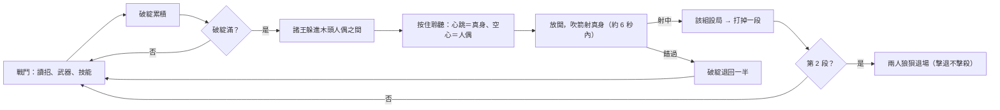

# MV-BOSS-002 家中奪命組 Boss 設計（含諸王 Boss 共用模板）

> **建立日期**：2026-10-03
> **上層依據**：[VISION.md](../../VISION.md) 6.5；[討論紀錄](MV-DESIGN-001_討論紀錄.md) 議題 C3、C5、G5；[MV-LEVEL-001 關卡設計](MV-LEVEL-001_關卡設計.md)；[Seven Macaw 設計](MV-BOSS-001_SevenMacaw設計.md)；[ART_SPEC.md](../../ART_SPEC.md) v0.3；[AUDIO_SPEC.md](../../AUDIO_SPEC.md) v0.3
> **原典**：Christenson 譯本 p.102（家中奪命組的職能、註 239～240）、p.147～150（議事廳的木頭人偶）
> **範圍**：諸王 3 組共用的 Boss 模板（第 1 節）；家中奪命組（Sweepings Demon、Stabbings Demon）的兩段設局、招式、場地、演出、重試。數值交給原型決定

## 定案（Brian，2026-10-03）

| 編號 | 問題 | 定案 | 理由 |
|---|---|---|---|
| BOSS2-1 | 諸王 3 組怎麼拆 | **拆三張**：MV-BOSS-002 家中奪命組（含共用模板）、003 化骨組、004 流血組；先做 002 | 每張都能在一個 session 內收尾；第一組是聆聽找弱點的第一次教學，模板在這裡定 |
| BOSS2-2 | 破綻滿時聆聽怎麼接上吹箭設局 | **真假聲源中找出活的，窗口約 6 秒** | 聆聽不能射吹箭，要「按住聆聽 → 放開 → 瞄準 → 射」，Seven Macaw 的 4 秒不夠；直接用議事廳學到的「活的諸王 vs 空心木偶」 |
| BOSS2-3 | 設局之箭由誰射 | **兩兄弟都可以，不自動換人** | 原典中諸王沒有被哪一位射中的依據；聆聽中被自動換人容易迷失聲源 |
| BOSS2-4 | 真假聲源是什麼 | **諸王躲進自己模樣的木頭人偶之中** | 三組共用同一形式，每次都重演「父親向假國王行禮 ↔ 兒子聽出誰是空的」的鏡像（支柱 1） |
| BOSS2-5 | 家中奪命組的設局 | **用他們自己的法則反制** | 兩段都是諸王被自己的規則愚弄（支柱 3）；第 1 段的設局本身就完成兩段之間的交棒 |
| BOSS2-6 | 共用模板細節 | 見第 1 節 | — |
| BOSS2-7 | 兩段的招式與場地 | 見第 2、3 節 | — |
| BOSS2-8 | 演出與重試 | 見第 4、5 節 | — |

---

## 1. 諸王 Boss 共用模板（BOSS2-2～4、6）

化骨組（MV-BOSS-003）、流血組（MV-BOSS-004）都套用本節，只設計各自的設局效果、招式與場地。

| 項目 | 規則 | 和 Seven Macaw 比 |
|---|---|---|
| 血條 | 2 段，一人一段輪流上場：第 1 段一位，設局成功後退場，第 2 段換搭檔（C3-3） | Seven Macaw 3 段 |
| 破綻累積 | 近戰命中為主；招架成功、吹箭打斷前搖、動物技能命中有加成；打倒召出的僕從不給破綻、但回充技能資源 | 相同 |
| 破綻滿 | 諸王退到一排和自己同樣模樣的木頭人偶之間，靜止不動，想用當年騙父輩的同一招騙雙胞胎；真身與人偶外觀完全相同 | 新增 |
| 找出真身 | 按住聆聽：真身是活物（心跳），人偶是虛假（空心）；放開聆聽後，聽到的活物在畫面上留約 2 秒的聲紋殘影，方便瞄準 | 新增（Seven Macaw 是視覺線索） |
| 觸發 | 兩兄弟的吹箭都可以，射中真身就觸發該組的設局、打掉一段；不自動換人 | Seven Macaw 只有 Hunahpu、會自動換人 |
| 窗口 | 約 6 秒（數值由原型決定） | Seven Macaw 約 4 秒 |
| 射錯 | 射中人偶：空洞的一聲「咚」，人偶裂開；之後那個位置只剩真身與其餘人偶；不扣時間 | 新增 |
| 錯過 | 窗口內沒射中真身：破綻退回一半，諸王回到戰鬥 | 相同 |
| 難度遞增 | 人偶數量（不含真身）暫定：第一組 2 → 3、第二組 3 → 4、第三組 4 → 5；排列由各組設計 | 新增 |
| 擊退不擊殺 | 第 2 段設局成功後，兩人一起狼狽退場；最終戰時在高處觀看 | — |
| 聲音視覺化 | 開啟時真身與人偶都顯示聲紋（AUDIO_SPEC 第 13 節），聽障玩家也能分辨 | — |

**第一組的教學**：第一次破綻滿時慢動作約 1 秒，畫面角落淡出聆聽鍵的圖示提示（不用文字），之後不再提示。

---

## 2. 場地

家中奪命區的 Boss 房：一小段街道，兩端各一間屋子，分別是兩位諸王的「家」；地上散著碎陶與枯葉。

此時玩家擁有：二段跳、讓工具自己動、聆聽；武器斧頭、掘棒、球具（若已過 Blade House 還有刀刃）；動物老鼠、隼、蚊子（若已取得還有切葉蟻）。

---

## 3. 兩段設局與招式（BOSS2-5、7）

| | 第 1 段：Sweepings Demon | 第 2 段：Stabbings Demon |
|---|---|---|
| 招式 1 | **撒垃圾**：抓起碎陶與枯葉拋過來，落點留下小垃圾堆數秒。可招架（白圓），用來練招架 | **長距突刺**：前搖長，直線衝過整條街。不可招架（暗紫），翻滾或跳過 |
| 招式 2 | **低掃**：像掃帚般的袍擺橫掃地面。不可招架，要跳過；二段跳派得上用場 | **連刺**：近身三連刺，可招架；招架成功的破綻加成大 |
| 招式 3 | **召喚**：從垃圾堆召出垃圾爬行者，最多 1 隻 | **門後突刺**：退進一間屋子，從另一間的門刺出；兩扇門都亮起前兆，聽聲音的方向判斷是哪一扇 |
| 招式 4 | — | **召喚**：召出突刺者，最多 1 隻 |
| 破綻滿 | 退到 2 個人偶之間（共 3 個） | 退到 3 個人偶之間（共 4 個） |
| 射中真身之後（設局） | 他撒出的垃圾全落回自己家門前 → 搭檔 Stabbings Demon 照法則衝出來，刺向「門前留垃圾的人」——自己的搭檔 → Sweepings 哀叫著逃走，Stabbings 接著上場 | 他吃痛，朝身旁的人偶亂刺（以為雙胞胎躲在裡面），尖端卡進空心木頭拔不出來 → 自己「面朝下跌在地上」（原典中他們對受害者做的事，p.102）→ 兩人狼狽退場 |

- 刺搭檔、刺人偶都是喜劇式的戳刺，只有剪影與誇張動作，不見血（ART_SPEC 第 2 節）。
- 第 1 段結束時 Stabbings 從家裡衝出來，兩段之間不需要另外的轉場。

---

## 4. 演出（BOSS2-8）

| 時刻 | 內容 |
|---|---|
| 開場（約 5 秒，重試時跳過） | 兩位諸王坐在各自家門前，看著雙胞胎走進街道、非語言地竊笑；Sweepings 把一堆垃圾掃向雙胞胎，開打 |
| 第 1 段 → 第 2 段 | Stabbings 刺跑搭檔後直接開打 |
| 擊退 | Stabbings 面朝下跌倒後，兩人各自逃回屋裡、甩上門；配樂抽掉，只剩風吹碎陶的環境音（AMB-10） |
| 覺醒 | Hunahpu 覺醒空中衝刺（MUS-S01＋覺醒特效）；街道出口就是通往化骨區的寬裂谷，覺醒後馬上用到（比照 BOSS-9c）。空中衝刺是自創能力，不編造原典閃回 |

---

## 5. 重試

Boss 門口有休息點；預設從第 1 段重來，開啟「Boss 段落保留」則從死掉的那段重來（C5、C5-1）。開場在重試時跳過。

---

## 6. 美術與聲音需求

### 美術（ART_SPEC 第 13 節）

- 兩位諸王的動作：開場坐姿、竊笑、撒垃圾、低掃、突刺、連刺、進出屋門、靜止（混在人偶中）、被刺逃走、刺卡住、面朝下跌倒、逃回屋裡
- 人偶：直接用諸王本人的素材、不播動作，外觀才會完全相同；被射中時加裂開特效
- Stabbings Demon 的武器是尖木樁，不用黑曜石，與 Blade House 的刀刃區隔
- 場景物件：兩間屋子的門面、可散落的碎陶與枯葉堆

### 聲音（AUDIO_SPEC 第 12 節）

- 真身用活物語彙（心跳），人偶用虛假語彙（空心）
- 射中人偶的空洞「咚」、尖木卡進木頭的悶響、垃圾落地
- 諸王的竊笑、被刺時的哀叫
- 配樂 MUS-B04 的家中奪命組變奏（沙鈴的乾刮擦、節奏尖銳）

---

## 7. 原典依據與改編

已登記到 [CULTURAL_PRINCIPLES.md](../../CULTURAL_PRINCIPLES.md) 改編清單：

| 改編 | 原典 |
|---|---|
| 諸王破綻滿時躲進自己模樣的木頭人偶之間 | 議事廳的人偶是 Xibalba 用來騙父輩的；雙胞胎靠蚊子識破（p.147～150）。原典中諸王沒有自己躲進人偶 |
| 家中奪命組被自己的法則愚弄：Stabbings 刺向門前有垃圾的搭檔；自己面朝下跌倒 | 他們的職能是追上門前屋後留垃圾的人，刺到對方面朝下倒地而死（p.102）；原典中沒有與雙胞胎交手 |

文化備註：Christenson 註 239 引 Andrés Xiloj，指當代 K'iche' 人認為保持家裡掃乾淨可以避開這些冥界之主。本設計**不**把「打掃」做成玩法（屬仍在實踐的信仰），只用諸王自己的法則反制他們。

---

## 8. 交給 MV-PROTO-006（戰鬥中的聆聽）的問題

- 約 6 秒的窗口夠不夠，會不會太鬆
- 放開聆聽後約 2 秒的聲紋殘影是否足夠瞄準
- 人偶數量的難度曲線（2 → 3 → … → 5）
- 第一次破綻滿的慢動作與圖示提示是否清楚
- 門後突刺只靠聲音方向判斷，在混音中是否聽得出來
