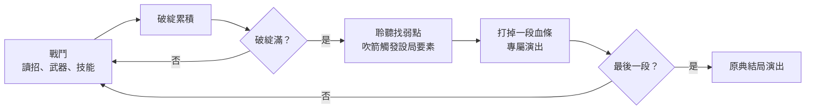
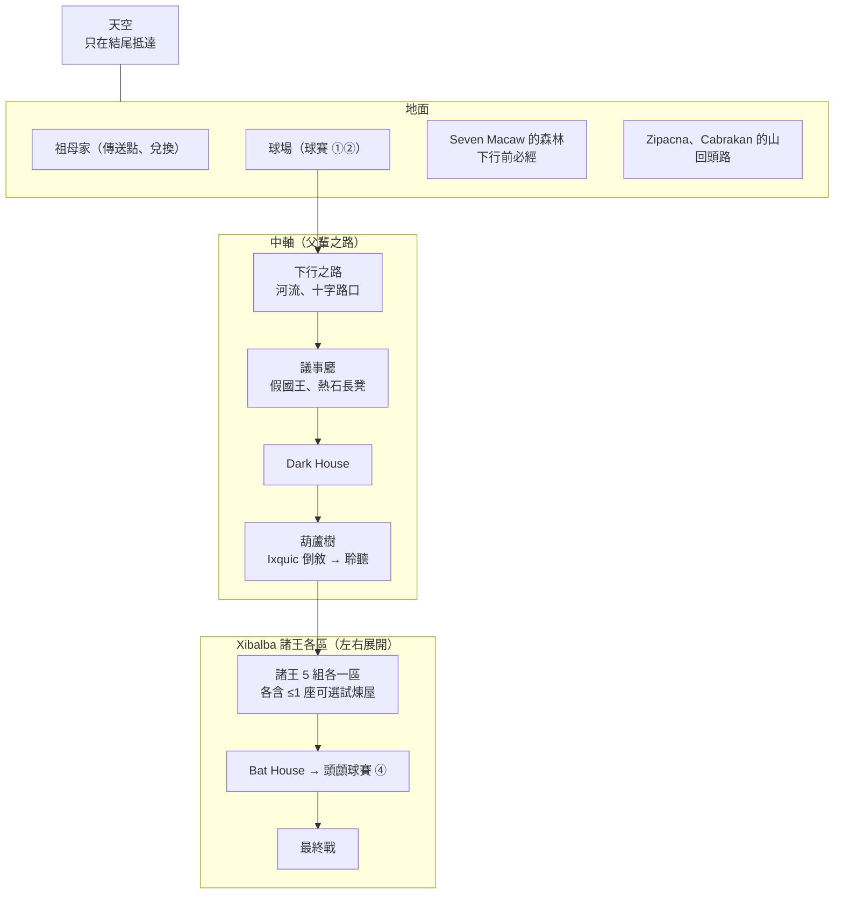

# MV-DESIGN-001 惡魔城版設計定調：討論紀錄

> **性質**：工作紀錄，依議題順序累積定案。全部議題定案後整理成 [VISION.md](../../VISION.md)，本檔保留為原始紀錄。
> **開始日期**：2026-09-30
> **做法**：`superpowers:brainstorming`，一次一問、子題拆細，每題附 Recommended 與理由

## 改類型的動機

Brian 選擇惡魔城類型的理由，依重要性排序：

1. 動作手感與 Boss 戰
2. 新能力打開舊路
3. 探索相連的地圖
4. 作品集辨識度

後續所有取捨以此排序為準。舊企劃的「沒有一般戰鬥、沒有血條」與第 1 名直接衝突，因此舊支柱 2「知識就是武器」重寫（見議題 A5）。

## 前提（議題 J 之後逐條確認）

| 項目 | 定案 |
|---|---|
| 專案性質 | **作品集為主，保留上架販售的可能**（舊企劃為「不以上架販售為目標」） |
| 製作者 | 一人；程式自己寫，美術與音訊交由 ChatGPT 生成，本人審查整合；片尾註明 AI 生成 |
| 引擎 | Godot 4（[ADR-0001](../adr/0001-game-engine-godot.md)） |
| 視角與平台 | 2D 側視；PC 下載版（Windows／macOS），鍵盤＋手把 |
| 目標玩家 | 作品集觀看者（評審、業界人士）＋喜歡 2D 動作、惡魔城的玩家（舊企劃為短篇敘事解謎） |
| 暴力尺度 | 不見血：戰鬥擊中以光、碎片、聲音表現，敵人倒下化為灰燼或剪影消散；關鍵死亡用剪影、切黑與聲音；內容約束在青少年可玩 |
| 文化詮釋 | 照 [CULTURAL_PRINCIPLES.md](../../CULTURAL_PRINCIPLES.md) |

保留上架可能的連帶事項：ChatGPT 素材的商用條款（舊企劃 ART-009、AUD-001）要在正式素材生成前確認；上架平台的 AI 生成內容揭露；文化審閱從嚴。

---

## 議題 A｜成長方式

| 子題 | 定案 |
|---|---|
| A 總方向 | 技巧為主，加少量數值 |
| A1 會成長的數值 | 血量上限、治療次數、技能資源上限；**攻擊力不成長** |
| A2 取得來源 | 地圖藏點（很多要新能力回頭拿）、試煉屋挑戰、Boss 擊敗獎勵、祖母兌換 |
| A2-1 祖母兌換 | 消耗型補血（有攜帶上限）＋試煉屋準備品 |
| A2-1a 準備品定位 | 另一條解法：不帶也能靠技巧過，帶了就重演原典的計謀 |
| A2-1b 準備品範圍 | 只做原典有的：Dark House 的紅羽毛與螢火蟲、Jaguar House 的骨頭；加上動物協助（Razor House 的切葉蟻），取得方式併入議題 F |
| A2-2 貨幣來源 | 打怪掉落＋地圖拾取 |
| A2-3 貨幣身份 | 可可豆；怪物為何掉可可先依遊戲慣例不解釋 |
| A2-4 升級分配 | 地圖藏點 → 血量碎片；試煉屋 → 治療次數；Boss → 新能力＋技能資源上限；祖母 → 消耗品 |
| A3 成長幅度 | 中幅，全收集約為初始 2 倍（例：血量 5→10、治療 2→5，實際數字由原型決定）；Boss 要在低、高兩種血量下各測一次 |
| A4 防硬打 | 原典 Boss 必須設局才能打倒，設局一擊配專屬演出、重演原典場面；自創 Boss 可硬扛，但都要有計謀解法，用計謀打倒有特殊演出與額外獎勵 |
| A5 支柱改寫 | 舊支柱 2 拆成兩條：「戰鬥靠技巧」「計謀勝過力量」（見下） |
| A5-1 衝突裁決 | 看對象：原典角色與原典場景 → 計謀優先；自創內容 → 技巧優先 |

### 支柱草稿（議題 D 討論舊支柱 1、3 後一併定稿）

| 支柱 | 意思 | 判準 |
|---|---|---|
| 戰鬥靠技巧 | 勝負取決於讀招、走位、時機；數值只增加容錯（血量、治療、資源約 2 倍），不增加輸出 | ① 攻擊力永遠不成長；② 如果某項數值升級讓讀招變得不必要，就砍 |
| 計謀勝過力量 | 原典中雙胞胎從不靠力量取勝，計謀永遠是更好的贏法 | ① 原典 Boss 如果能硬打過去，就改設計；② 自創 Boss 要有計謀解法（傷害戰鬥手感時可簡化或砍）；③ 每座試煉屋都要能靠計謀或準備品過關 |

衝突時：原典內容 → 計謀優先；自創內容 → 技巧優先。

### 待核對（定案前）

- 各試煉屋在原典中的過關方式（紅羽毛、螢火蟲、骨頭、對刀刃說話、切葉蟻），依 Christenson 譯本逐條核對
- 可可豆作為中美洲貨幣的史料依據

### 待登記改編清單

- 祖母的兌換服務（補血、準備品）
- 可可豆作為遊戲貨幣
- 試煉屋改為可選挑戰房，過關給治療次數
- 自創 Boss（逐一登記）

### 延後到其他議題

| 項目 | 延後到 |
|---|---|
| Bat House（斬首）與 Dark House 應屬主線，影響可選試煉屋數量 | J 範疇與故事 |
| 聆聽是否消耗技能資源（建議維持免費，以「只能慢走」為代價，沿用 PROTO-001 驗證的規則） | B 戰鬥本體 |
| 動物協助的取得方式（老鼠、蚊子、兔子、切葉蟻可能成為一類能力） | F 能力清單 |
| 死亡時是否掉可可豆 | I 死亡與存檔 |
| 從 Xibalba 回到地面祖母家的方式（快速移動？） | G 地圖結構 |

---

## 議題 B｜戰鬥本體

| 子題 | 定案 |
|---|---|
| B1 手感參考 | 《Hollow Knight》為主，另參考《死亡細胞》 |
| B1-1 借死亡細胞的部分 | 翻滾無敵幀與快節奏、敵人前搖讀招設計、多種武器與技能搭配（不借 roguelite 結構） |
| B1-2 武器強弱 | 純側向選擇：各武器單位時間傷害大致相同，差在攻速、範圍、距離、特性；沒有「更強的武器」 |
| B1-3 武器清單（6 把） | 原典器物：吹箭、斧頭、掘棒、球具；從 Xibalba 奪來：Razor House 的刀刃、藏刃的球 |
| B1-3b Xibalba 武器取得 | 在原典場景用計謀取得：Razor House 以說服刀刃過關 → 治療次數＋刀刃跟隨（靠技巧過關只有治療次數）；在 Xibalba 球賽識破藏刃的球 → 奪得 |
| B1-4 裝備方式 | 吹箭常駐（獨立按鍵，戰鬥與探索共用）＋2 個武器槽從其餘 5 把搭配，**隨時可更換** |
| B1-5 技能結構 | 開路能力（被動擁有）與戰鬥技能（技能槽）分開兩套 |
| B1-5a 技能內容 | 動物協助：每個技能是一種原典中幫過雙胞胎的動物（候選：兔子、蚊子、切葉蟻、螢火蟲、隼） |
| B1-5b 動物取得 | 全部散在地圖上，以食物或幫忙交換取得 |
| B1-5b-1 原典情節中的動物 | 情節照原典演出（蚊子套名字、兔子冒充球）；玩家已交換到該動物時，出場的是「你的」那隻（識別標記＋小動作） |
| B1-5c 技能槽與消耗 | 2 槽；消耗技能資源；武器打中敵人時回充（類似 HK 的靈魂）；更換規則比照武器（隨時） |
| B3 吹箭定位 | 低傷害、無限、有射速限制；專門打斷前搖、擊中弱點觸發設局、打落物件、觸發機關（對應原典「先射下顎」的計謀起手式） |
| B3-1 吹箭瞄準 | 雙搖桿自由瞄準，不必按住；未指向時朝面向射；對弱點與機關輕度吸附 |
| B4 防禦 | 翻滾為人人都有的基本閃避；**球具**的攻擊鍵改為招架／彈反（球具＝近身招架，藏刃的球＝丟出收回） |
| B5-1 聆聽代價 | 免費，代價是只能慢走、不能跳、不能射吹箭（沿用 PROTO-001 規則） |
| B5-2 戰鬥中的聆聽 | 只管找弱點與設局線索，不管讀招；攻擊前兆一律不必聆聽就看得到、聽得到 |
| B6-1 敵人密度 | 中等，多數房間 1～4 隻，每隻有清楚的行為模式 |
| B6-2 敵人重生 | 在休息點休息後重生（與補滿血量、治療綁在一起） |
| B6-3 敵人來源 | 原典生物（貓頭鷹使者、蠍子、蝙蝠、美洲豹、刀刃等）＋諸王僕從（行為對應主人的職能，外型自創並登記）；疾病與血的意象以剪影與暗示處理 |
| B7 治療操作 | 按一下，約 1 秒硬直；治療次數用完後同一鍵自動改用祖母的補血道具 |
| B8 下劈彈跳 | 要；所有近戰武器都有側攻、上攻、下劈，下劈打中敵人或特定物件會彈起 |

### 視覺語言

地面的動物是夥伴（動物技能），Xibalba 的動物是敵人。

### 風險與提醒

- **按鍵預算已接近上限**：跳躍、翻滾、武器 1、武器 2、技能 1、技能 2、吹箭（右搖桿＋發射）、聆聽、治療、互動，若加上雙胞胎切換共 11 個動作；議題 E 定案後要整體排一次按鍵
- **動畫量**：5 把近戰類武器 × 側攻／上攻／下劈；骨架動畫可共用部分姿勢，判定與手感仍要分別調
- 敵人攻擊要標明可否被球具招架

### 待核對（定案前）

- 原典器物：斧頭與掘棒（開墾田地一段）、球具藏在祖母家屋頂、Xibalba 的球藏有刀刃
- 動物情節：兔子、蚊子、切葉蟻、螢火蟲、隼（蝨子→蟾蜍→蛇→隼的口信）、老鼠
- 敵人：四隻貓頭鷹使者的名字、下行途中的蠍子、諸王的職能分組與名稱

### 待登記改編清單

- Razor House 的刀刃被說服後跟隨雙胞胎、作為武器
- 藏刃的球被奪來作為武器
- 斧頭、掘棒、球具作為武器；球具用於招架
- 動物協助作為戰鬥技能（動物攻擊敵人）、動物以交換方式加入
- 諸王僕從（逐一登記）

### 延後到其他議題

| 項目 | 延後到 |
|---|---|
| 雙胞胎在戰鬥中的分工（槽位是否改成每人各帶什麼） | E 主角與操作身份 |
| 原典器物在原典中都於下 Xibalba 前取得，是否全放在地面階段 | J 範疇與故事 |
| 聆聽是一開始就有還是解鎖 | F 能力清單 |
| 動物總數、敵人種類數 | H 規模 |

---

## 議題 C｜Boss

| 子題 | 定案 |
|---|---|
| C1 原典 Boss | Seven Macaw；Zipacna、Cabrakan（舊企劃砍掉的第二章救回）；其他 Xibalba 諸王 5 組（擊退不擊殺）；一死神、七死神（最終戰）。合計 9 場 |
| C2 自創 Boss | 不另外發明；只有試煉屋的最終挑戰算自創 Boss，套用 A4 規則（可硬扛、計謀有額外獎勵） |
| C3 原典 Boss 結構 | 交織式：血條只能靠設局打穿 |
| C3-1 武器的作用 | 武器與技能打中 Boss 累積「破綻」，破綻滿時觸發設局要素才生效，每次打掉一段血條 |
| C3-2 段數 | 依份量：諸王組 2 段，其餘 3 段；全作約 22 個設局要素 |
| C3-3 成對諸王 | 一人一段輪流上場：第 1 段打其中一位，設局成功後退場，第 2 段換另一位（同職能、招式變奏） |
| C4 Camazotz | 撐過一夜的生存戰（對抗蝙蝠群）→ 假黎明、聆聽顯示安全 → 探頭瞬間被無聲的 Camazotz 斬首；Camazotz 不可被打倒 |
| C5 重試 | 每場 Boss 門口必有休息點，打輸從這裡重來，走回 Boss 房不到 10 秒 |
| C5-1 段落保留 | 預設從第 1 段重來；輔助選項「Boss 段落保留」開啟後從死掉的那段重來 |
| C6 最終戰 | 表演即戰鬥：諸王在高處觀看、不親自出手，召來「死亡的考驗」；戰鬥打得漂亮累積「著迷度」（取代破綻），滿了完成一段原典表演（狗 → 房子 → 兄弟），三段後諸王自己要求被殺 |
| C7 球賽 | 獨立的球賽小遊戲（全作唯一新增的輕量系統） |
| C7-1 場次 | 四場全做、逐場升級：① 父輩地面（教學）→ ② 子代地面（完整規則，與 ① 同一座球場形成鏡像）→ ③ Xibalba 第一場（識破藏刃的球）→ ④ 頭顱球賽（兔子引開、換回真頭） |
| C7-2 形式 | 側視擊球：球在球場兩側斜牆間彈跳，沿用移動與跳躍追球，攻擊鍵擊球；需要球的物理與對手 AI |
| C7-3 勝利條件 | 不比分數，每場目標依原典事件而定：①② 連續擊球、打出響亮的聲音（吵到 Xibalba）；③ 識破並奪下藏刃的球；④ 把頭打出場外。失敗從該場開頭短暫重來 |

### Boss 戰模板（原典 Boss）

### 風險與提醒

- **規模警訊**：9 場原典 Boss＋試煉屋挑戰、約 22 個設局要素，對一人製作偏重；議題 H 依總時數回頭裁減（諸王 5 組是第一個可裁的地方）
- Camazotz 的假黎明要靠演出讓玩家覺得是「故事裡的被愚弄」而非「設計不公平」，原型階段要找人試玩驗證
- 最終戰的表演內容（狗、房子、兄弟互殺再復活）只照原典，細節以剪影、光、聲音處理（文化原則 2）

### 待核對（定案前）

- Zipacna（假螃蟹、山壓）與 Cabrakan（塗泥土的烤鳥）的擊倒方式
- Xibalba 諸王 5 組的名稱、分組與職能；原典中諸王在一死神、七死神死後的結局
- 最終表演的順序與內容
- Xibalba 第一場球賽中雙胞胎是否故意輸球、以四碗花為賭注（與 Razor House 剪花任務的關係）

### 待登記改編清單

- 諸王以 Boss 戰形式被擊退（原典中未與雙胞胎交戰）
- Camazotz 夜晚的蝙蝠群戰鬥、假黎明的演出
- 最終戰「死亡的考驗」與著迷度機制

### 延後到其他議題

| 項目 | 延後到 |
|---|---|
| 諸王 5 組是否全做、Boss 總數上限 | H 規模 |
| Zipacna、Cabrakan 納入後的故事範疇與順序 | J 範疇與故事 |
| Camazotz 那一段玩家操控誰、誰探頭 | E 主角與操作身份 |

---

## 議題 D｜世代鏡像

| 子題 | 定案 |
|---|---|
| D1 鏡像的地位 | 父輩序章＋子代主篇（前例：《月下夜想曲》的 Richter 序章） |
| D2-1 父輩的戰鬥 | 序章前半在地面球場用球具教基本操作與招架；貓頭鷹使者到來後，父輩把球具藏在祖母家屋梁、空手下行，Xibalba 段只能躲、被愚弄 |
| D2-1a 序章戰鬥教學 | 球賽 ① 教移動與擊球；接著一胡納普與七胡納普用球具對練（約 2～3 分鐘）教攻擊、翻滾、招架；貓頭鷹使者隨後到來 |
| D2-2 敘事順序 | 父輩序章開場，按時間順序；Seven Macaw 改為子代主篇地面區域的 Boss（不再是開場） |
| D2-3 序章長度 | 約 20 分鐘，舊第一幕節點照走：球場教學（約 5 分）→ 邀請、藏球具 → 下行之路（河流、十字路口被騙）→ 議事廳（假國王、熱石長凳）→ Dark House 失敗 → 處刑（畫面切走） |
| D3 兩代地圖 | 父輩的路是子代 Xibalba 的中軸：下行之路 → 議事廳 → Dark House 為主幹，子代從主幹擴展到諸王各區；鏡像點構圖完全相同 |
| D3-1 鏡像點玩法 | 識破後接戰鬥：先以舊企劃的識破機制（不給提示、失敗閃現父輩下場、兩次失敗出現父輩殘影），識破成功後接戰鬥 |
| D3-1a 識破後的戰鬥 | 伏兵群戰：詭計被識破，Xibalba 僕從湧出、鎖門，約 1～2 分鐘群戰（用一般敵人組合，不新增 Boss） |
| D4 Ixquic 段 | 子代在主篇中抵達葫蘆樹、看見父親頭顱時，倒敘操控 Ixquic 逃亡（約 10 分鐘），沿中軸倒著往上；倒敘結束後雙胞胎獲得**聆聽** |
| D4-1 Ixquic 玩法 | 潛行為主（躲、引、騙；假心臟騙過貓頭鷹使者），被發現時可短暫自衛擺脫（推開、撒樹汁等，細節待原型） |
| D5 支柱 | 舊支柱 1、3 合併為一條，全作共三條支柱（見下） |
| D5-1 縮減順序 | 不能砍：父輩序章、中軸鏡像點、Seven Macaw、Camazotz、最終戰。依序可砍：① 諸王組數（5→3）→ ② 試煉屋數量 → ③ Zipacna／Cabrakan → ④ 動物與武器數量 |
| D6 pitch | 見下 |
| D6-1 帶走的感受 | 見下 |

### 三條設計支柱（草稿）

| 支柱 | 意思 | 判準 |
|---|---|---|
| 1. 父親的路，兒子的反擊 | 父輩走過並失敗的中軸，子代重走並識破；同一場景，父輩沉重、子代機智 | ① 中軸上每個鏡像點都要有「被騙 ↔ 識破」的對照；② 同一場景兩代給出相反的情緒；③ 分支區域不受此限 |
| 2. 戰鬥靠技巧 | 勝負取決於讀招、走位、時機；數值只增加容錯，不增加輸出 | ① 攻擊力永遠不成長；② 如果某項數值升級讓讀招變得不必要，就砍 |
| 3. 計謀勝過力量 | 原典中雙胞胎從不靠力量取勝，計謀永遠是更好的贏法 | ① 原典 Boss 如果能硬打過去，就改設計；② 自創 Boss 要有計謀解法（傷害手感時可簡化或砍）；③ 每座試煉屋都要能靠計謀或準備品過關 |

**裁決**：支柱 1 只在中軸與父輩序章起作用，在那裡優先；其餘地方依 A5-1（原典內容 → 支柱 3 優先；自創內容 → 支柱 2 優先）。

### 一句話 pitch（草稿，文字可再潤飾）

> 父親空手走進冥界 Xibalba，被愚弄致死。雙胞胎兒子帶著他藏起的球具重走同一條路，一路打穿整座冥界；但能打倒神的，只有計謀。

### 玩家玩完要帶走的感受

> 「父親輸掉的每一步，都成了我們打贏的理由。」

### 待核對（定案前）

- 父輩出發前把球具藏在屋梁上、由老鼠告知雙胞胎
- Ixquic 以紅色樹汁做假心臟、說服貓頭鷹使者放她走

### 待登記改編清單

- 鏡像點識破後的伏兵群戰（原典中識破後沒有打起來）
- 父輩兄弟以球具對練（戰鬥教學）
- Ixquic 逃亡沿父輩的路倒著走（舊企劃已登記，需重新登記）
- 聆聽能力由 Ixquic 取得、雙胞胎繼承（舊企劃已登記，需重新登記）
- Ixquic 的自衛動作
- 父輩殘影、失敗閃現父輩下場（舊企劃已登記，需重新登記）

### 延後到其他議題

| 項目 | 延後到 |
|---|---|
| 父輩序章中操控誰（Hun Hunahpu 帶 Vucub Hunahpu？） | E 主角與操作身份 |
| 中軸以外的區域劃分 | G 地圖結構 |
| 葫蘆樹在地圖上的位置（決定聆聽的取得時機） | G 地圖結構 |

---

## 議題 E｜主角與操作身份

| 子題 | 定案 |
|---|---|
| E1 雙胞胎操控 | 場上一人，一鍵換人；**每人各持一個武器槽**（換人即換武器，取代 B1-4 的「2 槽」）；可隨時更換各自持有的武器 |
| E2 兩人差異 | 各有專屬開路能力，探索時要換人 |
| E2-1 能力分配 | 依主題分：Hunahpu 空中與速度（例：二段跳、空中衝刺）；Xbalanque 力量與地形（例：攀爬、破牆、搬動重物）；翻滾、聆聽、下劈為兩人共通 |
| E3 斬首之後 | 一夜獨行：Xbalanque 獨自一人（換人無回應、只剩一個武器槽與自己的能力），靠動物夥伴找到長鼻浣熊與南瓜；南瓜頭裝上後 Hunahpu 回到隊伍，頭顱球賽奪回真頭 |
| E4 父輩操控 | 操控一胡納普，不能換人；七胡納普跟隨（對練時為對手），不參與戰鬥 |
| E5 Camazotz 探頭 | 生存戰結束、假黎明出現時自動切到 Hunahpu；聆聽顯示安全，唯一的互動是「探頭」，由玩家親手按下（久不按時弟弟催促）；畫面切走 |
| E6 按鍵 | 方案 A（見下） |

技能槽兩人共用（動物是兄弟共同的夥伴）——預設，未逐條確認。

### 按鍵配置（方案 A，原型階段微調）

| 動作 | 手把 | 鍵盤＋滑鼠 |
|---|---|---|
| 移動 | 左搖桿 | WASD |
| 跳躍 | A | Space |
| 翻滾 | B | Shift |
| 攻擊（當前角色的武器）／球賽擊球 | X | 滑鼠左鍵 |
| 換人 | Y | Tab |
| 技能 1／技能 2 | LB／RB | Q／E |
| 聆聽（按住） | LT | F |
| 吹箭 | 右搖桿瞄準＋RT 發射 | 滑鼠右鍵（朝游標） |
| 治療 | 十字鍵上 | R |
| 互動 | 靠近時左搖桿上 | 靠近時 W |
| 選單／地圖 | Start | Esc／M |

換人放在最好按的 Y：它是戰鬥中的即時連段操作。治療放十字鍵：治療本來就有 1 秒硬直，是「停下來才做」的動作，拇指離開搖桿正好配合這個代價。

### 設計限制

- Bat House 斬首後到南瓜頭裝上之前，這段地圖只能要求 Xbalanque 的能力

### 待核對（定案前）

- 長鼻浣熊帶來南瓜、Xbalanque 雕成暫時的頭；頭顱球賽中兔子引開諸王、換回真頭

### 待登記改編清單

- 雙胞胎各有專屬開路能力（原典中兩人能力相近）
- Camazotz 段由玩家親手探頭（演出方式）

---

## 議題 F｜能力清單

| 子題 | 定案 |
|---|---|
| F1 能力來歷 | 雙胞胎自身的神通逐步覺醒：能力都來自原典中雙胞胎做過的事，打倒 Boss 是覺醒的時機（與「聆聽繼承自母親」同一框架；不是奪取對手的力量） |
| F2 能力清單 | 原典情節優先，缺口自創並登記（見下表，共 8 個含聆聽） |
| F2-1 游泳時序 | 照原典放最後：重生後到最終戰之間是「流浪藝人」自由探索期，游泳打開全圖水域（收尾探索用的收集品與捷徑） |
| F3 門的比例 | 能力門為主，知識門集中在原典場景（中軸鏡像點、試煉屋、原典 Boss 設局、聆聽找假牆），約 7:3 |
| F4 動物夥伴 | 五隻：兔子、蚊子、切葉蟻、隼、老鼠；螢火蟲只當 Dark House 準備品；長鼻浣熊只在 E3 劇情中出現 |

### 開路能力（8 個）

| 能力 | 給誰 | 原典依據 | 依據強度 | 取得 |
|---|---|---|---|---|
| 聆聽 | 共通 | Ixquic 在葫蘆樹下聽見頭顱說話（改編） | 已定 | Ixquic 倒敘結束後 |
| 縮小，穿過窄道 | Hunahpu | Bat House 躲進吹箭筒 | 情節 | Bat House 事件（MV-LEVEL-001 改） |
| 二段跳 | Hunahpu | 無 | 自創 | Boss 覺醒 |
| 空中衝刺 | Hunahpu | 無 | 自創 | Boss 覺醒 |
| 攀爬 | Xbalanque | 名字中的 balam（美洲豹） | 名稱意象 | Boss 覺醒 |
| 讓植物長高，長出平台 | Xbalanque | 讓樹長高困住兩個哥哥 | 情節 | Boss 覺醒 |
| 讓工具自己動，遠端破壞障礙 | Xbalanque | 開墾田地時斧頭自己砍樹 | 情節 | Boss 覺醒 |
| 游泳、水中行動 | 共通 | 死後化為魚人重生 | 情節 | 重生後 |

翻滾、下劈、吹箭為一開始就有。Boss 覺醒的 6 個能力對應 8 場非最終 Boss，多出的 Boss 只給技能資源上限（議題 H 把諸王縮為 3 組後，非最終 Boss 變為 6 場，見議題 H「規模的連帶影響」）。哪個 Boss 對應哪個能力，待議題 G 排出區域順序後決定。

### 動物夥伴（5 隻）

| 動物 | 原典情節 | 技能 |
|---|---|---|
| 兔子 | 頭顱球賽中冒充球，引開諸王 | 誘餌：吸引敵人火力 |
| 蚊子 | 叮諸王、套出名字 | 叮咬標記：被叮的敵人破綻累積加快 |
| 切葉蟻 | 替雙胞胎剪花（Razor House） | 放置型：在地面持續切割；也是 Razor House 的計謀解法 |
| 隼 | 口信「蝨子 → 蟾蜍 → 蛇 → 隼」的最後一棒 | 遠距俯衝打擊 |
| 老鼠 | 用「球具藏在哪」換食物 | 鑽地突襲 |

### 待核對（定案前）

- 雙胞胎讓樹長高困住 One Monkey、One Artisan；開墾田地時工具自己工作；死後骨灰入河、化為魚人，再以流浪藝人身分表演
- 口信的傳遞鏈（蝨子、蟾蜍、蛇、隼）

### 待登記改編清單

- 雙胞胎的神通以開路能力的形式逐步覺醒
- 二段跳、空中衝刺（Hunahpu，自創）
- 攀爬（Xbalanque，以名字意象為依據）
- 五隻動物的戰鬥技能效果

---

## 議題 G｜地圖結構

| 子題 | 定案 |
|---|---|
| G1 世界形狀 | 垂直分層：地面在最上層（祖母家、球場、Seven Macaw 的森林、Zipacna 與 Cabrakan 的山）；中軸從球場一路往下，穿過下行之路到 Xibalba；諸王各區從中軸左右展開。結尾一路往上穿過整張地圖到天空 |
| G2 推進順序 | Seven Macaw 為下行前必經（設局教學、第一個覺醒能力）；Zipacna、Cabrakan 在地面山區，入口需要 Xibalba 覺醒的能力，放在回頭路上 |
| G3 快速移動 | 祖母家＋每區一個固定傳送點（約 6～8 個）；其餘休息點只能休息。敘事包裝另議 |
| G4 試煉屋配置 | Razor、Cold、Jaguar、Fire 分散到諸王各區，每區最多一座，主題與該區諸王的職能搭配；Dark House 在中軸，Bat House 在主線 |
| G5 葫蘆樹 | 中軸 Dark House 之後、父輩之路的盡頭：子代識破 Dark House 後看見父親的頭顱 → Ixquic 倒敘 → 獲得聆聽 |

### 修正

- **Seven Macaw 的設局改用視覺線索**（看得見的反光），因為打他時還沒有聆聽。聆聽從諸王開始才成為設局工具，教學分兩步：Seven Macaw 教「設局」，諸王教「聆聽找弱點」

### 世界結構草圖

### 待核對（定案前）

- 葫蘆樹的位置：父輩在球場獻祭處被處死，頭顱掛在路旁的樹上

### 待登記改編清單

- 雙胞胎在 Xibalba 旅程中回到地面（原典中沒有）
- Zipacna、Cabrakan 的時序移到 Xibalba 旅程期間
- 快速移動的敘事包裝（待定）

### 延後到其他議題

| 項目 | 延後到 |
|---|---|
| 各試煉屋與哪一組諸王搭配、哪個 Boss 覺醒哪個能力 | 關卡設計（VISION 之後） |
| 區域總數 | H 規模 |

---

## 議題 H｜規模

| 子題 | 定案 |
|---|---|
| H1 總時數 | 主線約 3～3.5 小時（全收集約 4.3 小時）；諸王先做 3 組，其餘 2 組視進度追加 |
| H2 時程 | 里程碑制，不設全作硬期限：灰盒原型驗證 → 垂直切片 → 其餘內容；垂直切片是第一個交付物 |
| H2-1 垂直切片 | 子代地面開頭＋Seven Macaw（約 30 分）：換人、武器、吹箭、翻滾、招架、一般敵人、祖母兌換、第一場交織式 Boss |
| H3 一般敵人 | 約 12～15 種：每區 2～3 種專屬＋跨區共用（如貓頭鷹使者、蠍子），後期以少量變體補充 |

### 時數粗估（諸王 3 組）

| 段落 | 粗估 |
|---|---|
| 父輩序章 | 20 分 |
| 地面開頭＋Seven Macaw | 30 分 |
| 中軸＋葫蘆樹＋Ixquic 倒敘 | 30 分 |
| 諸王 3 區（含試煉屋） | 約 1.8 小時 |
| Bat House＋頭顱球賽 | 20 分 |
| 流浪藝人期＋最終戰 | 20 分 |
| Zipacna、Cabrakan（回頭路，可選） | 30 分 |
| 水域收尾探索（可選） | 30 分 |

### 規模的連帶影響

- 諸王 3 組時，區域約 7 個：地面、中軸、諸王 3 區、Bat House 一帶、最終區；傳送點約 6～7 個
- 原典 Boss 變為 7 場（Seven Macaw、Zipacna、Cabrakan、諸王 3 組、最終戰），設局要素約 3×3＋3×2＋3＝18 個
- 非最終 Boss 為 6 場，正好對應 6 個 Boss 覺醒能力；但 Zipacna、Cabrakan 在回頭路上、且是可砍內容，**主線必要的能力不能綁在他們身上**，關卡設計時要處理
- 可選試煉屋隨諸王區縮為最多 3 座（Razor、Cold、Jaguar、Fire 四選三）；**Razor House 必留**（綁了刀刃武器與切葉蟻解法）；3 座各給 1 次治療，正好對應 A3 的治療次數 2→5

---

## 議題 I｜死亡與存檔

| 子題 | 定案 |
|---|---|
| I1 死亡懲罰 | 回到最近的休息點（敵人重生、用掉的道具不回來），**可可豆不損失** |
| I2 存檔 | 在休息點休息時自動存檔，關閉後從最後的休息點繼續；3 個存檔欄位。通關後解鎖「Boss 重戰」（取代舊企劃的章節選擇） |
| I3 輔助選項 | Boss 段落保留（C5-1）、受到傷害調整（100%／50%／無敵）、遊戲速度調整（約 70%～100%）、聲音視覺化（所有攻擊前兆與重要聲音都有畫面提示）、球賽與平台挑戰可跳過（球賽 ③④ 跳過時自動給出結果：③ 拒用藏刃的球並贏得四碗花的賭局進度、④ 換回真頭；藏刃的球已不是武器，見 MV-DESIGN-002 決定 1；MV-AUD-002 更正） |

沿用舊企劃且不變的失敗規則：父輩序章一般失誤時遠處傳來 Xibalba 的笑聲；鏡像點失敗時閃現父輩下場；被奪走的死亡畫面切走、自己選擇的死亡（主動赴死）不切走。

---

## 議題 J｜範疇與故事

| 子題 | 定案 |
|---|---|
| J1 少年時期事件 | 地面開頭做短事件：開墾田地（取得斧頭、掘棒）、抓老鼠（得知球具藏處）；哥哥變猴子不做關卡，在覺醒「讓植物長高」時以短閃回呈現 |
| J2 原典器物取得（推導） | 一開始：吹箭；地面開頭開墾田地：斧頭、掘棒（兄弟一人一把）；抓老鼠：以食物交換球具藏處，老鼠成為第一隻動物夥伴（兼動物交換教學）；球賽 ② 前：球具；Xibalba：球賽 ③ 奪得藏刃的球、Razor House 計謀過關得刀刃 |
| J3 結局 | 最終戰後，雙胞胎在父輩被處死的球場與父親告別（支柱 1 的最後一個鏡像點）→ 玩家操作一路往上，穿過走過的每一層到天空（約 2～3 分鐘、無敵人）→ 第一道真光，影子出現 |
| J4 對白量 | 角色幾乎不說話（動作、手勢、非語言聲音）；系統文字（UI、兌換、武器與能力說明、操作提示）另計；字卡：區域標題、叫出諸王名字、片尾改編說明 |
| J4-1 繪本範圍 | 故事文本另做繪本。前篇（遊戲前閱讀）：世界、人物、Xibalba 是什麼地方，講到父輩在地面打球為止；後篇（通關解鎖）：完整原典故事，並標出遊戲改編了哪裡 |
| J4-2 繪本位置 | 遊戲內為主：第一次開始前可選擇閱讀前篇（可跳過）、主選單隨時可翻、後篇通關解鎖；下載頁另附 PDF，前篇公開、後篇標明「含劇透」 |
| J5 故事範疇 | 見下表；創世篇只在繪本前篇以一兩頁交代「世界還沒有真正的太陽」 |

### 故事範疇

| 原典段落 | 惡魔城版 |
|---|---|
| 創世（泥人、木人） | 不做（繪本前篇一兩頁背景） |
| Seven Macaw | 地面必經 Boss |
| Zipacna、Cabrakan | 回頭路 Boss（可砍） |
| 父輩下行、失敗、處刑 | 父輩序章 |
| Ixquic、雙胞胎出生 | 葫蘆樹倒敘 |
| 少年時期（哥哥變猴子、開墾田地、老鼠） | 地面短事件＋覺醒閃回 |
| Xibalba 試煉、Bat House、頭顱球賽 | 主篇 |
| 主動赴死、重生、表演 | 流浪藝人期＋最終戰 |
| 與父親告別、升天 | 結局 |
| 玉米人、祖先遷徙 | 不做 |

### 新增交付物：繪本

- 文本依基準譯本（Christenson 為主、Tedlock 交叉參照）撰寫，屬於文化審閱範圍
- 插圖交由 ChatGPT 依 ART_SPEC 生成（需在 ART_SPEC 改寫時補繪本規格）
- 後篇的「改編標示」以改編清單為準

### 待核對（定案前）

- One Monkey、One Artisan 變猴子的經過
- 雙胞胎與父親告別的內容（父親未能完全復活、被尊為最先受敬拜者）；雙胞胎升天成為日月

### 待登記改編清單

- 老鼠以交換方式成為動物夥伴
- 可操作的升天段落（穿過整張地圖）

---

## 收尾

### 待登記改編清單 → 已登記

各議題的「待登記改編清單」已彙整登記到 [CULTURAL_PRINCIPLES.md](../../CULTURAL_PRINCIPLES.md)「改編清單」，拿不準的項目另列「灰色地帶（請人審閱清單）」。以 CULTURAL_PRINCIPLES.md 為準，本檔各議題下的清單保留為原始紀錄。

### 待核對總表

> ✅ 2026-10-01 已全數核對，結果與修正見 [MV-DESIGN-002 原典核對](MV-DESIGN-002_原典核對.md)；本表保留為原始紀錄。

以下內容在討論中依記憶整理，**正式採用前要對照基準譯本**（Christenson 為主、Tedlock 交叉參照；Mesoweb 可取得 Christenson 譯本與 K'iche' 原文轉寫）。核對結果與原設計不符時，回頭修正對應議題與 [VISION.md](../../VISION.md)。

| # | 項目 | 影響的議題 |
|---|---|---|
| 1 | 各試煉屋的過關方式：Dark House（紅色金剛鸚鵡羽毛放在火炬上、螢火蟲放在雪茄頭）、Jaguar House（撒骨頭）、Razor House（對刀刃說話、切葉蟻剪花）、Cold House、Fire House | A2-1b、B1-3b、F4 |
| 2 | 試煉屋的名稱與順序（譯本間有差異） | G4 |
| 3 | 可可豆作為中美洲貨幣的史料依據 | A2-3 |
| 4 | 開墾田地時工具自己工作（斧頭、掘棒） | B1-3、F2、J1 |
| 5 | 父輩出發前把球具藏在祖母家屋梁、老鼠告知雙胞胎藏處（以食物交換） | D2-1、J2 |
| 6 | Xibalba 的球藏有刀刃；第一場球賽雙胞胎是否故意輸球、以四碗花為賭注 | B1-3b、C7-3 |
| 7 | 兔子在頭顱球賽冒充球；長鼻浣熊帶來南瓜、Xbalanque 雕成暫時的頭 | B1-5b-1、E3 |
| 8 | 蚊子叮諸王套出名字 | B1-5b-1、F4 |
| 9 | 口信傳遞鏈：蝨子 → 蟾蜍 → 蛇 → 隼 | F4 |
| 10 | 四隻貓頭鷹使者的名字；下行途中的蠍子；河流與十字路口 | B6-3、D2-3 |
| 11 | Xibalba 諸王的名稱、兩兩分組與職能；一死神、七死神死後其餘諸王的結局 | B6-3、C1 |
| 12 | Zipacna 被假螃蟹引入山谷遭山壓住；Cabrakan 吃下塗泥土的烤鳥後被埋 | C1 |
| 13 | Seven Macaw 被吹箭射傷下顎、被假治療者以白玉米換牙 | C1、G5 |
| 14 | 最終表演的順序與內容（狗、房子、兄弟互殺再復活）；諸王自己要求被殺 | C6 |
| 15 | Ixquic 以紅色樹汁做假心臟、說服貓頭鷹使者放她走 | D4-1 |
| 16 | 葫蘆樹的位置：父輩在球場獻祭處被處死，頭顱掛在路旁的樹上 | G5 |
| 17 | 雙胞胎讓樹長高、One Monkey 與 One Artisan 變成猴子 | F2、J1 |
| 18 | 雙胞胎死後骨灰入河、化為魚人，再以流浪藝人身分表演 | F2-1 |
| 19 | 雙胞胎與父親告別（父親未能完全復活、被尊為最先受敬拜者）；升天成為日月 | J3 |
| 20 | 雙胞胎在 Bat House 躲進吹箭筒過夜、Hunahpu 探頭被斬首 | C4、F2 |

---

## 美術決定（MV-ART-001 第一階段，2026-10-01）

撰寫 [ART_SPEC.md](../../ART_SPEC.md) v0.2 時追加的定案。ART-0、ART-5、ART-6、ART-7 會影響 VISION，已同步。

| 編號 | 子題 | 定案 |
|---|---|---|
| ART-0 | 地面的一般敵人（設計缺口） | Seven Macaw 的假光造物：由他珠寶的反光凝成的光影生物，打碎化為光點；Zipacna、Cabrakan 的山區沿用同一族群的變體 |
| ART-1 | 角色大小 | 1920×1080 基準，角色約 180 px（約 1/6 畫面高）；基準圖 1024 px，輪廓線約 16～18 px |
| ART-2 | 戰鬥訊號 | 光的語言，顏色＋形狀雙重編碼：可招架＝白色圓形閃光，不可招架＝暗紫鋸齒暗芒；不用紅色 |
| ART-3 | 命中與擊倒 | 依本質分：假光造物碎成光點與寶石碎片，Xibalba 生物碎成彩陶片後化為塵；灰燼留給主動赴死 |
| ART-4 | HUD | 抽象幾何（血量、治療、資源）＋實物小圖（可可豆、動物、武器） |
| ART-5 | Seven Macaw 覺醒的能力 | 兄弟各一：Xbalanque「讓工具自己動」、Hunahpu「二段跳」。主線 Boss（Seven Macaw＋諸王 3 組）可給 5 個能力，第 6 個由某組諸王多給或放在 Zipacna／Cabrakan（須為非必要能力），交 MV-LEVEL-001。**MV-LEVEL-001 定案**：縮小改由 Bat House 事件取得，Boss 覺醒的能力變成 5 個（Seven Macaw 2＋諸王 3），第 6 個能力的問題消失 |
| ART-6 | 補血道具 | 葫蘆碗裝的熱湯（避開玉米的神聖意涵；容器形制待核對） |
| ART-7 | 休息點 | 一般的篝火，刻意不做成三石灶；火光照亮周圍但沒有影子 |
| ART-8 | 雙胞胎區分 | Hunahpu 暖色（赭、金）、較輕瘦；Xbalanque 冷色（藍綠、銀白）、較壯實；共用骨架、分件比例微調；不照搬古典期英雄雙胞胎的圖像程式 |

### 待核對（追加至 MV-DESIGN-002）

| # | 項目 | 影響 |
|---|---|---|
| 21 | Seven Macaw 的外觀描述（牙、眼的珠寶）；古典期大鳥神祇圖像程式的範圍 | ART_SPEC 第 2、8 節 |
| 22 | 治療者老夫婦在原典中的名稱與形象 | ART_SPEC 第 8 節 |
| 23 | 古典期英雄雙胞胎的圖像程式（黑色斑點、美洲豹皮斑塊）；雙胞胎與日、月的對應 | ART_SPEC 第 2、4 節 |
| 24 | 葫蘆碗作為日常容器的形制 | ART_SPEC 第 8 節 |

---

## 音訊決定（MV-AUD-001 第一階段，2026-10-01）

撰寫 [AUDIO_SPEC.md](../../AUDIO_SPEC.md) v0.2 時追加的定案。

| 編號 | 子題 | 定案 |
|---|---|---|
| AUD-1 | 配樂策略 | 區域靠環境音（可帶極淡的音樂性、無旋律），配樂只給 Boss 戰、球賽與關鍵事件，全作約 10～12 首；配樂一出現就代表重要的時刻 |
| AUD-2 | 攻擊前兆的聲音 | 聲音語彙新增「前兆」類：所有前搖統一為短促、上揚的蓄力聲（與「危險」的持續、低平嗡聲區隔）；不可招架的攻擊再疊一層低沉共鳴，與 ART-2 的視覺訊號一一對應 |
| （推導） | 假光造物的聲音 | 歸入「虛假」類：空洞的玻璃或金屬聲、帶一次回聲；玩家拿到聆聽前就先用耳朵學到「閃亮的東西是空的」 |
| （推導） | 聆聽與配樂 | 聆聽時配樂與環境音淡出（沿用舊規則「世界聲音被抽走」），Boss 戰中亦同 |
| （推導） | 簽名動機 | 球落地節奏：球賽 ① 首次出現、球賽 ② 原樣重現、結尾與父親告別時以樂器重現 |

### ChatGPT 音訊實測（2026-10-01，Brian 執行）

| 測試 | 結果 |
|---|---|
| 音效 sfx_voc_hollow_01.wav | 產出檔案。ChatGPT 說明：乾澀木擊激發低頻中空腔體共鳴，約 0.19 秒後加入一次較暗、較弱的短回聲 |
| 配樂 mus_test_forest.wav | 產出檔案。ChatGPT 說明：陶笛明亮旋律搭配少量不安鄰音、稀疏木製縫鼓與交錯沙鈴，30 秒無縫循環立體聲，已驗證接縫 |
| 技術檢查 | 兩檔皆 48 kHz／16-bit、長度與峰值合規、配樂循環無斷點；配樂響度 -15.4 LUFS 比目標 -18 大聲，prompt 範本加入響度目標 |
| 聽感（Brian） | 音效與配樂都可用 |
| 結論 | 音訊全部交給 ChatGPT；多半為程式合成，prompt 要寫得具體；測試檔存於未進版控的 `assets-test/` |

---

## 原典核對後的修正（MV-DESIGN-002，2026-10-01）

依 Christenson 核對 24 項後的修正。上方各議題的原文保留為紀錄，**以本節與 [VISION.md](../../VISION.md) 為準**。逐項依據見 [原典核對](MV-DESIGN-002_原典核對.md)。

| 原定案 | 修正後 | 依據 |
|---|---|---|
| B1-3 武器 6 把（含藏刃的球） | **5 把**：吹箭、斧頭、掘棒、球具、Blade House 的刀刃 | 決定 1：White Dagger 暗示獻祭刀，且原典中雙胞胎只是拒用 |
| C4、E5 的名稱 Camazotz | 顯示名稱「**死亡蝙蝠**」；文件內部可用 Camazotz 當代稱 | 決定 2：Christenson 只稱 death bat |
| C6 最終戰三段 | 維持三段（狗 → 房子 → 兄弟）；原典第三段「獻祭一個人」遊戲省略，**繪本後篇完整交代**並標明理由 | 決定 3 |
| ART-6 葫蘆碗裝的熱湯 | **素面陶碗**裝的熱湯 | 決定 4：原典說葫蘆果就是一胡納普的頭 |
| C7-3 球賽 ③ 目標「識破並奪下藏刃的球」 | 識破藏刃的球 → **拒用、改用自己的球** → 故意輸球（賭四碗花） | 原典 p.152～154 |
| C7-3 球賽 ④ 目標「把頭打出場外」 | **把球打出場外**，兔子冒充球引開諸王 → 取回真頭 → 最後打碎南瓜 | 原典 p.161～163 |
| C1「被假治療者用白玉米換掉牙齒」 | 治療者是 Great White Peccary 與 Great White Coati，**雙胞胎扮成他們的孫子**；換牙後還有摘眼，Seven Macaw 死去 | 原典 p.83～86 |
| B1-3a、C1 諸王譯名 | Pus Demon、Jaundice Demon、Bone Staff、Skull Staff、Sweepings Demon、Stabbings Demon | 原典 p.101～103 |
| 試煉屋譯名 Razor House、Dark House | **Blade House**、House of Darkness（簡稱 Dark House 可） | 依基準譯本 |
| ART-8 暖冷主色「呼應日月」 | 只用於辨識，不對應日月 | 原典未指明誰成為太陽 |
| E3「Xbalanque 把南瓜雕成暫時的頭」 | 長鼻浣熊滾來 chilacayote 瓜、雕上眼睛；臉靠 Huracan 與眾智者降臨才完成 | 原典 p.160～161 |

---

## 文字語言（MV-DOC-001，2026-10-01）

| 子題 | 定案 |
|---|---|
| 文字語言 | 繁體中文、英文；日文留待上架前（舊企劃為繁中、英文、日文三語）。理由：惡魔城版的系統文字與繪本文字量大，每多一語的翻譯與文化審閱都是實工；文字以外部檔管理，之後加日文可逆 |
| 名稱表 | K'iche' 原文（ALMG）／傳統拼法／繁中／英文的完整名稱表另立工單 MV-NAME-001；英文名稱依 Christenson 譯名 |

---

## 素材設計決定（MV-ASSET-001，2026-10-01）

撰寫第 0 批素材工單時追加的定案，已同步到 [ART_SPEC.md](../../ART_SPEC.md)。

| 編號 | 子題 | 定案 |
|---|---|---|
| D-A1 | 雙胞胎服裝 | 有點個性的獵人：腰布、短披肩、長髮束起、赤腳或簡單涼鞋；無頭冠、無羽飾、無白頭帶（原典只提到腰布，p.129） |
| D-A1a | 獵人配件 | Hunahpu 腰間的泥彈袋（原典 p.96 吹箭的泥彈）；Xbalanque 肩上斜掛捲起的獵網（原典 p.137 用網子抓老鼠）；畫在軀幹分件上，不另加骨骼 |
| D-A2 | 斧頭形制 | 木柄＋灰色磨製石刃，繩綁；不用黑曜石或燧石（獻祭刀聯想，原典 p.111 註 269）、不用綠石（貴重意涵）、不用金屬 |
| D-A3 | 分件生成方式 | 先生成一張分件表（同一次生成、同一比例、洋紅背景）再切件，不理想的件個別補生成；MV-PROTO-004 對照兩種結果 |

---

## 關卡設計（MV-LEVEL-001，2026-10-03）

議題 F、G4、H、ART-5 延後的「哪個 Boss 覺醒哪個能力、試煉屋與諸王的搭配」已定案，詳見 [MV-LEVEL-001 關卡設計](MV-LEVEL-001_關卡設計.md)。

| 編號 | 子題 | 定案 |
|---|---|---|
| LEVEL-1、2 | 諸王 3 組 | 家中奪命組、化骨組、流血組（含 Ixquic 的父親 Gathered Blood） |
| LEVEL-3 | 可選試煉屋 | Blade House（家中奪命區）、Jaguar House（化骨區）、House of Fire（流血區）；House of Cold 不做 |
| LEVEL-4 | 縮小 | Bat House 事件覺醒 |
| LEVEL-5 | 區域順序 | 固定：家中奪命 → 化骨 → 流血 |
| LEVEL-6 | 諸王覺醒的能力 | 空中衝刺 → 攀爬 → 讓植物長高 |
| LEVEL-7 | Zipacna、Cabrakan | 入口用攀爬；只給技能資源上限 |
| LEVEL-8 | 試煉屋時機 | 進該區就能挑戰、在 Boss 前 |
| LEVEL-9 | 動物與試煉屋解法 | 動物照原典事件順序取得；試煉屋定過關概念（House of Fire 自創：烤 croton 樹汁引開看守） |
| LEVEL-10 | 主線能力門 | 二段跳 → 聆聽 → 衝刺 → 攀爬 → 長植物 → （Xbalanque 獨行）→ 縮小（最終區入口） |

---

## 美術第二階段（MV-ART-002，2026-10-03）

ART_SPEC 升為 v0.3，詳見 [ART_SPEC.md](../../ART_SPEC.md) 第 1、2、13～16 節。

| 編號 | 子題 | 定案 |
|---|---|---|
| ART2-1 | 一般敵人 | 13 種：地面假光造物 3＋中軸 2（蠍子、木頭人偶）＋諸王三區各 2＋Bat House 蝙蝠群 1＋跨區貓頭鷹使者 1；美洲豹只在 Jaguar House |
| ART2-2 | 諸王造型 | 宮廷貴族，以剪影與手持物暗示職能；不照搬古典期死神的骷髏圖像程式，不醜化 |
| ART2-3 | 諸王僕從 | 物質主題＋職能動作：垃圾爬行者、突刺者（家中奪命）；骨片跳躍者、枯殼（化骨）；痂殼飛蟲群、收集者（流血）；不畫血、膿、傷口 |
| ART2-4 | Blood River、Pus River | 畫成暗紅褐、混濁黃綠的稠泥流（泥與礦物質感）；遊戲中不寫河名，繪本照原典 |
| ART2-5 | Blade House 的刀刃 | 原典材質（黑曜石或燧石，註 269），無柄、成群懸浮的破片；列入灰色地帶 |
| ART2-6 | 傳送點 | 隼的棲架：隼飛來帶路、畫面隨飛行轉場 |
| ART2-7 | 繪本插圖 | 與遊戲同一畫風、完整構圖；16:9；前篇 8 張＋後篇 20 張；圖上無文字 |
| ART2-8 | 參考圖來源清單 | 兩層：可上傳（The Met、芝加哥藝術博物館、克里夫蘭藝術博物館、Smithsonian 的 CC0 影像）＋只供對照（Kerr 陶瓶展開照片，CC BY-SA 4.0，不上傳）；授權 2026-10-03 核對 |
| ART2-9 | 各區辨識色 | 見 ART_SPEC 第 1 節；背景避開暗紫與高亮白，明度比戰鬥訊號低一階以上 |

---

## 音訊第二階段（MV-AUD-002，2026-10-03）

AUDIO_SPEC 升為 v0.3，詳見 [AUDIO_SPEC.md](../../AUDIO_SPEC.md) 第 4、5、12～14 節。

| 編號 | 子題 | 定案 |
|---|---|---|
| AUD2-1 | 配樂數量與共通規則 | Zipacna（B02）、Cabrakan（B03）各一首，全作 11 首；配樂不可模仿聲音語彙（持續低平嗡聲、短促上揚蓄力聲、乾短空洞敲擊帶回聲） |
| AUD2-2 | 諸王配樂（B04） | 嘲弄而傲慢的宮廷：龜殼、低音縫鼓、海螺、非語言笑聲；三組各自變奏（家中奪命尖銳、化骨稀疏、流血厚重） |
| AUD2-3 | 死亡蝙蝠之夜（E02） | 只有節奏、沒有旋律，隨波次加密；假黎明時整個抽掉、只剩寂靜 |
| AUD2-4 | 鳥的聲音 | 「鳥鳴」指鳴禽的歌聲，只留給結尾；隼、貓頭鷹的單一叫聲另計；花園看守的夜鷹只以振翅表現 |
| AUD2-5 | 聆聽時一般敵人的歸類 | 依本質：真的生命是活物（蠍子、蝙蝠群、貓頭鷹使者、諸王、僕從），人造或假象是虛假（假光造物、木頭人偶） |
| AUD2-6 | 聲音視覺化 | 圖示＋方向、不用文字：畫面外前兆的邊緣箭頭、P1 聲紋＋前兆兩類聲紋、畫面外敵人與重要聲音的小圖示；刻意的靜默（死亡蝙蝠、假黎明、換人無回應）不顯示任何提示 |

---

## 家中奪命組 Boss 設計（MV-BOSS-002，2026-10-03）

諸王 3 組拆成 MV-BOSS-002～004；本張同時定下諸王 Boss 的共用模板，詳見 [MV-BOSS-002](MV-BOSS-002_家中奪命組設計.md)。

| 編號 | 子題 | 定案 |
|---|---|---|
| BOSS2-2 | 聆聽接上設局 | 破綻滿時從真假聲源中聽出活的，窗口約 6 秒；放開後留約 2 秒聲紋殘影 |
| BOSS2-3 | 設局之箭 | 兩兄弟都可以，不自動換人 |
| BOSS2-4 | 真假聲源 | 諸王躲進自己模樣的木頭人偶之間（心跳＝真身、空心＝人偶），三組共用 |
| BOSS2-5 | 家中奪命組的設局 | 用自己的法則反制：第 1 段 Stabbings 刺向門前有垃圾的搭檔 Sweepings；第 2 段 Stabbings 刺卡在空心人偶裡、面朝下跌倒 |

---

## 化骨組 Boss 設計（MV-BOSS-003，2026-10-03）

套用 MV-BOSS-002 的諸王 Boss 共用模板，詳見 [MV-BOSS-003](MV-BOSS-003_化骨組設計.md)。

| 編號 | 子題 | 定案 |
|---|---|---|
| BOSS3-1 | 第 1 段 Bone Staff | 骨頭騙局：雙胞胎把動物骨頭丟進化骨之風，他以為雙胞胎已化成骨頭、喊搭檔來看，當眾出醜 |
| BOSS3-2 | 第 2 段 Skull Staff | 空心的頭：他拿到人偶的木頭頭，敲出空洞的「咚」才發現被騙 |
| 文化 | 杖與身形 | 不碰諸王的杖（註 237，當代職杖）；杖頭抽象化；不畫腹部腫脹（註 238） |

---

## 流血組 Boss 設計（MV-BOSS-004，2026-10-03）

套用 MV-BOSS-002 的諸王 Boss 共用模板，詳見 [MV-BOSS-004](MV-BOSS-004_流血組設計.md)。

| 編號 | 子題 | 定案 |
|---|---|---|
| BOSS4-1 | 第 1 段 Flying Scab | Xbalanque 的獵網套住「套索」（Pat 讀法，註 234）；Gathered Blood 過來收「掉到地上的東西」才發現是搭檔 |
| BOSS4-2 | 第 2 段 Gathered Blood | 雙胞胎把 croton 樹脂丟進火裡，他像當年一樣彎腰聞香，第二次被女兒的計謀騙 |
