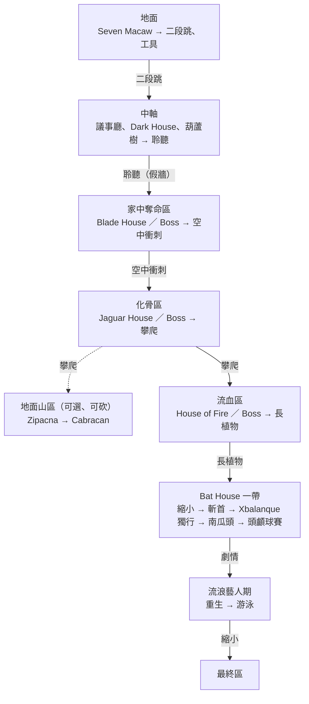

# MV-LEVEL-001 關卡設計：Boss、能力、試煉屋的對應

> **建立日期**：2026-10-03
> **上層依據**：[VISION.md](../../VISION.md) 6.3～6.5、第 7、8 節；[討論紀錄](MV-DESIGN-001_討論紀錄.md) 議題 A2、C2、F、G2、G4、H、ART-5；[Seven Macaw 設計](MV-BOSS-001_SevenMacaw設計.md)
> **原典**：Christenson 譯本 p.101～103（諸王）、p.110（試煉屋）、p.118～120（Ixquic 的樹汁）、p.140～162（雙胞胎在 Xibalba）、p.173（宣判）
> **範圍**：諸王選哪 3 組、試煉屋選哪 3 座與搭配、各能力在哪裡覺醒、區域順序與能力門、Zipacna／Cabracan 的定位、動物夥伴的取得區域、試煉屋的過關概念。房間配置、各 Boss 的設局細節、數值不在本文件

## 定案（Brian，2026-10-03）

| 編號 | 問題 | 定案 | 理由 |
|---|---|---|---|
| LEVEL-1 | 流血組（Ixquic 的父親 Gathered Blood）要不要選 | **選** | 玩家剛在葫蘆樹操控過 Ixquic；設局可以用母親的「樹汁代替心臟」，兒子用母親的計謀愚弄外祖父，同時契合支柱 1、3；擊退不擊殺 |
| LEVEL-2 | 另外兩組 | **化骨組、家中奪命組** | 兩組都有原典直接對得上的試煉屋：化骨組「讓人瘦到只剩骨頭」↔ Jaguar House 撒骨頭；家中奪命組「把人刺死」↔ Blade House 的刀刃 |
| LEVEL-3 | 第三座試煉屋（配流血組） | **House of Fire**；House of Cold 不做 | Ixquic 的樹汁「心臟」就是放在火上烤，諸王被香味吸引而上當（p.120）；保留原典試煉順序的最後一座 |
| LEVEL-4 | 縮小在哪裡覺醒 | **Bat House 事件** | 照原典（躲進吹箭筒，p.158）；斬首後 Hunahpu 不在場，自然只剩 Xbalanque 的能力；Boss 覺醒的能力變成 5 個，剛好等於 Seven Macaw 2 個＋諸王 3 個，ART-5 的「第 6 個能力」問題消失 |
| LEVEL-5 | 諸王 3 區的順序 | **固定：家中奪命 → 化骨 → 流血** | 照原典試煉順序 Blade → Jaguar → Fire → Bat；Xibalba 第一場球賽（賭四碗花）與 Blade House 當夜偷花是同一段原典，放第一區最順；外祖父成為 Bat House 前最後一組諸王；固定順序讓能力門不會破洞 |
| LEVEL-6 | 諸王各覺醒哪個能力 | **家中奪命：空中衝刺；化骨：攀爬；流血：讓植物長高** | 衝刺（自創）對應閃過刀刃；攀爬（balam＝美洲豹）與同區的 Jaguar House 呼應；長植物對應 Ixquic 的 croton 樹（母親的樹與兒子的樹）；兩兄弟最後各 3 個能力 |
| LEVEL-7a | Zipacna、Cabracan 的入口 | **攀爬（化骨組之後）** | 爬山的意象最直接；中期就能去，當作第三區前的可選繞路；砍掉只少一個可選區 |
| LEVEL-7b | Zipacna、Cabracan 的獎勵 | **各給技能資源上限，不給能力** | 照議題 A「Boss → 技能資源上限」；符合 VISION 第 8 節「主線必要的能力不能綁在他們身上」 |
| LEVEL-8 | 試煉屋什麼時候能挑戰 | **進該區就能挑戰、在 Boss 前** | 治療次數馬上幫得上該區 Boss；與原典「先過試煉、再與諸王對決」的順序一致 |
| LEVEL-9a | 動物夥伴的取得區域 | **照原典事件順序**（見第 5 節） | Blade House 要用切葉蟻，放在同一份文件才檢查得到卡關 |
| LEVEL-9b | 試煉屋過關方式要定到哪 | **定概念**，房間與挑戰細節留給各區實作 | 每座都有計謀或準備品解法，符合支柱 3；House of Fire 的自創解法要先定，才知道需不需要新的準備品來源 |
| LEVEL-10 | 主線的能力門 | **見第 2 節**；最終區入口用縮小 | 縮小有一個主線用途；游泳照 VISION 只開收尾探索的收集品與捷徑 |

---

## 1. 總表

| 順序 | 區域 | Boss | 覺醒能力 | 可選試煉屋 | 取得的動物 |
|---|---|---|---|---|---|
| 1 | 地面 | Seven Macaw | 二段跳（Hunahpu）、讓工具自己動（Xbalanque） | — | 老鼠（開頭）、隼（下行前） |
| 2 | 中軸 | —（Dark House、葫蘆樹） | 聆聽（共通，Ixquic 倒敘後） | — | 蚊子（議事廳） |
| 3 | 家中奪命區 | Sweepings Demon、Stabbings Demon | 空中衝刺（Hunahpu） | Blade House | 切葉蟻 |
| 4 | 化骨區 | Bone Staff、Skull Staff | 攀爬（Xbalanque） | Jaguar House | — |
| 支線 | 地面山區（可砍） | Zipacna → Cabracan | —（各給技能資源上限） | — | — |
| 5 | 流血區 | Flying Scab、Gathered Blood | 讓植物長高（Xbalanque） | House of Fire | — |
| 6 | Bat House 一帶 | 死亡蝙蝠（不可打倒） | 縮小（Hunahpu，事件） | — | 兔子（頭顱球賽） |
| 7 | 流浪藝人期 | — | 游泳（共通，事件） | — | — |
| 8 | 最終區 | 一死神、七死神 | — | — | — |

| 檢核 | 結果 |
|---|---|
| 能力總數 | 8 個：Hunahpu 3（二段跳、衝刺、縮小）、Xbalanque 3（工具、攀爬、長植物）、共通 2（聆聽、游泳），與 VISION 6.4 一致 |
| Boss 覺醒 | 5 個＝Seven Macaw 2＋諸王 3；Zipacna、Cabracan 不綁能力 |
| 治療次數 | 3 座試煉屋各 +1，2→5（議題 H） |
| 技能資源上限 | 每場非最終 Boss 都給（Seven Macaw、諸王 3 組、Zipacna、Cabracan） |

---

## 2. 能力門推進圖

| 從 → 到 | 門 | 說明 |
|---|---|---|
| 地面 → 中軸 | 二段跳 | 打倒 Seven Macaw、隼帶來召喚後才開；下行之路入口的高台 |
| 中軸 → 家中奪命區 | 聆聽（知識門） | 葫蘆樹之後用聆聽找出假牆；延續「從諸王開始用聆聽」的教學（議題 G 修正） |
| 家中奪命區 → 化骨區 | 空中衝刺 | 寬裂谷 |
| 化骨區 → 流血區 | 攀爬 | 高牆 |
| 化骨區之後 → 地面山區 | 攀爬 | 從祖母家傳送點回地面爬山；可選 |
| 流血區 → Bat House 一帶 | 讓植物長高 | 長出平台才上得去 |
| Bat House → 頭顱球賽 | 只用 Xbalanque 的能力 | 斬首後的獨行段：工具、攀爬、長植物 |
| 頭顱球賽之後 → 流浪藝人期 | 劇情 | 主動赴死、重生，取得游泳 |
| 流浪藝人期 → 最終區 | 縮小 | 讓縮小有一個主線用途 |

### 2.1 限制檢查

| 限制 | 出處 | 檢查 |
|---|---|---|
| 主線必要的能力不綁 Zipacna、Cabracan | VISION 第 8 節 | ✅ 兩人只給技能資源上限 |
| 斬首後到南瓜頭，地圖只能要求 Xbalanque 的能力 | VISION 第 8 節 | ✅ 獨行段只用工具、攀爬、長植物；縮小屬 Hunahpu |
| Zipacna、Cabracan 入口要用 Xibalba 覺醒的能力 | 議題 G2 | ✅ 攀爬 |
| 每區最多一座試煉屋 | 議題 G4 | ✅ |
| 能力門為主，知識門約 3 成 | 議題 F3 | ✅ 主線只有聆聽假牆一道知識門；其餘知識門在鏡像點、試煉屋、Boss 設局 |

### 2.2 給各區設計的規則

1. **主線只能要求進入該區時已有的能力**。用到之後才拿到的能力的地方，一律是可選的收集品或捷徑。
2. **門的形狀要讓已有的能力組合過不去**：
   - 衝刺門：裂谷寬到二段跳跳不過，上方有低天花板。
   - 攀爬門：牆高到「二段跳＋衝刺」也上不去。
   - 長植物門：平台高到前面三種能力加起來都上不去，旁邊沒有可以爬的牆。
   - 縮小門：通道窄到任何身形都過不去。
3. **每個新能力在之前的區域至少開 1 個回頭點**（血量碎片或捷徑），讓回頭有收穫。

---

## 3. 諸王 3 組

| 組別 | 譯名（Christenson） | 職能（p.101～103） | 區域主題 |
|---|---|---|---|
| 家中奪命 | Sweepings Demon、Stabbings Demon | 家前家後留有垃圾的人會被追上刺死 | 刀刃 |
| 化骨 | Bone Staff、Skull Staff | 使人瘦到只剩骨頭與頭骨（飢餓） | 骨頭、飢餓 |
| 流血 | Flying Scab、Gathered Blood | 使人的血液生病；Gathered Blood 在當代 K'iche' 說書人口中是「收集地上流出的血、端給其他諸王享用」的殘酷之王（註 235） | 火、紅樹 |

不做的兩組：化膿組（Pus Demon、Jaundice Demon）、路上奪命組（Wing、Packstrap）。若日後追加諸王，從這兩組選；追加組在縮減順序中最先被砍（VISION 第 8 節）。

---

## 4. 試煉屋

都在該區 Boss 前就能挑戰，過關各給 1 次治療次數；可以硬扛過去，用計謀過關有特殊演出與額外獎勵（議題 C2）。

| 試煉屋 | 區域 | 原典（Christenson） | 遊戲中的過關概念 | 需要的東西 |
|---|---|---|---|---|
| Blade House | 家中奪命區 | 對刀刃說「你們該吃的是動物的肉」，刀刃全部停下；當夜派切葉蟻去偷 One Death、Seven Death 花園的花，填滿四碗（p.154～156） | 對刀刃說話讓它們停下（互動）；再派切葉蟻偷花，賭注是 Xibalba 第一場球賽輸掉的四碗花（p.153） | 切葉蟻（同區取得） |
| Jaguar House | 化骨區 | 撒骨頭給美洲豹啃，看守以為那是雙胞胎的骨頭（p.157～158） | 撒骨頭引開美洲豹 | 骨頭（祖母兌換，議題 A2-1b） |
| House of Fire | 流血區 | 只寫「沒有被燒到」，沒有方法（p.158） | **自創**：在火上烤 croton 樹汁，香味引開火中的看守，重現 Ixquic 的計謀（p.120） | croton 樹汁（流血區地圖上的紅樹取得） |

House of Cold（p.157，原典寫雙胞胎「讓寒冷消散」）不做。

---

## 5. 動物夥伴的取得區域

| 動物 | 區域 | 原典事件 |
|---|---|---|
| 老鼠 | 地面開頭 | 咬斷吊在屋頂的繩子，讓球具掉下來（p.140） |
| 隼 | 地面，下行前 | 口信接力的最後一棒；被吹箭射中眼睛後，雙胞胎削下球的橡膠治好牠（p.143～144） |
| 蚊子 | 中軸議事廳 | 被派去叮諸王套出名字；先叮到的是木頭人偶（p.147～150），呼應父輩序章的假國王 |
| 切葉蟻 | 家中奪命區 | Blade House 當夜偷花（p.154～156） |
| 兔子 | Bat House 一帶 | 頭顱球賽中冒充球，引開諸王（p.161～162） |

進 Xibalba 時手上有 3 隻，第一區 4 隻，兔子最後。

---

## 6. 流血組的注意事項（交給流血組的 Boss 設計）

- **樹汁的畫法**：畫成暗紅色、凝固成塊的樹脂，不畫滴流，以符合 ART_SPEC「不見血」。K'iche' 語的血與樹汁是同一個字 kik'（註 287），寫進繪本，遊戲畫面不強調。
- **設局素材**：可以用「樹汁代替心臟」，讓結尾雙胞胎宣判諸王「以後只能得到樹汁」（p.173）有前因。實際設局由流血組的 Boss 設計決定。
- **審閱**：雙胞胎打的是外祖父；擊退不擊殺，外祖父只是被愚弄。當代 K'iche' 人仍向諸王祈禱（p.103 註 243），屬優先審閱。

---

## 7. 原典依據與改編

已登記到 [CULTURAL_PRINCIPLES.md](../../CULTURAL_PRINCIPLES.md) 改編清單：

| 改編 | 原典 |
|---|---|
| House of Cold 不做；可選試煉屋只有 Blade、Jaguar、Fire 三座 | 原典 Darkness → Blade → Cold → Jaguar → Fire → Bat 六座（p.110、154～159） |
| 三座試煉屋分到三組諸王的區域，順序固定為 Blade → Jaguar → Fire | 原典是同一段旅程中一夜接一夜，由全體 Xibalba 安排 |
| House of Fire 的過關方式：烤 croton 樹汁，以香味引開看守 | 原典只寫雙胞胎沒有被燒到（p.158）；樹汁計謀出自 Ixquic（p.118～120） |
| 各能力與 Boss 的對應（例：打倒化骨組後覺醒攀爬）、縮小在 Bat House 覺醒 | 原典中能力不與打倒對手相連；躲進吹箭筒出自 p.158 |

---

## 8. 對其他文件的影響（已同步）

| 文件 | 修改 |
|---|---|
| [VISION.md](../../VISION.md) | 6.4 能力表加「取得」欄；第 7 節試煉屋改為定案的三座 |
| [討論紀錄](MV-DESIGN-001_討論紀錄.md) | 議題 F 能力表與 ART-5 註記由本文件定案 |
| [WORLD_AND_STORY.md](../../WORLD_AND_STORY.md) | 諸王、Gathered Blood 兩列改為定案 |
| [CULTURAL_PRINCIPLES.md](../../CULTURAL_PRINCIPLES.md) | 改編清單：更新試煉屋兩列、新增 House of Fire 與能力對應；灰色地帶新增流血組 |

---

## 9. 交給後續工單的問題

| 問題 | 交給 |
|---|---|
| 三組諸王各自的設局要素、招式、演出（流血組參考第 6 節） | 各組的 Boss 設計（比照 MV-BOSS-001） |
| 三座試煉屋的房間與最終挑戰細節；House of Fire 看守的造型 | 各區實作 |
| 縮小與死亡蝙蝠生存戰的操作關係（躲進吹箭筒＝縮小） | MV-PROTO-010 |
| 完整素材與音訊清單（諸王 3 組、3 座試煉屋、各區色盤） | MV-ART-002、MV-AUD-002（本文件完成後可開工） |
