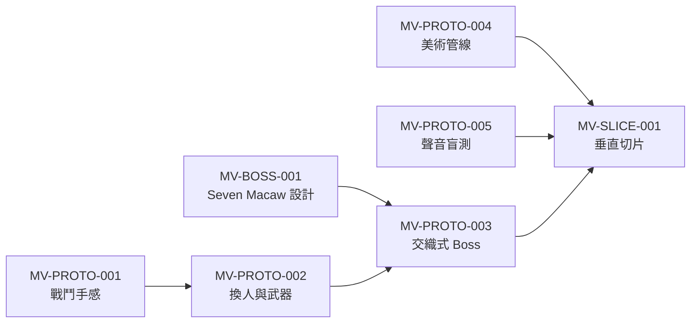

# MV-PROTO-000 原型驗證計畫

> **建立日期**：2026-10-01
> **上層依據**：[VISION.md](../../VISION.md) 第 9 節（里程碑制：灰盒原型 → 垂直切片 → 其餘內容）、第 11 節（主要風險）
> **範圍**：惡魔城版的灰盒原型清單、順序、專案組織、驗證方式；P1 聆聽原型的沿用評估

## 定案（Brian，2026-10-01）

| 編號 | 問題 | 定案 |
|---|---|---|
| PROTO-1 | 順序策略 | **切片所需的優先，依依賴排序**：戰鬥 → 換人 → Boss，美術管線與聲音盲測並行；全部通過後做垂直切片，其餘原型放在切片之後 |
| PROTO-2 | 專案組織 | **戰鬥線共用一個核心專案**（`prototypes/core/`），MV-PROTO-001 → 002 → 003 在同一個專案逐步長大，最後成為垂直切片的骨幹；其餘原型是可丟棄的獨立小專案 |
| PROTO-3 | 驗證方式 | ~~依類型分：手感類以 Brian 自評為主（可加 1 人）；理解類必須找 2～3 位沒看過設計的人，找到之前不算通過~~ → **全部由 Brian 獨自驗證**（2026-10-05 變更，見下方） |
| PROTO-3（變更，2026-10-05） | 驗證方式 | **不找外人，所有原型（含理解類）都由 Brian 獨自試玩與自評**。限制：Brian 已知設計，理解類問題（例如「能不能自己發現設局」「聲音分不分得出來」）的結果會偏樂觀，判讀時要記住這點 |
| （工程） | P1 的處理 | **P1 原封不動保留**（聆聽盲測通過的證據，需可重現）；複製一份改裝成聲音盲測台（MV-PROTO-005），聆聽相關程式抽成模組給核心專案用 |

---

## 1. P1 聆聽原型的沿用評估

`prototypes/p1-listening/`（舊企劃 PROTO-001，真人盲測通過）。2026-10-01 以 Godot 4.7.2 重跑 `--self-test`：有聲音 5/5、靜音故意答錯 1/5、專注係數 0.2／0.5 正確，仍可運作。

| 部分 | 檔案 | 沿用方式 |
|---|---|---|
| 聆聽狀態（按住、慢走 35%、不能跳） | `player.gd` | 抽成聆聽模組，給核心專案的角色用 |
| 去色 shader、鏡頭拉遠 | `main.gd`（`DESAT_SHADER`） | 抽成聆聽模組；**鏡頭拉遠在戰鬥中是否合適**留給 MV-PROTO-006 判斷 |
| 專注壓低（0.2／0.5） | `main.gd`（`_update_focus`） | 沿用。實際音量差＝專注係數（約 -14 dB）＋2D 距離衰減（相距 300 px、max 700、指數 2，約 -9.7 dB），合計約 -24 dB，與 AUDIO_SPEC 一致 |
| 五類聲紋的繪製 | `source.gd` | 沿用；聲紋只用形狀與動態區分、全部同色（色盲友善） |
| 程式合成的佔位音效 | `sound_bank.gd` | 沿用為佔位；正式音效由 ChatGPT 生成後替換 |
| 作答介面與計分 | `main.gd` | 改裝成 MV-PROTO-005 的盲測台（加入「前兆」兩種變體） |
| 整個原型當作戰鬥原型的底 | — | ❌ 不適合：它是答題介面，沒有戰鬥、敵人或移動中的聲源 |

---

## 2. 原型清單

### 垂直切片之前

| ID | 原型 | 專案 | 類型 | 前置 |
|---|---|---|---|---|
| MV-PROTO-001 | 戰鬥手感 | 核心 | 手感 | — |
| MV-PROTO-002 | 換人與武器 | 核心 | 手感 | 001 |
| MV-BOSS-001 | Seven Macaw Boss 設計（文件） | — | 設計 | — |
| MV-PROTO-003 | 交織式 Boss | 核心 | **理解** | 002、BOSS-001 |
| MV-PROTO-004 | 美術管線 | 獨立 | 管線 | —（需 Brian 用 ChatGPT 生成素材） |
| MV-PROTO-005 | 聲音語彙盲測 | 獨立（複製 P1） | **理解** | — |

### 垂直切片之後

| ID | 原型 | 專案 | 類型 |
|---|---|---|---|
| MV-PROTO-006 | 戰鬥中的聆聽（諸王找弱點） | 核心 | 手感＋理解 |
| MV-PROTO-007 | 中軸鏡像點：識破＋伏兵群戰（先評估舊倉庫 P2 鏡像切片能否搬過來） | 核心 | **理解** |
| MV-PROTO-008 | 球賽：側視擊球 | 獨立 | 手感 |
| MV-PROTO-009 | 動物技能：2 槽＋資源 | 核心 | 手感 |
| MV-PROTO-010 | 死亡蝙蝠之夜：生存戰＋假黎明 | 核心 | **理解** |
| MV-PROTO-011 | Ixquic 潛行 | 獨立 | 手感 |

---

## 3. 各原型的範圍與驗收

### MV-PROTO-001 戰鬥手感

| 項目 | 內容 |
|---|---|
| 要回答的問題 | ①《Hollow Knight》為主、借《死亡細胞》的手感能不能成立？② 翻滾無敵與跳躍閃避的分工清不清楚？③ 吹箭（低傷害、打斷）會不會架空近戰？ |
| 範圍 | 灰盒單一角色；斧頭的側攻、上攻、下劈；翻滾（無敵幀）；下劈彈跳；吹箭（雙搖桿自由瞄準、未指向時朝面向）；受擊與短暫無敵；治療（按一下約 1 秒硬直、有次數）；灰盒 HUD（血量、治療）；假光造物 2 種（地面爬行近戰、飛行俯衝）；前搖訊號（輪廓亮起；可招架＝白色圓形、不可招架＝暗紫鋸齒）；一間戰鬥房＋一段平台；手把與鍵盤（按鍵方案 A） |
| 不做 | 換人、技能、Boss、美術、音樂 |
| 驗收（自評） | ① 連續玩 10 分鐘沒有「卡手」的時刻；② 讀前搖能無傷打倒 3 隻敵人；③ 下劈彈跳能穩定連續 3 次；④ 吹箭打斷前搖有明確回饋；⑤ 產出數值表（移動速度、跳躍高度、翻滾距離與無敵幀、各攻擊的判定時間）寫回本計畫 |
| 自動驗證 | `--self-test`：傷害、無敵幀、治療次數、下劈彈跳判定 |
| 結果 | ✅ **結案（Brian 2026-10-06 自評，手把）**。① 卡手：「還可以，太久沒用搖桿玩遊戲了」；② 無傷打倒 3 隻：「訓練一下，是可以的」；③ 下劈彈跳：初始數值 0/5「掉下來的速度需要慢一點」→ 一般下落重力倍率 1.5 → 0.6、按下劈的瞬間變回原本的 1.5 倍（新參數 `down_slash_gravity_multiplier`）、彈跳物間距 400 → 500（坑寬 1550 → 1600），commit `e357d5d`、`5d6703b`、`50bd329`（002 分支） 後 **3/5，未達「5 次至少 4 次」**，Brian 判定可接受（平常跳躍不會太飄、下劈變快的感覺沒問題）；④ 吹箭打斷：「清楚，但是不能連續打斷」，同一隻 3 秒冷卻（PROTO1-5）維持；⑤ 數值表見下方「MV-PROTO-001～003 結案數值表」。回答問題：① 手感成立（需要熟悉搖桿）；② 未逐項自評；③ 打斷有冷卻，不會架空近戰 |

### MV-PROTO-002 換人與武器

| 項目 | 內容 |
|---|---|
| 要回答的問題 | ①「換人＝換武器」的即時連段順不順？② 球具招架看不看得懂、抓不抓得到？③ 兄弟的專屬能力讓探索「需要換人」但不煩？ |
| 範圍 | 兩兄弟（灰盒暖冷色區分）一鍵換人；各持一個武器槽（斧頭／掘棒／球具可指定）；球具招架與招架成功回饋；專屬能力：Hunahpu 二段跳、Xbalanque「讓工具自己動」（遠端破壞木障）；一段需要換人的小型探索區 |
| 不做 | Boss、技能、美術 |
| 驗收（自評＋可加 1 人） | ① 戰鬥中換人沒有誤按、沒有手忙腳亂；② 招架成功率在練習 5 分鐘後明顯上升；③ 探索段中「該換誰」不需要提示；④ 手把十字鍵上治療的實際手感（E6 方案 A 的假設）可接受 |
| 結果 | ✅ **結案（Brian 2026-10-06 自評，手把）**。① 換人：「不會」誤按或手忙腳亂；② 招架：開始練後 13 分鐘內共 116 次、成功 45 次（約 39%），各分鐘 16%～80% 起伏、沒有達到參考線（第 5 分鐘比第 1 分鐘高 20 個百分點或達 70%），被不可招架打中 0 次；Brian 判斷「有」變熟練；③ 探索區：「可以，但是需要摸索一陣子」；④ 十字鍵上治療：「可以」；數值表見下方「MV-PROTO-001～003 結案數值表」 |

### MV-BOSS-001 Seven Macaw Boss 設計（文件工單）

| 項目 | 內容 |
|---|---|
| 產出 | Seven Macaw 的三段設局要素、視覺線索、破綻條規則、招式表、演出；依 brainstorming 一次一問與 Brian 定案 |
| 原典素材 | 吹箭射中下顎、扯斷 Hunahpu 的手臂（MV-DESIGN-002 #13）、雙胞胎扮成治療者老夫婦的孫子、白玉米換牙、摘眼 |
| 限制 | 打 Seven Macaw 時還沒有聆聽（G5），設局線索全部是視覺；原典 Boss 必須設局才能打倒（A4） |
| 結果 | ✅ 2026-10-02 完成，見 [Seven Macaw 設計](MV-BOSS-001_SevenMacaw設計.md)（BOSS-1～9 定案） |

### MV-PROTO-003 交織式 Boss

| 項目 | 內容 |
|---|---|
| 要回答的問題 | ① 破綻 → 設局會不會把戰鬥拖成解謎？② 沒看過設計的人能不能靠視覺線索自己發現設局？③ 三段的長度與重試成本合不合理？ |
| 範圍 | 依 [Seven Macaw 設計](MV-BOSS-001_SevenMacaw設計.md) 做灰盒：兩個場地（nance 樹、宮殿）；破綻條；三段設局（光源微亮／最亮兩級、只有 Hunahpu 的箭能觸發、破綻滿時自動換成 Hunahpu）；斷臂後 Hunahpu 武器槽停用；假光閃耀的背對判定；假光造物召喚；兩個門口的休息點與重試；輔助選項「Boss 段落保留」。過場與演出可先用文字卡代替。設計文件第 9 節列出要由原型回答的數值與可讀性問題 |
| 驗收（Brian 獨自，PROTO-3 變更） | ① Brian 自評：視覺線索夠不夠讓沒看過設計的人找到至少 2 個設局要素（替代原本「至少 2 位外人不看提示就找到」）；② 記錄「卡住超過 1 分鐘」的時間點與原因；③ 記錄通關所需的嘗試次數；④ Brian 自評：感覺是「打贏」還是「解開」 |
| 結果 | ✅ **通過（Brian 2026-10-06 結案）**。鍵盤 2 場、手把 1 場整場＋1 場只打第 1 段（日誌與原話見 [核心 README 試玩紀錄](../../prototypes/core/README.md)）。① 視覺線索「足夠」（Brian 已知設計，偏樂觀）；② 手把整場沒有卡超過 1 分鐘（鍵盤時卡在「硬直時不知道該做什麼」與「覺醒後上不了高台」，已加光環與二段跳提示）；③ 手把通關 4 次（鍵盤 3 次）；④「看懂機制之後解開，但還是硬打」。回答三個問題：① 沒有拖成解謎，仍要硬打；② 只能以 Brian 自評回答，結果偏樂觀；③ 段落保留開時 3～4 次通關，可接受。試打後的修改：爆亮光源加光環、覺醒後提示二段跳、第 1 段改為假光閃耀後緊接俯衝（白茫才有代價，第 1 段由 2 次變 6 次，Brian：可接受、公平）。連射順便設局不擋、小怪不調、數值不調 |

MV-PROTO-001～003 結案數值表（F9，2026-10-06；003 結案後 001 自評又改了下落：fall_gravity_multiplier 1.5 → 0.6、新增 down_slash_gravity_multiplier 1.5）

| 分組 | 參數 | 值 |
|---|---|---|
| 移動 | run_speed | 900.0 |
| 移動 | accel_time | 0.05 |
| 移動 | decel_time | 0.04 |
| 跳躍 | jump_height | 400.0 |
| 跳躍 | jump_apex_time | 0.4 |
| 跳躍 | jump_cut_multiplier | 0.4 |
| 跳躍 | fall_gravity_multiplier | 0.6 |
| 跳躍 | max_fall_speed | 2200.0 |
| 跳躍 | coyote_time | 0.1 |
| 跳躍 | jump_buffer | 0.1 |
| 跳躍 | action_buffer | 0.1 |
| 翻滾 | roll_distance | 360.0 |
| 翻滾 | roll_time | 0.3 |
| 翻滾 | roll_iframe_start | 0.03 |
| 翻滾 | roll_iframe_end | 0.25 |
| 翻滾 | roll_cooldown | 0.35 |
| 斧頭 | axe_startup | 0.06 |
| 斧頭 | axe_active | 0.08 |
| 斧頭 | axe_recovery | 0.18 |
| 斧頭 | axe_damage | 4 |
| 斧頭 | axe_side_box | (140.0, 120.0) |
| 斧頭 | axe_up_box | (120.0, 150.0) |
| 斧頭 | axe_down_box | (120.0, 150.0) |
| 斧頭 | pogo_velocity | 1700.0 |
| 斧頭 | down_slash_gravity_multiplier | 1.5 |
| 斧頭 | side_hit_recoil | 220.0 |
| 斧頭 | side_hit_recoil_time | 0.08 |
| 掘棒 | stick_startup | 0.1 |
| 掘棒 | stick_active | 0.08 |
| 掘棒 | stick_recovery | 0.22 |
| 掘棒 | stick_damage | 4 |
| 掘棒 | stick_side_box | (210.0, 60.0) |
| 掘棒 | stick_up_box | (60.0, 210.0) |
| 掘棒 | stick_down_box | (60.0, 210.0) |
| 球具 | parry_window | 0.2 |
| 球具 | parry_recovery | 0.35 |
| 球具 | parry_stagger | 1.2 |
| 球具 | ballgear_down_box | (120.0, 150.0) |
| 吹箭 | dart_damage | 1 |
| 吹箭 | dart_interval | 0.35 |
| 吹箭 | dart_speed | 2400.0 |
| 吹箭 | dart_range | 1400.0 |
| 吹箭 | dart_stagger_time | 0.6 |
| 吹箭 | dart_interrupt_cooldown | 3.0 |
| 吹箭 | aim_deadzone | 0.3 |
| 血量與治療 | max_hp | 5 |
| 血量與治療 | hurt_stun_time | 0.25 |
| 血量與治療 | hurt_invuln_time | 1.0 |
| 血量與治療 | hurt_knockback | (500.0, -500.0) |
| 血量與治療 | heal_charges | 2 |
| 血量與治療 | heal_amount | 2 |
| 血量與治療 | heal_time | 1.0 |
| 回饋 | hitstop_time | 0.05 |
| 回饋 | shake_strength | 8.0 |
| 回饋 | shake_time | 0.12 |
| 敵人共用 | enemy_rest | 0.2 |
| 敵人共用 | enemy_flash_time | 0.08 |
| 爬行型 | crawler_hp | 12 |
| 爬行型 | crawler_damage | 1 |
| 爬行型 | crawler_detect_range | 450.0 |
| 爬行型 | crawler_patrol_speed | 150.0 |
| 爬行型 | crawler_patrol_range | 200.0 |
| 爬行型 | crawler_telegraph | 0.6 |
| 爬行型 | crawler_lunge_speed | 1100.0 |
| 爬行型 | crawler_lunge_time | 0.35 |
| 爬行型 | crawler_recover | 0.8 |
| 飛行型 | flyer_hp | 8 |
| 飛行型 | flyer_damage | 1 |
| 飛行型 | flyer_detect_range | 700.0 |
| 飛行型 | flyer_leash_range | 1000.0 |
| 飛行型 | flyer_hover_offset | (250.0, -350.0) |
| 飛行型 | flyer_hover_speed | 300.0 |
| 飛行型 | flyer_telegraph | 0.7 |
| 飛行型 | flyer_dive_speed | 1400.0 |
| 飛行型 | flyer_dive_max | 900.0 |
| 飛行型 | flyer_recover | 0.8 |
| 換人 | swap_cooldown | 0.3 |
| 二段跳 | double_jump_ratio | 0.75 |
| 工具 | tool_speed | 900.0 |
| 工具 | tool_chops | 3 |
| 工具 | tool_chop_time | 0.6 |
| 練習對象 | dummy_interval | 2.0 |
| Boss | gauge_max | 100 |
| Boss | gauge_melee | 8 |
| Boss | gauge_parry | 15 |
| Boss | gauge_dart_interrupt | 10 |
| Boss | gauge_glow_hit | 12 |
| Boss | boss_stagger_time | 4.0 |
| Boss | gauge_miss_reset | 50 |
| Boss | boss_interrupt_stagger | 0.6 |
| Boss | whiteout_in | 0.3 |
| Boss | whiteout_hold | 1.4 |
| Boss | whiteout_out | 0.3 |
| Boss | boss_move_gap | 0.4 |
| Boss | boss_fly_speed | 1100.0 |
| Boss | boss_walk_speed | 700.0 |
| Boss | boss_chase_max | 1.5 |
| Boss | intro_eat_time | 3.0 |
| Boss | throw_telegraph | 0.6 |
| Boss | fruit_speed | 1000.0 |
| Boss | eat_time | 2.5 |
| Boss | dive_telegraph | 0.7 |
| Boss | dive_speed | 1600.0 |
| Boss | dive_rest | 1.2 |
| Boss | flash_telegraph | 1.0 |
| Boss | summon_telegraph | 0.6 |
| Boss | flail_telegraph | 0.5 |
| Boss | flail_active | 0.6 |
| Boss | flail_box | (380.0, 220.0) |
| Boss | wail_time | 2.5 |
| Boss | charge_telegraph | 0.8 |
| Boss | charge_speed | 1800.0 |
| Boss | pillar_warn | 0.8 |
| Boss | pillar_active | 0.4 |
| Boss | pillar_count | 3 |
| Boss | pounce_telegraph | 0.6 |
| Boss | pounce_speed | 1400.0 |
| Boss | pounce_max | 900.0 |
| Boss | pounce_rest | 1.2 |
| Boss | beam_charge | 1.2 |
| Boss | beam_active | 0.5 |
| Boss | beam_band | (20.0, 100.0) |
| Boss | beam_wobble | 1.0 |
| Boss | phase1_cycle | ["summon", "throw_fruit", "eat_fruit", "throw_fruit", "eat_fruit", "false_flash", "dive"] |
| Boss | phase2_cycle | ["flail", "wail", "throne_charge", "wail"] |
| Boss | phase3_cycle | ["summon", "stagger_pounce", "beam", "stagger_pounce", "beam"] |
| Boss | summon_cap_p1 | 1 |
| Boss | summon_cap_p3 | 2 |
| Boss | card_min_time | 1.2 |
| 場地 | pit_damage | 1 |

### MV-PROTO-004 美術管線

| 項目 | 內容 |
|---|---|
| 要回答的問題 | ① ChatGPT 生成的分件，比例、輪廓線、關節能不能一致到可以組裝？② 在 Godot 組一個骨架角色要多少工時？③ 縮到 180 px 戰鬥中看不看得清楚？ |
| 範圍 | Brian 依 ART_SPEC 範例 1、2 生成 Hunahpu 基準圖與全套分件 → Godot Skeleton2D 組裝 → 做待機、跑、斧頭側攻三個動作 → 遊戲尺寸截圖 |
| 驗收 | ① 符合 ART_SPEC 第 11 節驗收；② 記錄組裝工時；③ 若分件一致性不足，回頭修改 ART_SPEC 的製作流程（例如改為整張生成後手動切件） |

### MV-PROTO-005 聲音語彙盲測

| 項目 | 內容 |
|---|---|
| 要回答的問題 | ① 新增的「前兆」會不會與「危險」混淆？② 七類（五類＋前兆兩變體）的分類正確率能否達到 AUDIO_SPEC 第 10 節的 80%？ |
| 範圍 | 複製 P1 為 `prototypes/p5-sound-test/`；加入前兆可招架、不可招架兩種佔位音效與聲紋；作答選項擴為 7 類 |
| 驗收（Brian 獨自，PROTO-3 變更；2026-10-06 改為先學再測） | 先用試聽模式帶標籤學過一輪，再盲測；七類正確率至少 80%；前兆與危險互相誤判為 0 次（或有誤判就重做該類聲音） |
| 結果 | 第 1 輪（2026-10-05）❌ 不通過：58%；前兆↔危險誤判 0 ✅；重做真實、虛假（假光）、殘響、前兆兩種（見 [p5 README](../../prototypes/p5-sound-test/README.md)）；第 2 輪（2026-10-06，重做 4 種＋前兆（可招架））❌ 不通過：3/15，前兆↔危險誤判 2 次 ❌；第 3 輪（先學再測，24 題）❌ 不通過：13/24，前兆↔危險 0 ✅，殘響↔危險、兩種前兆、真實↔虛假（木）仍混淆；第 4 輪（先學再測，24 題）❌ 不通過：17/24，前兆↔危險 0 ✅，剩殘響（聽成危險）、虛假（木）（聽成殘響），兩種前兆各 2/3；第 5 輪（只換殘響）❌ 14/24，前兆↔危險 0 ✅（連 3 輪），沒改的聲音起伏與改動效果一樣大，單人測量已無法判斷。**停止迭代（Brian 2026-10-06）**：學過之後（第 3～5 輪）前兆↔危險誤判 0／72 題，硬性規則達標；活物、危險、前兆（可招架）穩定；虛假（木）、前兆（不可招架）、殘響、真實、虛假（假光）未達 80%，延到垂直切片在有聲紋與情境的遊戲裡驗 |

### 垂直切片之後的原型

範圍與驗收在切片完成後細化；先記下各自要回答的問題：

| ID | 要回答的問題 |
|---|---|
| MV-PROTO-006 | 只能慢走的代價下，在 Boss 戰中停下來聆聽找弱點，是有張力的冒險還是令人煩躁？聆聽時鏡頭拉遠在戰鬥中合不合適？ |
| MV-PROTO-007 | 子代能不能靠父輩序章學到的「陷阱的規則」自己想出識破法？識破後的伏兵群戰會不會稀釋「識破」的爽感？（舊企劃 P2 從未給外人玩過） |
| MV-PROTO-008 | 側視擊球好不好玩？四場的目標差異夠不夠？ |
| MV-PROTO-009 | 2 個技能槽、打中回充的資源節奏是否讓動物技能有存在感？ |
| MV-PROTO-010 | 假黎明與玩家親手探頭，會被感受為「故事裡的被愚弄」還是「設計不公平」？ |
| MV-PROTO-011 | Ixquic 的潛行（躲、引、騙＋短暫自衛）在 10 分鐘內能否成立？ |

---

## 4. 共通規則

- **灰盒優先**：原型一律用色塊與佔位音效；正式素材只在 MV-PROTO-004 與垂直切片使用。
- **每個原型都有 `--self-test`**：沿用 P1 的做法，用程式驗證規則邏輯，結果以 `SELFTEST` 開頭印出。
- **每個原型都寫試玩紀錄**：試玩者、版本、觀察、原話；理解類原型附上「沒看過設計」的確認。
- **數值寫回文件**：手感類原型調出的數值寫回本計畫或後續的手感規格，不只留在程式裡。
- **派工**：每個實作原型開工前在 `todo/spec/` 寫規格書，走 dispatch-task-execution 的 feature 分支流程。
