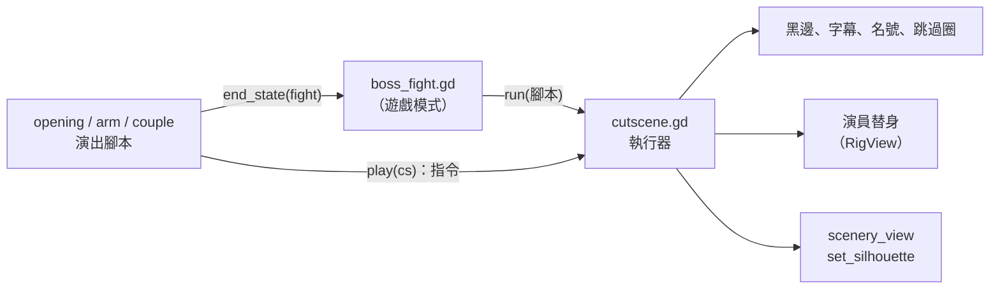

# MV-SLICE-001c2a 過場機制與 nance 樹的演出

更新時間：2026-10-14

## 基本資訊

| 項目 | 內容 |
|------|------|
| 分支 | `feature/MV-SLICE-001c2a_過場機制與nance演出`（從 `develop` `00a0cbc` 開） |
| 影響範圍 | `game/`：新增 `world/cutscene/`（執行器、三段演出腳本）與 `--cutscene` 開發參數；`core/boss/boss_fight.gd` 在遊戲模式改播演出；`world/scenery_view.gd` 加剪影模式；`ui/pause_menu.gd` 演出中不開；`game/rig/twin_anims.json`、`sevenmacaw_anims.json` 加新動作 |
| 上層 | [MV-SLICE-001 總規格](MV-SLICE-001_垂直切片.md)：c2 Boss 過場拆成 c2a（本文件）→ c2b 宮殿演出 → c2c 覺醒、結尾與通關存檔 |
| 前置 | MV-SLICE-001c1（已合併） |
| 設計依據 | [MV-BOSS-001](../../docs/design/MV-BOSS-001_SevenMacaw設計.md) 第 5 節（BOSS-3、BOSS-7a、BOSS-9d） |
| 引擎 | Godot 4.7.2 |
| 狀態 | ✅ Brian 2026-10-14 看影片後同意合併 |

## 背景與目的

垂直切片是作品集展示用（SLICE-1）。Seven Macaw 戰的劇情目前全部是全螢幕文字卡（灰盒時期的代替品，MV-BOSS-001「灰盒範圍」）。c2 把它們換成引擎內的正式演出；c2a 先做所有演出共用的過場機制，以及 nance 樹的三段：開場、斷臂、轉場。

## 盤點（2026-10-14，AI 實查）

| 段落 | 現在 | 觸發與結果（不改） |
|---|---|---|
| 開場 | `boss.play_intro()`：飛到低枝、下顎微亮吃果子、飛回樹冠；角色被鎖住；沒有字、沒有名號 | 第一次進 nance 場地（`intro_seen` 為 false）；之後 `_start_fight()` |
| 斷臂 | 文字卡 `arm` | 第 1 段設局成功（`_on_setup(1)`）；結束後 `phase = 2`、胡納普斷臂、`lights_removed = 1` |
| 轉場 | 文字卡 `couple` → 角色出現在小路起點、老夫婦跟在後面 | 接在 `arm` 後；之後 `stage = APPROACH`，走到宮殿門口開第 2 段 |

- 文字卡顯示時用 `world.process_mode = DISABLED` 凍結戰場。
- 雙胞胎在遊戲裡一次只顯示一人（Tab 換人）；骨架 `rig_view.set_arm_visible(false)` 可以隱藏近側手臂（斷臂狀態已用）。
- 暫停鍵按下就開暫停選單（`ui/pause_menu.gd`）。
- 宮殿後牆圖（`bg_palace_back_01.png`）畫了一堆火，上方垂著一條繩子（世界座標約 x 14712，繩結 y 約 720，火約 y 760～880；實作時量）。
- 動作檔已有：Seven Macaw `fly`、`eat`、`spread`、`fall`、`down`、`wail`、`idle_*`；雙胞胎 `run`、`idle`、`jump_up`、`fall`、`land`、`hurt`；老人 `idle`、`walk`；奇瑪瑪特 `idle`。

## 定案（Brian，2026-10-14）

| ID | 議題 | 定案 | 理由 |
|---|---|---|---|
| SLICE-c2-1 | 呈現方式 | 引擎內演出：骨架在場景裡演、鏡頭不切 | 和設計文件一致；不用新美術；和戰鬥畫面同一種風格 |
| SLICE-c2-2 | 拆法 | 依場地拆三塊：c2a 機制＋nance 三段 → c2b 宮殿三段 → c2c 取回手臂與覺醒、結尾、通關存檔 | 每塊都能從頭玩到尾、各自影片驗收；機制在第一塊就被真實使用 |
| SLICE-c2-3 | 對話呈現 | 電影字幕＋上下黑邊（示意畫面 C）：說話者名字放前面，旁白不加名字 | 一看就知道「過場、不能操作」；最像影片，適合作品集 |
| SLICE-c2-4 | 剪影樣子 | 逆光剪影（示意畫面 A）：暖色漸層底，場景退成深淺不同的棕色層，角色純黑 | 像皮影戲、不見血；和原典故事感最搭 |
| SLICE-c2-5 | 跳過 | 長按暫停鍵（Esc／手把 Start）1 秒跳整段；畫面角落顯示進度小圈；第一次看也能跳 | 不會誤觸；重玩、展示友善 |
| SLICE-c2-6 | 換句 | 自動換句（每字約 0.12 秒、至少 1.5 秒），攻擊鍵可提前 | 演出連續像影片；錄展示影片不用按鍵 |
| SLICE-c2-7 | HUD | 演出時淡出、結束淡回 | 畫面乾淨 |
| SLICE-c2-8 | 文字卡 | `arm`、`couple` 改成演出（遊戲模式）；`toothache`、`teeth`、`death`、`awaken`、`clear` 留給 c2b、c2c | 每塊做完都能從頭玩到尾 |
| SLICE-c2-9 | 開場旁白 | 加一句原典旁白 | 沒讀過原典的人也看得懂「埋伏」 |
| SLICE-c2-10 | 埋伏 | 雙胞胎自動走進前景草叢、蹲下；他展翅時跳出來 | 原典 p.82 的埋伏畫面 |
| SLICE-c2-11 | 名號 | 畫面中央大字名號＋一行稱號，約 1.5 秒 | Boss 登場的經典做法 |
| SLICE-c2-12 | 剪影範圍 | nance 樹那幾幕全程剪影；切到宮殿恢復正常顏色 | 暴力的部分全部是剪影；宮殿安靜，也先讓玩家看到第 2 段的場地 |
| SLICE-c2-13 | 扯下手臂 | 看得到動作：撲抓 → 他叼住一扯 → 手臂留在他嘴上、胡納普跌坐 | 只有輪廓、沒有血，但看得懂 |
| SLICE-c2-14 | 台詞 | 照現在文字卡的句子拆成字幕，不改字；新寫的只有開場旁白與稱號 | 文字卡已對過 Christenson p.82～84 |
| SLICE-c2-15 | 轉場地點 | 小路起點：老人站在路邊，兄弟走過去 | 直接接上現有的「帶老人走到宮殿門口」 |
| SLICE-c2-16 | 轉場說話者 | 胡納普、希巴拉克各一句 | 原典是「他們說」，兩人都參與 |
| SLICE-c2-17 | 程式做法 | 腳本式時間軸：每段演出一支腳本，呼叫共用的可 await 指令 | AI 寫、改、測都直接；跳過與看完停在同一個結果 |

## 範圍

### 過場機制

- 只有遊戲模式（`boss_fight` 的 `gs != null`）播演出；原型模式照舊（`play_intro`、文字卡）。
- **執行器**（`world/cutscene/cutscene.gd`，掛在 Boss 戰底下）：
  - 開始：上下黑邊各約畫面高 11%、0.4 秒滑入；HUD 淡出；角色不吃輸入；戰場暫停（Boss 不跑 AI、造物與招式不動、受不到傷害）；暫停選單不開。
  - 結束：反向還原，交還操作。
  - 指令（都可 `await`）：`narrate(句子)`、`say(說話者, 句子)`、`wait(秒)`、`walk(演員, x)`、`fly(演員, 位置)`、`play(演員, 動作)`、`fade_to_black(秒)`／`fade_in(秒)`、`silhouette(開／關)`、`title(名號, 稱號)`。
  - 字幕：畫面下方黑邊上緣置中，白字黑描邊；說話者名字以金色接在前面（「奇瑪瑪特：」），旁白不加名字。停留 `max(1.5, 0.12 × 字數)` 秒後自動換句；攻擊鍵提前換（每句至少顯示 0.3 秒，避免狂按一次跳過好幾句）。
  - 跳過：演出中按住暫停鍵，畫面右下角的小圈 1 秒填滿 → 剩下的指令立刻完成，套用該段的結束狀態。放開就歸零；短按什麼都不做。
- **演出腳本**（`world/cutscene/opening.gd`、`arm.gd`、`couple.gd`）：`play(執行器)` 依序呼叫指令；`end_state(戰鬥)` 設定演出後的遊戲狀態。看完與跳過都會跑 `end_state`。
- **演員替身**：演出時真正的玩家、Boss、老人隱藏並暫停；腳本操作骨架替身（雙胞胎兩人同時上場）。Boss 替身掛 c1 的光源光暈（`LightFx`）。結束時移除替身。
- **剪影**（`scenery_view.set_silhouette(on)`，不用 shader）：場景後面加暖色漸層底（上 `#faaa5a` 附近、下 `#f0e6aa` 附近，依 SLICE-c2-4 示意圖），各圖層的 `modulate` 換成黑色＋不同透明度（遠景約 0.35、中景約 0.6、地面與前景約 0.85）；替身骨架 `modulate` 純黑。關閉時還原。
- **開發參數** `--cutscene opening|arm|couple`（只在開發版）：直接擺好該段的前置狀態並播放；可加 `--frames <資料夾>`（配 `--fixed-fps 30`）逐格輸出 1920×1080 JPG，錄驗收影片。

### 三段演出

旁白與台詞除標「新」者外，皆為現有文字卡原句。

**開場**（第一次越過 nance 入口；約 9 秒）

1. 黑邊滑入；雙胞胎自動走進前景草叢、蹲下（`crouch`）。
2. 旁白（新，依 p.82）：「七金剛鸚鵡每天飛到 nance 樹上吃果子。兄弟倆躲在樹下的葉叢裡，等著他。」
3. 他從畫面上方飛到低枝（`fly`），吃果子（`eat`），下顎微亮約 1.5 秒。
4. 他察覺有人、展翅（`spread`）；雙胞胎跳出草叢（`jump_up` → `land`）。
5. 畫面中央淡入大字「七金剛鸚鵡」與一行稱號（新，依原典他自誇是太陽與月亮）「自稱是太陽，也是月亮」，約 1.5 秒後淡出。
6. 他飛回樹冠；黑邊收起；開打（Boss 血條出現）。
- 結束狀態：`intro_seen = true`；Boss 在樹冠、光源熄滅；玩家站在開場結束的位置、目前操作的是進場前那一位。

**斷臂**（第 1 段設局成功；約 20 秒）

1. 進入剪影。他從樹上摔落地面（`fall` → `down`）。旁白：「七金剛鸚鵡大叫一聲，從樹頂摔落地面。」
2. 胡納普衝上前撲抓（`run` → `lunge`）；他叼住手臂一扯（`yank`），手臂（胡納普近側手臂的分件拼成）留在他嘴上；胡納普跌坐（`knocked_down`，近側手臂隱藏）。旁白：「胡納普衝上前去抓他，卻被他扯下了手臂。」
3. 他捧著下顎（`wail`）、叼著手臂飛出畫面（`fly`）。淡黑。
4. 宮殿，關閉剪影。他把手臂掛到火堆上方的繩子上（`hang`）；奇瑪瑪特站在寶座旁。
   - 旁白：「他捧著下顎回到家中，把手臂掛在火上。」
   - 奇瑪瑪特：「你帶了什麼回來？」
   - 七金剛鸚鵡：「兩個騙子射了我。這條手臂就掛在這裡，等他們來拿回去。」
5. 淡黑，接轉場（同一次演出，不交還操作）。
- 結束狀態（同現在 `_on_setup(1)` 的結果）：`phase = 2`、`lights_removed = 1`、胡納普斷臂；**宮殿的繩子上掛著手臂**：由狀態推得（`phase ≥ 2` 且未覺醒就掛著），不另外存檔；重試、讀檔也一樣，c2c 取回。

**轉場**（接在斷臂後；約 12 秒）

1. 小路起點淡入；兩位老人站在路邊，兄弟倆走過去（`walk`）。
2. 旁白：「兄弟倆去找兩位老人：一位頭髮全白，一位彎著腰。」
3. 胡納普：「請陪我們去七金剛鸚鵡那裡，取回我們的手臂。」
4. 希巴拉克：「我們跟在後面，就說是你們的孫子。」
5. 兩位老人：「好。」
6. 老人走到兄弟身後；黑邊收起，交還操作。
- 結束狀態（同現在 `couple` 卡之後）：角色在小路起點、老人跟隨（`couple_following`）、`stage = APPROACH`。

### 新動作（AI 寫成動作資料，不需要新美術）

| 角色 | 動作 | 用在 |
|---|---|---|
| 雙胞胎（兩人共用） | `crouch`（蹲伏，循環）、`walk`（循環）、`lunge`（撲抓，單次）、`knocked_down`（跌坐後停住，單次） | 開場、斷臂、轉場 |
| Seven Macaw | `yank`（叼住一扯，單次）、`hang`（伸頭把東西掛上去，單次） | 斷臂 |

- 新動作照現有動作檔的格式與 12 fps；關節覆蓋檢查照 b2 的測試。
- 手臂道具：胡納普近側手臂的分件（上臂、前臂、手）拼成一組，掛在 Seven Macaw 嘴上（剪影時）或宮殿繩結上。

### 不做

- 宮殿三段（牙痛開場、換牙、死亡）→ c2b；取回手臂、覺醒、結尾、通關後存檔 → c2c；`toothache` 等其餘文字卡維持原樣。
- 聲音（d）、新美術、鏡頭移動或縮放。
- 戰鬥數值、判定、重試規則（過了第 1 段就是進度，斷臂與轉場不重播；開場只在第一次）。

## 架構

- `boss_fight` 在遊戲模式把 `play_intro`、`show_card("arm")`、`show_card("couple")` 換成 `await cutscene.run(腳本)`；原型模式不變。
- 跳過：執行器設 `skipped`，之後每個指令立刻 return；腳本跑完後一律呼叫 `end_state`。
- 演出中戰場暫停的做法沿用文字卡（`world.process_mode`），替身與執行器放在不受影響的節點底下。

## 自測（新增 `game/tests/test_cutscene.gd`）

1. 遊戲模式第一次進 nance 播 `opening`，之後 `intro_seen`；重試不播；原型模式照舊 `play_intro`。
2. 每段演出：看完與跳過的結束狀態相同（玩家位置與目前角色、Boss 位置與狀態、`phase`、`lights_removed`、胡納普斷臂、老人跟隨、`stage`、宮殿掛著手臂）。
3. 演出中：角色不吃輸入、受不到傷害；Boss 不出招；HUD 隱藏；暫停選單不開。
4. 字幕停留時間＝`max(1.5, 0.12 × 字數)`；攻擊鍵提前換句；說話者名字的格式。
5. 長按暫停鍵 1 秒跳過；按住不到 1 秒放開不跳、也不開暫停選單。
6. 剪影：開啟時替身純黑、場景圖層是黑色＋設定的透明度；關閉後還原。
7. 新動作存在於動作檔、每格關節覆蓋（沿用 b2 的檢查）。
8. 遊戲模式不再出現 `arm`、`couple` 文字卡；原型模式仍出現。
9. `--cutscene` 參數解析。
10. 全套自測照舊全過（目前 377 項＋新增），沒有 `SCRIPT ERROR`／`Parse Error`／`flushing queries`。

## 風險與退路

| 風險 | 退路 |
|---|---|
| AI 寫的撲抓、扯手臂動作不自然 | 剪影只看輪廓、細節不明顯；影片抽格修正；仍不行就把扯下的瞬間改成黑幕帶過（SLICE-c2-13 的備案） |
| 前景草叢遮不到蹲著的雙胞胎 | 調整蹲的位置；或在草叢位置加一個前景草叢分件（用既有前景圖裁切） |
| 演出比設計文件長（開場約 9 秒） | 自動換句的係數可調；能跳過 |
| 替身和真實節點切換時位置跳動 | 結束狀態依腳本最後一幀的替身位置設定；測試 2 比對 |
| 演出中按暫停鍵和暫停選單衝突 | 演出中暫停選單不開，暫停鍵只用來跳過；測試 5 |

## 驗收標準

實作完成（AI）：

- [x] 自測全部通過（377 項＋新增），沒有 `SCRIPT ERROR`／`Parse Error`／`flushing queries`；`import_art.py --check`、`import_rig.py --check` 結束碼 0
- [x] `--shots` 每個畫面平均 60 fps
- [x] 用 `--cutscene` 錄三段演出的影片（彩色），AI 抽格看黑邊、字幕、剪影、名號、斷臂動作、宮殿掛手臂、轉場

驗收（Brian）：

- [x] 看影片：三段演出的樣子與節奏（Brian 2026-10-14 看過、同意合併）
- [ ] 手把試玩：從 nance 篝火打到宮殿門口，看完與跳過各一次（未另外回報）

## Git Commit

分支 `feature/MV-SLICE-001c2a_過場機制與nance演出`（從 `develop` `00a0cbc` 開）：

| Commit | 內容 |
|---|---|
| `fc04e03`、`ba08bce` | 規格書、實作計畫（c2 拆成 c2a～c2c） |
| `854ee3a` | Task 1：過場執行器（黑邊、字幕、名號、長按跳過、凍結戰場） |
| `0d90564` | Task 2：替身、手臂道具、逆光剪影 |
| `8697dae` | Task 3：6 個新動作 |
| `b434885` | Task 4：開場 |
| `8c169e3` | Task 5：斷臂與轉場、宮殿掛著手臂 |
| `038093a` | Task 6：`--cutscene`、影片、文件；字幕移進黑邊、斷臂與宮殿的走位修正 |
| 最終審查修正 | 交還操作不再出現兩組角色、鏡頭不跳；按鍵不穿透改用跳躍測試（commit 見 git log） |

驗證（2026-10-14，最終審查修正後）：自測 400／0、`SCRIPT ERROR`／`Parse Error`／`flushing queries` 0；兩個 `--check` 結束碼 0；unittest 38 項 OK；`--shots` 11 個畫面 16.16～16.32 ms；影片 `assets-test/c2a_video/`（1920×1080、30 fps：開場 388 格、斷臂＋轉場 969 格、轉場 429 格，完整解碼無誤）。
