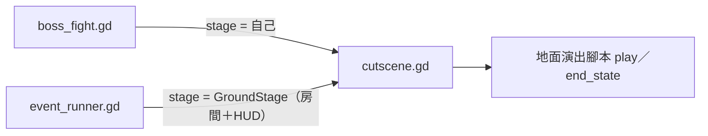

# MV-SLICE-001c3a 地面事件演出

更新時間：2026-10-19

## 基本資訊

| 項目 | 內容 |
|------|------|
| 分支 | `feature/MV-SLICE-001c3a_地面事件演出`（從 `develop` `96229a7` 開） |
| 影響範圍 | `game/world/cutscene/cutscene.gd`（`fight` 改成通用的「舞台」）、`game/world/cutscene/` 新增 5 段地面演出腳本、`game/events/event_runner.gd`、`field_clearing.gd`、`night_rat.gd`、`gear_drop.gd`、`game/world/rooms/field.gd`（只供演出的灌木）、`game/world/game_world.gd`（`STORY_FLAGS`）、必要時 `game/world/prop.gd`、`game/world/room.gd`（夜晚、祖母） |
| 上層 | [MV-SLICE-001 總規格](MV-SLICE-001_垂直切片.md)：c3 拆成 c3a 演出（本文件）→ c3b 素材與動作 |
| 前置 | MV-SLICE-001c2a～c2c（過場系統：黑邊、替身、字幕、長按跳過）、MV-SLICE-001b2b2（祖母、老鼠的骨架） |
| 設計依據 | [MV-DESIGN-002 原典核對](../../docs/design/MV-DESIGN-002_原典核對.md) 第 4、5 項；繪本後篇第 9 張「老鼠與球具」（[MV-BOOK-003](../../docs/book/MV-BOOK-003_繪本後篇文本.md)） |
| 引擎 | Godot 4.7.2 |
| 狀態 | ✅ 完成：影片與手把試玩通過（Brian 2026-10-19），合併：[PR #25](https://github.com/isbrian/Game-Popol-Vuh-Metroidvania/pull/25) |

## 背景與目的

地面的三個事件（開墾田地、入夜抓老鼠、球具掉下）在 MV-SLICE-001a 只做了玩法和文字卡：清完田地 3 秒後跳卡入夜、網子罩住老鼠後跳卡、回家跳卡後球具直接掉下。c2 已經為 Boss 段落做好過場系統。c3a 讓地面房間也能用這套系統，把三個事件的文字卡換成有角色動作的短過場，並放進原典的「工具自己工作」「動物讓田地復原、抓斷尾巴」。畫面先用現有骨架與佔位，正式素材留給 c3b。

## 盤點（2026-10-19，AI 實查）

- 事件排程 `events/event_runner.gd`：每次換房依旗標掛事件節點（掛在房間下，換房時一起釋放）；`show_card(text)` 顯示文字卡並鎖住角色；撿起 `gear` 時給球具與老鼠技能、發 `gear_picked`。
  - 田地：沒有 `field_cleared` → `FieldClearing`；有 `field_cleared`、沒有 `rat_caught` → `NightRat`。
  - 祖母家：沒有 `intro_seen` → 開場旁白卡；有 `rat_caught`、沒有 `gear_obtained` → `GearDrop`。
- `field_clearing.gd`：田裡 3 叢灌木（斧頭）、3 個土塊（掘棒）在 x 1900～2900；全清 → `field_cleared`，3 秒後 `runner.start_night()`。斧頭、掘棒在 x 900、1250。田地 2 個畫面寬、右門通祖母家。
- `night_rat.gd`：文字卡 → `_tint(true)`（有場景時 `scenery.night`）→ 灌木與土塊放回來（只是背景）→ 老鼠在田中央；角色靠近 300 內就往反方向跑（跑速 ×1.1），到左右牆邊 110 內 → 網子 → 文字卡 → `rat_caught` → 恢復白天。
- `gear_drop.gd`：文字卡 → 球具從繩子位置（`rope` 道具，x 930、y 420）0.5 秒掉到地上 → 變成可撿的 pickup → 撿起後文字卡「第二天早上」→ `gear_obtained`。
- 過場系統 `world/cutscene/cutscene.gd`：透過 `fight` 讀 `player`、`boss`、`world`、`scenery`、`camera`、`hud`、`player.twins[0].arm_broken`；`run(段落們)` 依序 `play(cs)`、交還時呼叫每段 `end_state(fight)`；指令有 `narrate`、`say`、`spawn`、`walk`、`fly`、`together`、`wait`、`fade_to_black`、`fade_in`、`animate`、`conceal`、`show_layer`、`view`、`silhouette` 等；長按暫停鍵 1 秒跳過。由 `core/boss/boss_fight.gd` 建立。
- 現有骨架與動作：雙胞胎 27 個（含 `walk`、`run`、`interact`、`lunge`、`crouch`、`dart`、`tool_cast` 等）；老鼠 `idle`、`run`；祖母 `idle`、`give`。沒有鹿、兔子等動物。
- 祖母家有祖母的骨架（`room.npc_anim`，x 1150）；`scenery_view.gd` 有 `night`（整個場景圖層變暗）。

## 定案（Brian，2026-10-19）

| ID | 議題 | 定案 | 理由 |
|---|---|---|---|
| SLICE-c3-1 | 演出形式 | 沿用 c2 的過場系統（黑邊、替身、字幕、長按跳過）擴充到地面房間 | 和 Boss 段落風格一致，作品集影片好看 |
| SLICE-c3-2 | 原典細節 | 中等：工具自己工作＋動物讓田地復原；不演支開祖母 | 看得出原典的味道，動物用剪影不必新畫骨架 |
| SLICE-c3-3 | 抓老鼠 | 保留「趕到牆角」的追逐，網子罩住後接過場 | 玩法和演出各管一段 |
| SLICE-c3-4 | 拆法 | c3a 演出（佔位）→ c3b 素材與動作 | 同 c4c 的拆法 |
| SLICE-c3-5 | 工具自己工作 | 玩家照舊手動清完 6 個（保留斧頭、掘棒與換武器教學）；過場裡兄弟倆把工具插好，工具自己清完田的另一半 | 保留教學，又放進原典 |
| SLICE-c3-6 | 尾巴 | 演：兄弟倆撲上去只抓到鹿和兔子的尾巴，旁白說明牠們的尾巴從此很短 | 原典的趣味點，年齡層合適 |
| SLICE-c3-7 | 說出祕密 | 在田裡交換時就說出球具在屋頂下 | 貼原典；玩家知道為什麼要回家 |
| SLICE-c3-8 | 台詞 | 旁白為主；只有老鼠用名字開口（`say("老鼠", …)`）；雙胞胎不開口 | 同 Boss 段落的旁白風格，交換這段有角色感 |
| SLICE-c3-9 | 祖母 | 球具掉下時祖母睡著 | 代替原典的「支開祖母」；夜裡合理 |
| SLICE-c3-10 | 夜晚 | 抓到老鼠後田地與祖母家都維持夜晚，撿起球具後演天亮 | 時間線一致 |
| SLICE-c3-11 | 拿球具 | 過場演到球具落地就交還，玩家自己撿 | 拿到的當下是玩家做的；提示照舊 |
| SLICE-c3-12 | 長度 | 每段約 15～25 秒（天亮約 6 秒） | 約等於 Boss 段落開場；第二次可長按跳過 |
| SLICE-c3-13 | 架構 | 過場的 `fight` 改成通用的「舞台」：`boss` 可為 null，地面用房間自己的玩家、場景、鏡頭，HUD 從遊戲本體拿 | 改動最小；跳過、黑邊、字幕全部沿用；Boss 段落行為不變 |

## 範圍

### 舞台（`cutscene.gd`）

- 把 `fight` 改名為 `stage`（duck typing）：`player`、`boss`（可為 null）、`world`（凍結的節點）、`scenery`（可為 null）、`camera`、`hud`（可為 null）。Boss 戰傳自己；地面傳一個小物件，從房間與遊戲本體組出來。
- `boss` 為 null 時不藏、不還原 Boss；`scenery` 為 null 時（灰盒房間）不設處理模式、剪影改調房間顏色。斷臂判斷只在 `player` 有 `twins` 時做。
- 演出腳本的 `end_state(stage)` 拿到同一個物件；Boss 段落的腳本內容不改。
- 事件排程把過場節點掛在房間下（換房時一起釋放）；演出中暫停選單不開、長按暫停鍵 1 秒跳過，同 c2。

### 五段演出（`world/cutscene/` 新檔）

| 段落 | 時機 | 內容 | `end_state` |
|---|---|---|---|
| 收工 `field_dusk.gd` | 田地 6 個都清掉 | 兄弟倆走到田邊，斧頭插在樹上、掘棒插進土裡；田的左半（只供演出的灌木，x 約 300～800）一叢一叢被工具清掉；兄弟倆拿吹管往外走去打獵；天色轉暗入夜。約 20 秒 | `field_cleared`；田地入夜 |
| 動物復原 `field_animals.gd` | 緊接收工；或之後進田地時還沒看過 | 夜裡，動物剪影跑過田地，灌木、土塊一個個長回來；兄弟倆撲上去，只抓到鹿和兔子的尾巴（尾巴剪影留在手上，動物跑掉）；旁白說明牠們的尾巴從此很短；剩下老鼠在田中央。約 20 秒 | `night_seen`；灌木、土塊在、老鼠在田中央；交還後開始追 |
| 交換 `rat_deal.gd` | 網子罩住老鼠 | 老鼠開口求饒、提出交換；兄弟倆拿出玉米、豆子、可可（佔位小圖形）；老鼠說出「你們父親的球具，就掛在家裡的屋頂下」；網子拿開，老鼠往祖母家跑走。約 20 秒 | `rat_caught`；田地維持夜晚；老鼠與網子移除 |
| 咬繩 `gear_rope.gd` | 夜裡進祖母家（有 `rat_caught`、沒有 `gear_obtained`） | 祖母睡著（待機姿勢＋「Zzz」佔位）；老鼠跑進來爬上屋梁、咬繩子；繩子斷，球具掉到地上。約 15 秒 | 球具變成可撿的 pickup（`gear_dropped`，見下） |
| 天亮 `morning.gd` | 撿起球具 | 淡出 → 旁白「第二天早上，兄弟倆出發了。」→ 祖母家變回白天、祖母醒著 → 淡入。約 6 秒 | `gear_obtained`；白天 |

- 文字與台詞照 SLICE-c3-8 寫在各腳本的常數（沿用現有文字卡的內容：夜裡動物復原、老鼠用食物交換、球具在屋頂下、第二天早上），實作時定稿，Brian 看影片時可改。
- 佔位外觀（c3b 會換）：動物剪影用深色程式圖形（鹿、兔子、其他小動物的輪廓）；尾巴是小剪影；食物是小圓形；插好的斧頭、掘棒用現有武器的圖；祖母的「Zzz」用文字。
- 替身沿用現有動作：走 `walk`、撲 `lunge`、插工具 `interact`、拿吹管 `dart` 的起手；老鼠 `run`、`idle`；祖母 `idle`。爬繩、咬繩用位移與小幅抖動代替（c3b 補動作）。

### 事件與旗標

- `field_clearing.gd`：全清後改成跑「收工＋動物復原」兩段（一次 `run`），不再 3 秒後跳卡。
- `night_rat.gd`：
  - 進田地時有 `field_cleared`、沒有 `rat_caught`：田地入夜、灌木與土塊在、老鼠在田中央；沒有 `night_seen` 時先跑「動物復原」。
  - 追逐規則不變（300 px、×1.1、牆邊 110）；網子罩住後跑「交換」，不再跳卡。
  - 中途死亡或離開：事件跟著房間釋放、旗標沒設，再進來就是夜裡的追逐（不重播動物復原）。
- `gear_drop.gd`：進祖母家時有 `rat_caught`、沒有 `gear_obtained`：祖母家入夜；沒有 `gear_dropped` 時跑「咬繩」，有的話球具已經在地上可撿；撿起後跑「天亮」。
- 新旗標：`night_seen`（動物復原看過）、`gear_dropped`（球具已掉在地上；中途離開再回來不重播咬繩）。寫進 `game_world.gd` 的 `STORY_FLAGS`（`--room` 除錯用），舊存檔沒有這兩個旗標時照「沒看過」處理。
- 祖母睡著：咬繩到天亮之間祖母播待機、上方畫「Zzz」；這段期間按互動不開兌換（祖母睡著）。
- 夜晚：田地從 `field_cleared` 到 `gear_obtained` 前、祖母家從 `rat_caught` 到 `gear_obtained` 前都是夜晚（`scenery.night`；灰盒房間調整個房間顏色，同現在的 `_tint`）。

### 不做

- 開場旁白卡（`intro_seen`）、聲音（d 階段）、正式素材與新動作（c3b）。
- 原典的辣醬倒影、蚊子弄破水罐支開祖母（SLICE-c3-2）。
- 追逐的數值與規則。

## 自測

1. 舞台：Boss 段落的既有過場測試全過；`boss`、`scenery`、`hud` 為 null 時 `run` 正常、不報錯。
2. 收工＋動物復原：清完 6 個 → 過場開始；看完與跳過後 `field_cleared`、`night_seen` 都有、田地是夜晚、灌木與土塊在、老鼠在田中央、玩家可以操作。
3. 重新進田地：有 `night_seen` 時不重播，直接夜裡追逐；沒有時先播動物復原。
4. 交換：老鼠被趕到牆角 → 網子 → 過場；看完與跳過後 `rat_caught` 有、老鼠與網子移除、田地維持夜晚。
5. 咬繩：抓到老鼠後進祖母家 → 夜晚、祖母睡著、過場；看完與跳過後球具在地上可撿、`gear_dropped` 有；離開再回來不重播、球具還在；睡著時互動不開兌換。
6. 天亮：撿起球具 → 過場；看完與跳過後 `gear_obtained` 有、祖母家白天、祖母醒著；拿到球具與老鼠技能、提示照舊。
7. 交還：每段結束後替身移除、真正的玩家顯示、鏡頭回到玩家、按鍵不穿透。
8. 全套自測全過（基準 570＋新增），沒有 `SCRIPT ERROR`／`Parse Error`／`flushing queries`；`import_art.py --check`、`import_rig.py --check` 結束碼 0。

## 風險與退路

| 風險 | 退路 |
|---|---|
| 把 `fight` 改成舞台時動到 Boss 過場 | Boss 過場測試全跑；`--shots` 與 c2 的影片錄法再錄一次 Boss 開場抽格比對 |
| 地面房間凍結整個房間時，夜晚或祖母的骨架也停住 | 同 Boss 段落把場景設成照常處理；祖母骨架掛在場景或另外設處理模式 |
| 佔位的動物剪影太醜，影響驗收觀感 | 驗收時先看節奏與內容；外觀在 c3b 換 |
| 中途離開、死亡造成旗標與畫面不一致（例如球具重複掉） | 新旗標 `gear_dropped`、`night_seen`；自測 3、5 涵蓋 |

## 驗收標準

實作完成（AI）：

- [x] 自測全部通過，沒有 `SCRIPT ERROR`／`Parse Error`／`flushing queries`；`import_art.py --check`、`import_rig.py --check` 結束碼 0（試玩修正後 588 項：570＋新增 18）
- [x] `--shots` 每個畫面平均 60 fps（33 個畫面 16.17～16.38 ms）
- [x] 五段演出的影片（`assets-test/c3a_video/`），AI 抽格檢查替身位置、字幕、夜晚與天亮：`field.mp4`、`deal.mp4`、`rope.mp4`、`morning.mp4`、`c3a_all.mp4`、抽格 `c3a_frames.jpg`；抽格時發現交還時玩家跳回過場前的位置，已改成接在替身最後的位置

驗收（Brian）：

- [x] 看五段演出的影片（節奏、台詞）——2026-10-19「影片可以」
- [x] 手把試玩：從新遊戲走到拿到球具（含中途離開田地、死亡再回來）——2026-10-19「整體遊玩體驗不錯」；試玩紀錄的物理錯誤已修（進房間就播的過場先跑一個物理幀）

## Git Commit

分支 `feature/MV-SLICE-001c3a_地面事件演出`（從 `develop` `96229a7` 開）：

| Commit | 內容 |
|---|---|
| `86d8834` | 規格書 |
| `3abe04d` | 實作計畫 |
| `8510084` | Task 1：過場的 host 與地面舞台 |
| `b73d8a3` | Task 2：收工、動物復原、夜晚 |
| `f648492` | Task 3：交換、咬繩、天亮 |
| `3b896f1` | Task 4：交還位置、錄影、截圖、README |
| `c9a3edf`、`f3cec68` | 最終審查修正：演出灌木改在收工過場開始時才放；文件 |
| `899e479`＋文件 commit | 試玩修正：進房間就播的過場先跑一個物理幀再凍結房間 |
