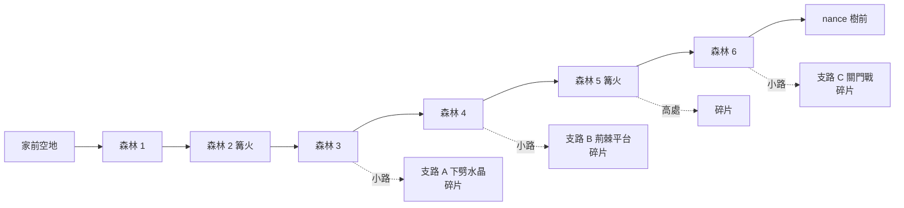

# MV-SLICE-001c4a 森林加大加深與血量碎片

更新時間：2026-10-15

## 基本資訊

| 項目 | 內容 |
|------|------|
| 分支 | `feature/MV-SLICE-001c4a_森林與藏點`（從 `develop` `bfdc207` 開） |
| 影響範圍 | `game/`：`world/rooms/`（改寫 `forest_1`～`forest_4`，新增 `forest_5`、`forest_6`、三間支路）、`world/rooms/index.gd`、`world/room.gd`（新元素）、`core/level/`（荊棘地形、關門戰）、`state/game_state.gd`、`state/loadout.gd`（血量上限）、`ui/hud.gd`（半格）、`ui/hints.gd`（下劈提示）、`world/scenery_view.gd`（荊棘地形、支路路標）；新增素材工單 MV-ASSET-017 |
| 上層 | [MV-SLICE-001 總規格](MV-SLICE-001_垂直切片.md)：內容量子專案（SLICE-c-2）拆成 c4a（本文件）→ c4b 覺醒後回頭開路 → c4c 新敵人 |
| 前置 | MV-SLICE-001c2c（已合併） |
| 設計依據 | [VISION](../../VISION.md) 6.2（下劈彈跳、每房 1～4 隻）、6.3（地圖藏點 → 血量碎片；全收集約初始 2 倍）、6.7（休息點）；[MV-SLICE-001a](MV-SLICE-001a_地面關卡與系統.md) 房間系統與存檔 |
| 引擎 | Godot 4.7.2 |
| 狀態 | ✅ Brian 2026-10-15 指示合併回 `develop` |

## 背景與目的

子專案 a 灰盒驗收的通關時間約 10 分半，目標約 30 分（SLICE-c-2）。森林只有 4 間平地房、敵人約 9 隻、一個可可豆藏點，是最薄的一段。c4a 把森林加到 9 間，加入下劈彈跳、荊棘、關門戰等平台與戰鬥挑戰，並照 VISION 6.3 用藏點給血量碎片，讓探索有回報。全部沿用現有場景素材，只有兩件新美術開小工單。

## 盤點（2026-10-15，AI 實查）

- 森林 1～4：每間 2 個畫面寬（3840 px）、一個畫面高（1080）、平地；森林 3 有一個單向平台與可可豆藏點（10 顆）；森林 2 有篝火；敵人合計 9 隻（爬行型、飛行型）。
- 房間資料（`world/rooms/kit.gd`）：外框、門（左右邊緣）、平台、篝火、藏點、敵人、拾取物、觸發區、閘門；`room.gd` 依資料建房間。場景只支援水平捲動。
- 下劈水晶：`core/level/pogo_crystal.gd` 已有（受擊框在 `POGO` 層，下劈打中會彈起），沒有用在任何房間，外觀是程式畫的菱形。
- 荊棘：只有「擋路的閘門」（`prop_thorns_wall.png`，`gear_obtained` 後消失），沒有會扣血的荊棘。
- 血量上限 `max_hp` 5；存檔 `valid_state` 要求每個欄位都存在（新增欄位會讓舊存檔讀不到）；`stashes_taken` 是已存檔的字典。
- 按鍵提示 `ui/hints.gd`：第一次需要時出現、做到就消失並存進 `hints_seen`。

## 定案（Brian，2026-10-15）

| ID | 議題 | 定案 | 理由 |
|---|---|---|---|
| SLICE-c4-1 | 內容量怎麼補 | 森林加大加深、藏點與血量碎片、覺醒後回頭開路、加一種敵人 | 惡魔城的主體是探索、房間戰鬥與能力門 |
| SLICE-c4-2 | 拆法 | c4a 森林＋碎片 → c4b 覺醒後回頭開路 → c4c 新敵人（中型反光）；ID MV-SLICE-001c4 | c4a 全用現有素材、補最多時間；c4c 要等美術 |
| SLICE-c4a-1 | 規模 | 9 間：主路 6 間（現有 4 間改寫＋2 間新）＋支路 3 間；每間 2～3 個畫面寬；約 +10 分 | c4b、c4c 再補約 5 分 |
| SLICE-c4a-2 | 高度 | 維持一個畫面高，高低層次靠平台、高台、坑洞 | 場景只支援水平捲動 |
| SLICE-c4a-3 | 認路 | 主路一條線＋只有一間深的支路；不做地圖 | 陌生人不迷路 |
| SLICE-c4a-4 | 血量碎片 | 2 片加 1 格，切片放 4 片（5 → 7 格） | 30 分內拿得到兩次加血 |
| SLICE-c4a-5 | 挑戰元素 | 下劈彈跳水晶、荊棘地形（會扣血）、關門戰 | 教下劈；給跳躍代價；可選的戰鬥挑戰 |
| SLICE-c4a-6 | 篝火 | 主路中段（森林 5）再加 1 個 | 死了不用走太遠 |
| SLICE-c4a-7 | c4b 的鎖 | c4b 再放 | 鎖與回程是同一個設計問題 |
| SLICE-c4a-8 | 新美術 | 下劈水晶、血量碎片開小工單給 ChatGPT（MV-ASSET-017），到位前用程式佔位 | 符合美術分工、不卡程式 |
| SLICE-c4a-9 | 關門戰 | 支路盡頭 1 間、3 波（2、3、4 隻），獎勵 1 片碎片 | 可選、有明確回報、不擋主路 |
| SLICE-c4a-10 | 碎片位置 | 各綁一種玩法：關門戰、下劈水晶支路、荊棘平台支路、主路上要留意的高處；森林 3 的可可豆藏點保留 | 收齊＝每種玩法都碰過 |
| SLICE-c4a-11 | 碎片回饋 | 血條末端顯示半格；湊滿一格時血量補滿、提示「血量上限 +1」；寫進存檔 | 進度看得到、不加新介面 |
| SLICE-c4a-12 | 下劈教學 | 第一顆水晶在主路上、底下是安全地面，旁邊出按鍵提示，彈起一次就不再出現 | 陌生人不知道有下劈 |

## 範圍

### 森林配置

| 房間（資料檔） | 寬（畫面） | 內容 | 敵人 |
|---|---|---|---|
| 森林 1 `forest_1`（改寫） | 3 | 入門戰鬥；一個很淺的荊棘坑 | 2～3 |
| 森林 2 `forest_2`（改寫） | 3 | 篝火；第一顆下劈水晶在主路上、底下是安全地面、靠近時出提示 | 2 |
| 森林 3 `forest_3`（改寫） | 3 | 高低兩層平台；保留可可豆藏點（`forest_3`，10 顆）；右端高處通往支路 A | 3 |
| 支路 A `forest_a`（新） | 2 | 連續幾顆下劈水晶跨過荊棘坑 → 碎片 `frag_a` | 0～1 |
| 森林 4 `forest_4`（改寫） | 3 | 荊棘與平台交錯；右端高處通往支路 B | 3～4 |
| 支路 B `forest_b`（新） | 2 | 荊棘之間的窄平台跳躍 → 碎片 `frag_b` | 0～1 |
| 森林 5 `forest_5`（新） | 3 | 篝火；主路上方一個要留意才找得到的高台 → 碎片 `frag_d` | 2～3 |
| 森林 6 `forest_6`（新） | 3 | 綜合（水晶＋荊棘＋敵人）；右端高處通往支路 C | 3～4 |
| 支路 C `forest_c`（新） | 2 | 關門戰 → 碎片 `frag_c` | 3 波：2、3、4 |

- 主路的門在房間左右邊緣的地面（同現在）；支路的門在主路房間右端的**高處平台**上，進出都在同一側。
- 路標：主路的門用現有路標（`prop_waymark`）；支路的門用同一張圖縮小約 0.7 倍。
- 森林 6 的右門接到 Boss 段落（取代現在森林 4 的右門）；森林 4 的右門改接森林 5。
- 敵人只有爬行型、飛行型，主路每間 2～4 隻、合計約 25 隻；可可豆掉落規則不變。
- 具體座標由實作計畫與截圖校準；每間房的跳躍都要在現有跳躍高度（`jump_height` 400）與單跳範圍內，主路不需要下劈或二段跳就能通過（下劈只在支路 A 是必要的）。

### 新元素（房間資料欄位，`room.gd` 建出來）

| 欄位 | 內容 | 規則 |
|---|---|---|
| `crystals: Array[Vector2]` | 下劈水晶位置 | 沿用 `pogo_crystal.gd`：下劈打中就彈起。素材到位前沿用程式畫的菱形 |
| `hazards: Array[Rect2]` | 荊棘地形（矩形，貼地或坑底） | 碰到扣 1 格（有受傷無敵時間就不重複扣）；畫面淡黑約 0.3 秒，玩家回到「最後站穩的地面」（腳踩實心地面、且離荊棘至少一個身寬的位置）；扣到 0 格時照一般死亡回篝火。外觀：`prop_thorns_wall.png` 裁成低矮的一排、水平重複 |
| `arena: {rect, waves, reward}` | 關門戰 | 玩家整個進到 `rect` 才觸發；兩側升起荊棘牆（沿用閘門）；`waves` 依序生成，一波全清後 1 秒出下一波；最後一波清完荊棘牆收回、在 `reward.pos` 出現碎片 `reward.id`。中途死亡：回篝火、整場重置。碎片已取過時不觸發 |
| `fragment: {id, pos}` | 血量碎片 | 撿起寫進 `stashes_taken[id] = true`（id 以 `frag_` 開頭）；拿過不再出現 |
| `hint_at: {id, rect}` | 進到區域時請求按鍵提示 | 森林 2 的第一顆水晶用：提示 id `pogo`，文字鍵盤「空中 S＋攻擊 下劈（打中會彈起）」、手把「空中左搖桿下＋攻擊 下劈（打中會彈起）」；下劈彈起一次就算做到 |

### 血量碎片與血量上限

- 片數＝`stashes_taken` 裡以 `frag_` 開頭且為 true 的數量；血量上限＝`max_hp`（5）＋片數 ÷ 2（取整數）。由 `GameState` 提供（例如 `max_hp_now()`），Loadout 套到玩家身上。
- 撿起時（提示用浮字顯示在碎片位置，同可可豆藏點；實作依計畫）：片數為奇數 → 提示「血量碎片 1/2」；為偶數 → 血量上限 +1、血量補滿、提示「血量上限 +1」。
- HUD：血條末端在片數為奇數時多畫一個半格（素材到位前用程式畫的外框半格）。
- **存檔不加欄位、版本不變**：舊存檔照常讀得到；新房間 ID（含篝火 `forest_5`）加進 `world/rooms/index.gd`，可當讀檔位置。

### 美術工單 MV-ASSET-017（文件；生成由 Brian 用 ChatGPT）

| 件 | 規格要點 |
|---|---|
| 下劈水晶 | 假光結晶，懸空，約 90 px；可讀性：和背景對比清楚、一看就知道「可以打」；不發真光（符合假光主題） |
| 血量碎片 | 撿取物（約 64 px）＋血條用的半格與一格圖示（配合現有血條尺寸） |

- 四段式 prompt（角色、任務、限制、輸出格式），照 ART_SPEC 共通規則；素材到位後另開整合的小工作（換掉佔位，不改規則）。

### 不做

- 地圖、高房間（垂直捲動）、移動平台、新背景美術。
- 新敵人（c4c）；能力鎖與覺醒後回頭（c4b）；事件正式演出（c3）。
- 戰鬥數值、敵人行為、Boss 段落。

## 自測

1. 房間資料：每扇門都有對應的門（目的地門存在、回得來）；從家前空地走得到 9 間森林與 Boss 段落；三條支路都只有一扇門、各有一片碎片；全切片正好 4 片碎片（`frag_a`～`frag_d`）。
2. 主路通過性：主路每段落差不超過單跳高度、每個坑不超過單跳距離（由資料計算）；主路不需要下劈。
3. 血量碎片：0、1 片時上限 5；2 片時 6、血量補滿；4 片時 7；提示文字；寫進存檔、讀檔後一樣；舊格式存檔（沒有碎片紀錄）照常讀得到。
4. 荊棘：碰到扣 1 格、回到最後站穩的位置；無敵時間內不重複扣；扣到 0 格時死亡回篝火。
5. 水晶：下劈打中彈起；靠近第一顆時出現 `pogo` 提示，彈起一次後消失、記進存檔。
6. 關門戰：觸發時兩側關閉；3 波依序（2、3、4 隻）；清完開門、出現碎片；中途死亡重置；碎片拿過後不再觸發。
7. 篝火：森林 5 休息後存檔、讀檔回到森林 5。
8. `test_walkthrough`：從新遊戲經新主路打到結尾。
9. 全套自測照舊全過（目前 469 項＋新增），沒有 `SCRIPT ERROR`／`Parse Error`／`flushing queries`。

## 風險與退路

| 風險 | 退路 |
|---|---|
| 新房間版面跳不過去或太難 | 自測 2 用資料檢查落差與坑寬；截圖檢查；Brian 試玩後調座標（只改資料） |
| 荊棘「回到站穩的地面」把玩家放回危險位置（例如敵人旁邊） | 記錄點要求離荊棘一個身寬；被放回後有短暫無敵（沿用受傷無敵時間） |
| 關門戰與敵人重生、存檔交錯 | 關門戰狀態不存檔（只存碎片）；死亡、離開房間都重置 |
| 時間仍不足 30 分 | c4b、c4c 再補；c4a 驗收時計時，差距記進總規格 |

## 驗收標準

實作完成（AI）：

- [x] 自測全部通過（500 項：469＋新增 31），沒有 `SCRIPT ERROR`／`Parse Error`／`flushing queries`；`import_art.py --check`、`import_rig.py --check` 結束碼 0
- [x] `--shots` 加入新房間，每個畫面平均 60 fps（31 個畫面 16.15～16.31 ms）
- [x] 每間新房間與改寫的房間截圖（整間的縮圖，`assets-test/c4a_shots/`），AI 檢查平台、荊棘、水晶、門與路標的位置
- [x] MV-ASSET-017 工單文件寫好（[工單](../../docs/assets/MV-ASSET-017_素材工單_下劈水晶與血量碎片.md)）

驗收（Brian）：

- [ ] 看房間截圖：版面（Brian 2026-10-15 指示合併；觀看結果未另外回報）
- [x] 手把試玩：主路、三條支路（Brian 2026-10-16：不會迷路；支路 A 下劈水晶與地上荊棘的可讀性另開 MV-TUNE-004；主路敵人維持 19 隻、碎片提示維持浮字）；計時未另外回報

## Git Commit

分支 `feature/MV-SLICE-001c4a_森林與藏點`（從 `develop` `bfdc207` 開）：

| Commit | 內容 |
|---|---|
| `1b9be23`、`04e12e4` | 規格書、實作計畫 |
| `86970dc` | Task 1：血量碎片與血量上限 |
| `48dc30d` | Task 2：荊棘地形 |
| `348558e` | Task 3：下劈水晶與下劈提示 |
| `f1db072` | Task 4：關門戰 |
| `692bdbc` | Task 5：房間檢查工具與支路路標 |
| `bf4bbe0`、`a7cf98d` | Task 6：主路 6 間 |
| `fc86cfe` | Task 7：支路 3 間 |
| `00cb91f` | Task 8：素材工單、截圖、文件 |
| `620e51e` | 最終審查修正：荊棘放回不滑回、下劈提示插隊、預設出生在地面 |
| `093940b`＋結案 commit | 文件 |

驗證（2026-10-15，最終審查修正後）：自測 503／0、`SCRIPT ERROR`／`Parse Error`／`flushing queries` 0；兩個 `--check` 結束碼 0；unittest 38 項 OK；`--shots` 31 個畫面 16.15～16.30 ms。
