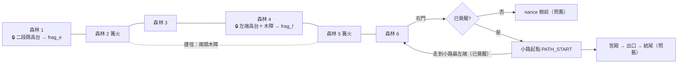

# MV-SLICE-001c4b 覺醒後回頭開路

更新時間：2026-10-15

## 基本資訊

| 項目 | 內容 |
|------|------|
| 分支 | `feature/MV-SLICE-001c4b_覺醒後回頭開路`（從 `develop` `c59d854` 開） |
| 影響範圍 | `game/`：`world/rooms/kit.gd`（左側高台與高門）、`world/rooms/forest_1.gd`、`forest_2.gd`、`forest_4.gd`、`forest_5.gd`（鎖）、`world/room.gd`（木障欄位）、`world/room_check.gd`（二段跳高度）、`core/boss/boss_fight.gd`（覺醒後的回程與提示）、`world/room_flow.gd`（覺醒後從森林 6 進 Boss 段落的出生點）；素材工單 MV-ASSET-017 加第 4 件 |
| 上層 | [MV-SLICE-001 總規格](MV-SLICE-001_垂直切片.md)：內容量子專案（SLICE-c-2）拆成 [c4a](MV-SLICE-001c4a_森林與藏點.md) → c4b（本文件）→ c4c 新敵人 |
| 前置 | MV-SLICE-001c4a（已合併 `c59d854`）、MV-SLICE-001c2c（已合併 `bfdc207`） |
| 設計依據 | [VISION](../../VISION.md) 6.3（地圖藏點 → 血量碎片）；c4a 定案 SLICE-c4a-7（鎖與回程是同一個設計問題，留到 c4b）；[MV-PROTO-002](MV-PROTO-002_換人與武器.md) 第 6 節木障規則 |
| 引擎 | Godot 4.7.2 |
| 狀態 | ✅ Brian 2026-10-16 驗收先通過、指示合併回 `develop`（PR #18） |

## 背景與目的

覺醒後玩家拿到二段跳（Hunahpu）與讓工具自己動（Xbalanque 的飛鏢標記木障、工具砍碎），但現在只能用來走出宮殿出口，用完就通關。惡魔城類型的回報是「拿到新能力後回頭，打開以前到不了的地方」。c4b 讓覺醒後能從小路走回森林，在現有主路房間裡放 3 個只有新能力打得開的鎖，後面是 2 片血量碎片與 1 條捷徑。預估補約 3～5 分鐘的可選遊玩。

## 盤點（2026-10-15，AI 實查）

- **Boss 段落是兩塊不相連的區域**：nance 區 x −100～6720（`Nance.REGION`，右牆 6720），小路＋宮殿區從 7800 起（`Palace.REGION`，左牆 7700～7800）；平常靠轉場演出接過去。`Palace.PATH_START` (8000, 900)、`Palace.REST` (9500, 900)、宮殿左緣 `Palace.LEFT` 14000。
- **回森林的出口只有一個**：第 1 段開打前從 nance 樹走到最左邊（`boss_fight.gd` `LEFT_EXIT_X` 0，`phase == 1` 才發 `left_exit`）→ 覺醒後完全回不了森林。`room_flow.gd` 把 `left_exit` 接到 `boss.gd` 的 `{"left_room": "forest_6", "left_door": "to_boss"}`。
- **從森林 6 右門進 Boss 段落**：`room_flow._swap` 的 `door_id != ""` 分支不呼叫 `begin_at_rest`，一律從 nance 篝火開始、`awakened` 不讀存檔；只有讀檔（`door_id == ""`）才走 `begin_at_rest`（覺醒後讀檔回宮殿篝火、已覺醒，c2c）。
- **能力**：二段跳只有 Hunahpu（`twin().can_double_jump`），第二跳高度＝`jump_height` 400 × `double_jump_ratio` 0.75＝300，合計約 700；讓工具自己動只有 Xbalanque（`can_send_tool`）。兩者都要 `player.abilities_enabled`，由 `Loadout` 設成 `gs.awakened`。
- **木障** `core/level/barrier.gd`：實心、擋路擋飛鏢；只有 Xbalanque 在 `abilities_enabled` 時的飛鏢能標記（`blowgun.gd` `marks_barrier`），工具砍碎後 `broken` 訊號；其餘攻擊只有悶響（`thudded`）。目前只用在宮殿出口（`palace_arena.gd`，外觀 `prop_palace_barrier.png`，`SceneryView.fill_vertical` 直向重複）。**房間資料沒有木障欄位**。
- **房間工具** `world/rooms/kit.gd`：c4a 已有右側版本——`ledge`（右端實心高台）、`door_branch`（高台上的門，路標 0.7 倍）、`door_right_under`（主路右門只到高台底下）；**沒有左側版本**。森林 2 右端沒有高台（右門是一般 `door_right`）；森林 5 左端是一般 `door_left`。
- **相關房間現況**：森林 1 有平台 (3700, 640)、飛行型 (3200, 450)；森林 2 有篝火、水晶 (2700, 640)、平台 (3300, 600)；森林 4 左端空著（平台在 2500、3350，飛行型 2000、4300）；森林 5 有篝火 (900)、碎片 `frag_d`。
- **下劈彈跳**：`pogo_velocity` 1700、重力 5000 → 彈高約 289 px。飛行型盤旋在玩家上方約 350 px（`flyer_hover_offset`），玩家離它出生點 1000 px 內才會追（`flyer_leash_range`）→ **在飛行型身上下劈，覺醒前就可能搆到離地 600 px 的高台**；爬行型、地面水晶彈不到。
- **房間檢查** `world/room_check.gd`：`walk_errors(d, from, to)` 用單跳的 `MAX_RISE` 340、`MAX_GAP` 400 判斷連通；`link_errors` 檢查每扇門都有對應的門。
- **提示**：`hud.notice` 是畫面下方的一行字；Boss 段落出口階段（`Stage.EXIT`）每幀用 `exit_notice()` 覆寫它。
- **血量碎片**：`gs.fragments()`、`gs.max_hp_now()`＝5＋片數 ÷ 2；碎片撿起寫 `stashes_taken[id]`；旗標 `gs.set_flag`／`has_flag` 存在 `flags`。兩者都已存檔，**不用加存檔欄位**。
- **自測基準**：503 項全過（c4a 結案）。

## 定案（Brian，2026-10-15）

| ID | 議題 | 定案 | 理由 |
|---|---|---|---|
| SLICE-c4b-1 | 回程 | 覺醒後走到小路最左端回到森林 6；覺醒後從森林 6 右門進 Boss 段落時，直接出現在小路起點，不經過 nance 樹。做法同第 1 段開打前從 nance 樹走回森林（`left_exit`） | 不用新地圖、不用新演出；nance 區在覺醒後沒有事情做 |
| SLICE-c4b-2 | 鎖的種類 | 二段跳才上得去的高台＋木障（兩者都用） | 兩個覺醒能力各有用處 |
| SLICE-c4b-3 | 鎖後的獎勵 | 再 2 片血量碎片 `frag_e`、`frag_f`（全切片 6 片，血量上限 5 → 8 格） | 沿用 c4a 的碎片系統，回報看得到 |
| SLICE-c4b-4 | 鎖的數量與位置 | 現有主路房間裡 3 個，不加新房間 | 回程的路上就看得到；不增加認路負擔 |
| SLICE-c4b-5 | 第 3 個鎖 | 一條捷徑 | 不是每個鎖都給碎片；捷徑讓回程變短 |
| SLICE-c4b-6 | 木障外觀 | 新畫森林木障（綠藤綁著的木樁之類），加進 MV-ASSET-017 當第 4 件；到位前用宮殿木障的圖（`prop_palace_barrier.png`）佔位 | 宮殿木障是宮殿的材質，森林裡要有森林的樣子；不卡程式 |
| SLICE-c4b-7 | 引導 | 覺醒後第一次走進小路，畫面下方顯示約 4 秒「森林裡有以前到不了的地方」，只出現一次（記旗標） | 陌生人不知道可以回頭；只講一次不囉嗦 |
| SLICE-c4b-8 | 鎖的做法 | 門是碰到就換房，所以鎖都用 c4a 支路那種「房間邊緣高台＋高台上的門」：森林 1 中段高台、森林 4 左端高台＋木障、森林 2 右端 ↔ 森林 5 左端的捷徑（兩頭高台上各一道木障） | 見下方「三個鎖」 |
| SLICE-c4b-9 | 存檔 | 不加欄位、版本不變：捷徑旗標 `shortcut_25`、提示旗標與碎片都用現有的 `flags`、`stashes_taken` | 舊存檔照常讀得到 |
| SLICE-c4b-10 | 結尾 | 不變：走上宮殿出口高台才觸發；覺醒時的自動存檔照舊 | 回頭是可選的 |

## 範圍

### 路線

### 三個鎖

| 鎖 | 位置與做法 | 後面 | 覺醒前看得到什麼 |
|---|---|---|---|
| 森林 1 | 房間中段一座高台，離地約 600 px（頂面 y≈300），只能二段跳上去。實作：x 1900～2200（飛行型 3200 → 3600，守 1300 px 規則） | 碎片 `frag_e` | 高台與上面的碎片（往上看得到，搆不到） |
| 森林 4 | **左端**實心高台，離地約 600 px（二段跳）；高台上一道木障擋在碎片前；木障沒有旗標，**每次進房重新立起**。實作：高台 x 0～1000，碎片 x 450、木障 x 600（左上角 HUD 蓋住畫面 x < 280，碎片與木障要在它右邊） | 碎片 `frag_f` | 高台、木障與後面的碎片（碎片在 HUD 右邊） |
| 捷徑 | 森林 2 **右端**高台上的門 ↔ 森林 5 **左端**高台上的門；兩頭高台都**單跳**上得去，高台上各一道木障擋在門前；任一頭破開就設旗標 `shortcut_25`，兩頭的木障都不再出現 | 森林 2 與森林 5 的篝火直接互通 | 站上高台就看到木障與後面的門 |

- 主路的門照舊在地面：森林 2 右門改成「只到高台底下」（同 c4a 的 `door_right_under`）；森林 5 左門改成左側的同款（只到高台底下）。
- 捷徑的兩扇門用支路的小路標（0.7 倍）；從捷徑門進房時出生在高台上（同 c4a 支路門）。
- 木障高度：從所在高台頂面一路到房間頂端外，單跳、二段跳、下劈都跳不過去。**實作計畫裁定**：房間左右牆與木障頂端都改到 y −1000（`Kit.TOP`）——森林 4 的鎖高台頂面 y 300，二段跳最高到約 y −400，原本 −200 的牆頂與木障頂會被翻過去。
- **下劈防繞過**（盤點最後一條）：鎖的高台水平 1300 px 內不放飛行型出生點與下劈水晶；森林 1 的高台與既有平台 (3700, 640) 之間單跳不連通。
- 具體座標由實作計畫與截圖校準；主路仍不需要下劈或二段跳就能通過（c4a 規則不變）。

### 房間工具與房間資料

| 項目 | 內容 |
|---|---|
| `kit.gd` 左側版本 | 左端實心高台（對應 `ledge`）、左端高台上的門（對應 `door_branch`，出生點在高台上）、主路左門只到高台底下（對應 `door_right_under`） |
| 房間資料新欄位 `barriers: [{rect, flag}]` | `room.gd` 依資料建 `core/level/barrier.gd` 的木障；有 `flag`：建房時 `gs.has_flag(flag)` 就不建，破開時 `gs.set_flag(flag)`；沒有 `flag`：每次建房都立起 |
| 外觀 | 素材到位前沿用 `prop_palace_barrier.png`、`SceneryView.fill_vertical` 直向重複（同宮殿木障的掛法）；到位後只換圖 |

### 回程（`boss_fight.gd`、`room_flow.gd`）

| 情況 | 行為 |
|---|---|
| 已覺醒、在小路走到最左端（靠近左牆 7800 的一條線） | 發 `left_exit` → 換到森林 6、出生在右門（`to_boss`）前，同第 1 段開打前走回森林。適用剛覺醒的出口階段，也適用讀檔回宮殿篝火後 |
| 已覺醒、從森林 6 右門進 Boss 段落 | 狀態等同讀檔回宮殿篝火（已覺醒：老夫婦靜止、開場已看過、往右走進宮殿直接是出口），只是出生在 `Palace.PATH_START`、鏡頭在小路 |
| 未覺醒 | 全部照舊：從森林 6 右門進來在 nance 篝火；第 1 段開打前走到最左邊回森林 6 |

### 引導提示

- 條件：已覺醒、角色在宮殿左緣以西（`x < Palace.LEFT`，小路與走廊）、旗標未設。
- 畫面下方（`hud.notice`）顯示「森林裡有以前到不了的地方」約 4 秒，同時設旗標（例如 `hint_forest_return`）；這 4 秒內優先於出口提示（`exit_notice()` 每幀覆寫的問題由實作處理）。
- 旗標隨下一次存檔寫入（休息或覺醒存檔）；在那之前結束遊戲，下次會再出現一次——可接受。

### 血量碎片

- `frag_e`、`frag_f` 沿用 c4a 的 `fragment: {id, pos}` 欄位與撿取規則；全切片 6 片 → `max_hp_now()` 最多 8。
- 不改碎片、HUD、存檔的規則。

### 美術工單 MV-ASSET-017 第 4 件（文件；生成由 Brian 用 ChatGPT）

| 件 | 規格要點 |
|---|---|
| C-04 森林木障 `prop_forest_barrier.png` | 綠藤綁著的一排木樁，**可直向重複**（同宮殿木障用 `fill_vertical` 鋪滿約 60 px 寬、800～900 px 高的範圍）；可讀性：一看就知道「擋路、可以砍」；照 ART_SPEC 共通規則，四段式 prompt |

- 工單文件加 C-04 一節；到位後另開整合小工作（換掉佔位，不改規則）。

### 不做

- 新房間、地圖、新演出（回程沿用換房淡出淡入）。
- 覺醒後回 nance 區；Boss 段落的其他流程、結尾、通關存檔的規則。
- 鎖的專屬音效或破開演出（沿用木障現有的回饋）；新敵人（c4c）；地面事件演出（c3）。

## 自測

1. **房間資料**：每扇門都有對應的門（含捷徑兩扇）；全切片正好 6 片碎片（`frag_a`～`frag_f`），血量上限最多 8。
2. **高度**：`room_check` 加二段跳版本的連通判斷（上升上限約 640，理論 700 留餘裕）。森林 1、4 的鎖高台：單跳從地面與房內任何可站處都到不了、二段跳到得了；捷徑兩頭高台單跳到得了；主路單跳照舊連通。
3. **下劈防繞過**：鎖的高台水平 1300 px 內沒有飛行型出生點與水晶（由資料檢查）。
4. **木障**：覺醒前（`abilities_enabled` false）Xbalanque 飛鏢只有悶響、打不破；覺醒後標記、工具砍碎。
5. **捷徑**：從任一頭破開 → 設 `shortcut_25`；重建兩個房間都沒有木障；兩扇門互通，從捷徑門進房出生在高台上、不在門的範圍裡（不會立刻換回去）。
6. **森林 4 木障**：破開後離房再進，木障立回；碎片拿過後不再出現。
7. **回程**：已覺醒時在小路最左端 → 森林 6 右門前；已覺醒從森林 6 右門進 → 出生在 `PATH_START`、已覺醒、往右走進宮殿是出口；未覺醒兩條都照舊。
8. **提示**：覺醒後第一次進小路顯示、約 4 秒後消失；旗標設了就不再出現；未覺醒不出現。
9. **存檔**：旗標與碎片存檔讀檔後一樣；舊存檔照常讀得到。
10. `test_walkthrough` 照舊從新遊戲打到結尾。
11. 全套自測全過（基準 503＋新增），沒有 `SCRIPT ERROR`／`Parse Error`／`flushing queries`。

## 風險與退路

| 風險 | 退路 |
|---|---|
| 下劈飛行型在覺醒前搆到鎖高台 | 版面規則（1300 px 內不放飛行型與水晶）＋自測 3；若試玩仍被繞過，把高台加高（二段跳上限內）或接受為高手捷徑，由 Brian 決定 |
| 二段跳要先換到 Hunahpu、破木障要換到 Xbalanque，陌生人不知道 | 宮殿出口已教過兩者（先破木障再二段跳）；試玩仍卡住再考慮在鎖旁加提示區 |
| 從森林 6 進 Boss 段落的已覺醒狀態和讀檔狀態不一致（例如老夫婦、鏡頭、出口提示） | 共用讀檔回宮殿篝火的同一段流程，只改出生點；自測 7 比對兩條路的狀態 |
| 提示被出口提示的每幀覆寫蓋掉 | 實作時讓提示期間優先；自測 8 檢查 4 秒內 `hud.notice` 是提示文字 |
| 破開捷徑或拿碎片後沒休息就死，讀檔回去木障又在 | 與 c4a 碎片同一規則（只在存檔時寫入）；可接受 |
| 補的時間不到 3 分 | 驗收時計時，差距記進總規格；c4c 再補 |

## 驗收標準

實作完成（AI）：

- [x] 自測全部通過（審查修正後 527 項：503＋新增 24），沒有 `SCRIPT ERROR`／`Parse Error`／`flushing queries`；`import_art.py --check`、`import_rig.py --check` 結束碼 0
- [x] `--shots` 加入 `forest_1_lock` 與已覺醒的小路 `boss_path_awake`，每個畫面平均 60 fps（33 個畫面 16.16～16.58 ms）
- [x] 改動房間的截圖（`assets-test/c4b_shots/`：整間縮圖 `c4b_rooms.jpg`、`c4b_lock_path.jpg`），AI 檢查高台、木障、碎片、門與路標的位置；排版時發現森林 4 的碎片被 HUD 蓋住，已移開
- [x] MV-ASSET-017 工單文件加 C-04 森林木障

驗收（Brian）：

- [x] 看房間截圖：版面（Brian 2026-10-16「先通過」）
- [x] 手把試玩並計時：回程（小路 → 森林 6、森林 6 → 小路）、3 個鎖、捷徑（Brian 2026-10-16「先通過」；計時未另外回報）

## Git Commit

分支 `feature/MV-SLICE-001c4b_覺醒後回頭開路`（從 `develop` `c59d854` 開）：

| Commit | 內容 |
|---|---|
| `4029282`、`fa8e13b`、`c60c419` | 規格書、實作計畫 |
| `9bf546f` | Task 1：房間木障 |
| `5078aa5` | Task 2：左側高台與高門、牆加高、可調的通過性檢查 |
| `3f0c88e` | Task 3：三個鎖與捷徑 |
| `0013507` | Task 4：回程與提示 |
| `6857934` | Task 5：素材工單、截圖、文件 |
| `b0b628f`＋結案 commit | 最終審查修正：森林房間的能力音效、小路出口線重送；文件 |
