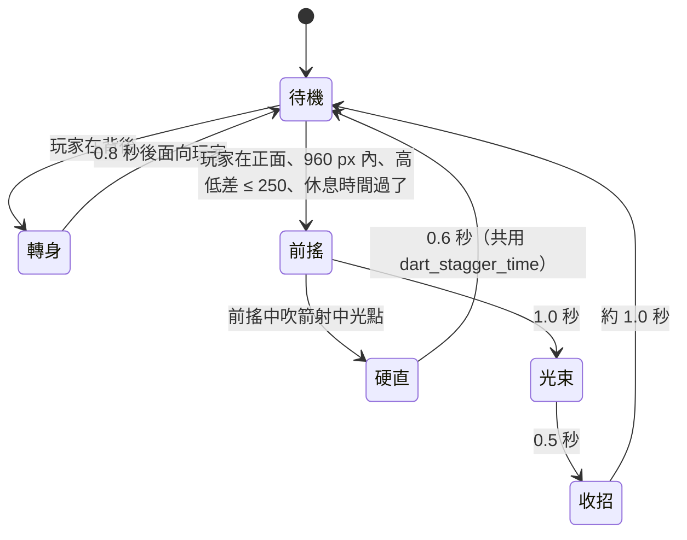

# MV-SLICE-001c4c1 反光型的行為

更新時間：2026-10-16

## 基本資訊

| 項目 | 內容 |
|------|------|
| 分支 | `feature/MV-SLICE-001c4c1_反光型行為`（從 `develop` `c812e09` 開） |
| 影響範圍 | `game/`：新增 `core/enemies/reflector.gd`；`core/tuning/combat_tuning.gd`（反光型數值）；`world/room.gd`（生成反光型、沒有骨架時用佔位）；`world/rooms/forest_3.gd`、`forest_5.gd`、`forest_6.gd`、`forest_c.gd`（放置）；新增素材工單 MV-ASSET-019 |
| 上層 | [MV-SLICE-001 總規格](MV-SLICE-001_垂直切片.md)：內容量子專案（SLICE-c-2）的 c4c 拆成 c4c1（本文件：行為）→ c4c2（美術與動作） |
| 前置 | MV-SLICE-001c4a、c4b、MV-TUNE-004（皆已合併） |
| 設計依據 | [ART_SPEC](../../ART_SPEC.md) 第 5 節（戰鬥訊號：光、不用紅色；不可招架＝暗紫鋸齒）、第 8 節（假光造物：爬行型、飛行型、反光型）；[MV-ASSET-003](../../docs/assets/MV-ASSET-003_素材工單_第2批.md)「舉反光面的中型等行為定了再做」；[MV-BOSS-001](../../docs/design/MV-BOSS-001_SevenMacaw設計.md)（第 3 段眼中光束） |
| 引擎 | Godot 4.7.2 |
| 狀態 | ✅ Brian 2026-10-16 跳過試玩、指示合併（PR） |

## 背景與目的

森林的敵人只有爬行型（地面撲擊、可招架）與飛行型（空中俯衝、不可招架），戰鬥節奏只有兩種。美術規格早就把第三種假光造物定為「舉起反光面射出強光的中型」，但行為一直沒定，素材工單也一直等著。c4c1 定下它的行為、放進森林，同時把素材工單交出去；骨架與動作等試玩定案後由 c4c2 做，避免行為改了動作要重做。

## 盤點（2026-10-16，AI 實查）

- 敵人共用邏輯 `core/enemies/enemy.gd`：狀態 IDLE → TELEGRAPH（前搖訊號：`parryable` true＝白色圓形、false＝暗紫鋸齒）→ ATTACK → RECOVER；前搖中被吹箭射中＝打斷、硬直 `dart_stagger_time` 0.6 秒，冷卻 `dart_interrupt_cooldown` 3 秒；碰觸身體不傷人，只有攻擊判定會傷人；子類別覆寫 `_` 開頭的函式。
- 爬行型：血 `crawler_hp` 12、傷害 1、前搖 0.6、收招 0.8、看得到玩家的高低差 250（`SIGHT_HEIGHT`）。飛行型：血 8。
- Seven Macaw 的眼中光束（`core/boss/moves/beam.gd`）：蓄力 `beam_charge` 1.2 秒、持續 `beam_active` 0.5 秒、離地 `beam_band` 20～100 px（單跳跳得過）。
- 木障（`core/level/barrier.gd`）：不該被打動的東西被打到時發 `thudded`，回饋音 `thud`。
- 房間生成敵人 `room.gd` `spawn_enemy`：`kind` 不是 `crawler` 就當成飛行型；有場景時掛骨架 `EnemyAnimator.attach(n, kind)`（只有爬行型、飛行型的骨架）。
- 森林 3 主路：爬行型 2、飛行型 1；森林 5：爬行型 2、飛行型 1；森林 6：爬行型 2、飛行型 2；主路合計 19 隻。支路 C 關門戰 3 波：2、3、4 隻（第 3 波：爬行型 2、飛行型 2）。
- 主路通過性、鎖高台附近不放飛行型與水晶（1300 px）的規則由 `room_check` 與 c4a、c4b 的自測檢查。

## 定案（Brian，2026-10-16）

| ID | 議題 | 定案 | 理由 |
|---|---|---|---|
| SLICE-c4c-1 | 定位 | 遠程壓制＋正面擋：站著用反光面射光，反光面同時擋正面 | 和爬行型（近戰）、飛行型（空中）的節奏最不同 |
| SLICE-c4c-2 | 攻擊 | 貼地水平光束，不可招架 | 沒有新規則；玩家在 Boss 第 3 段前先練到同一種閃法 |
| SLICE-c4c-3 | 破解 | 前搖時吹箭射反光面的光點 → 打斷；繞到背後打 | 用到吹箭與走位兩種既有技巧 |
| SLICE-c4c-4 | 血量 | 爬行型的 2 倍（24） | 一隻就是一個小戰鬥，不拖太久 |
| SLICE-c4c-5 | 蓄力 | 1.0 秒 | 比 Boss 光束（1.2）快一點，小怪節奏較緊 |
| SLICE-c4c-6 | 移動 | 不走；玩家繞到背後時要 0.8 秒才轉過來，轉身時不擋 | 轉身就是繞背的空檔 |
| SLICE-c4c-7 | 射程 | 960 px（約半個畫面） | 看得到它才會被射，不會從畫面外狙擊 |
| SLICE-c4c-8 | 正面擋 | 悶響、一點火花、不扣血（同木障） | 玩家馬上知道「正面打不動」 |
| SLICE-c4c-9 | 放置 | 森林 3、5、6 主路各 1 隻（加在現有敵人之外，主路 19 → 22）；支路 C 關門戰第 3 波換入 1 隻 | 森林 1、2 留給新手熟悉基本操作 |
| SLICE-c4c-10 | 光束高度 | 貼地、單跳跳得過（同 Boss 的 `beam_band`） | 和第 3 段學到的一致 |
| SLICE-c4c-11 | 名稱 | 反光型，程式 id `reflector` | 美術規格第 8 節已用 |
| SLICE-c4c-12 | 美術 | 交 Codex：基準圖＋分件，反光面是獨立一件；到位前用程式畫的佔位 | 反光面要能舉起、放下、轉向；不卡程式 |
| SLICE-c4c-13 | 拆法 | c4c1 行為＋佔位＋放置＋素材工單 → c4c2 切分件、骨架與動作（同 b2b1 的做法） | 行為試玩定案後再做動作，不重做 |
| SLICE-c4c-14 | 提示 | 不加；試玩卡住再說 | 正面悶響、蓄力光點會閃，和木障「射了沒反應 → 換人」同一個引導思路 |

## 範圍

### 行為（`core/enemies/reflector.gd`，繼承 `enemy.gd`）

| 狀態 | 反光面 | 正面受擊 | 背後受擊 |
|---|---|---|---|
| 待機、前搖、光束 | 舉著、朝向玩家那一側 | 悶響＋火花、不扣血；**前搖中**的吹箭＝射中光點 → 打斷 | 全額扣血 |
| 轉身 | 轉動中 | 扣血（轉身時不擋） | 扣血 |
| 收招、硬直 | 放下 | 扣血 | 扣血 |

- 「正面」＝攻擊來源在反光面朝向的那一側（以兩者的 x 判斷）。
- 前搖訊號：暗紫鋸齒（`parryable = false`），反光面上的光點在 1.0 秒內由暗到亮。
- 光束：從反光面往前、長 960 px、離地 `beam_band`（20～100 px）、持續 0.5 秒、傷害 1；碰到牆就停。外觀沿用 Boss 光束的畫法（落在 c4c2 換素材）。
- 轉身：玩家在背後時開始轉，0.8 秒後朝向玩家；轉身中不出招、不擋。
- 數值加進 `combat_tuning.gd`：`reflector_hp` 24、`reflector_damage` 1、`reflector_telegraph` 1.0、`reflector_beam_time` 0.5、`reflector_range` 960、`reflector_recover` 1.0、`reflector_turn_time` 0.8；體型約 160×140。
- 擊倒：碎成光點與寶石碎片（共用現有的擊倒效果）；掉可可豆照現有規則。

### 生成與佔位（`room.gd`）

- `spawn_enemy` 依 `kind` 建三種（`crawler`、`flyer`、`reflector`）。
- 反光型沒有骨架之前不掛 `EnemyAnimator`，由程式畫佔位：珠寶金的身體＋一塊看得出朝向的反光板；舉起、放下、轉向都要看得出來。

### 放置

| 房間 | 改動 |
|---|---|
| 森林 3、5、6 | 主路各加 1 隻反光型（具體座標由實作計畫與截圖校準：離門的出生點與鎖高台遠一點，前方留得出閃光束的空間） |
| 支路 C 關門戰 | 第 3 波的一隻爬行型換成反光型（仍是 4 隻） |

- 主路通過性與 c4a、c4b 的版面規則照舊（反光型不是飛行型，不受 1300 px 規則限制）。

### 美術工單 MV-ASSET-019（文件；生成交 Codex）

| 件 | 規格要點 |
|---|---|
| 反光型基準圖＋分件 | 珠寶色的假光造物（同爬行型、飛行型的造型語言），中型、約 160×140；反光面是獨立分件（舉起、放下、轉向），上面有一個「光點」位置；不畫真光、光暈；四段式 prompt，照 ART_SPEC 共通規則 |

- 生成與驗收在 c4c1 內做（Brian 已同意素材交 Codex）；切分件、骨架與動作在 c4c2。

### 不做

- 骨架與動作、正式外觀（c4c2）；新的光束特效素材。
- 其他敵人的行為與數值；Boss 段落放反光型；教學提示。

## 自測

1. 正面擋：待機時正面的近戰、吹箭不扣血、發悶響；背後近戰全額扣血。
2. 前搖中正面吹箭 → 打斷、硬直 0.6 秒；前搖以外的正面吹箭只有悶響。
3. 收招、轉身中正面也扣血。
4. 轉身：玩家繞到背後後 0.8 秒才面向玩家；轉身中不出招。
5. 出招條件：正面 960 px 內才前搖；961 px 外、背後、高低差 > 250 都不出招。
6. 光束：1.0 秒後出現、持續 0.5 秒、長 960（碰到牆就停）、離地 20～100；站著被打扣 1 格、跳起來不被打到。
7. 血量 24；被擊倒會發 `died`、掉可可豆。
8. 放置：森林 3、5、6 各 1 隻、主路合計 22 隻；關門戰第 3 波有 1 隻反光型、仍 4 隻；房間檢查、主路通過性照舊。
9. 佔位：沒有骨架時畫得出反光板的朝向（截圖檢查）。
10. `test_walkthrough` 照舊；全套自測全過（基準 538＋新增），沒有 `SCRIPT ERROR`／`Parse Error`／`flushing queries`。

## 風險與退路

| 風險 | 退路 |
|---|---|
| 光束 960 px 加上主路原有敵人太擠，陌生人被夾擊 | 截圖與試玩後調位置或拿掉同房一隻爬行型（只改資料） |
| 「正面／背後」用 x 判斷，玩家從正上方下劈時判定搖擺 | 正上方（水平距離小於半個身寬）算背後，給下劈一點甜頭；試玩再調 |
| 吹箭射光點太難瞄（光點小） | 前搖中正面的吹箭都算射中光點（不另做小判定框） |
| 佔位看不出朝向，試玩時繞背沒感覺 | 佔位的反光板用高對比色、舉起時明顯變高；c4c2 換正式素材 |

## 驗收標準

實作完成（AI）：

- [x] 自測全部通過（審查修正後 558 項：538＋新增 20），沒有 `SCRIPT ERROR`／`Parse Error`／`flushing queries`；`import_art.py --check`、`import_rig.py --check` 結束碼 0
- [x] `--shots` 每個畫面平均 60 fps（33 個畫面 16.15～16.43 ms）；森林 3、5、6 的截圖（`assets-test/c4c1_shots/c4c1_check.jpg`），AI 檢查反光型的位置與佔位朝向（支路 C 的反光型在第 3 波才出現，截圖拍不到，由自測 `test_arena_wave3_with_reflector_clears` 驗證）
- [x] MV-ASSET-019 工單寫好、Codex 生成、AI 驗收（[工單](../../docs/assets/MV-ASSET-019_素材工單_反光型.md)）

驗收（Brian）：

- [ ] 手把試玩：反光型好不好讀、繞背與吹箭打斷好不好用、森林 3、5、6 會不會太擠（Brian 2026-10-16：跳過試玩、沒有問題；c4c2 換正式外觀後再一起試）

## Git Commit

分支 `feature/MV-SLICE-001c4c1_反光型行為`（從 `develop` `c812e09` 開）：

| Commit | 內容 |
|---|---|
| `833acf2`、`4b3547d` | 規格書、實作計畫 |
| `e601bec` | Task 1：反光型的行為 |
| `e4e14e4` | Task 2：放進房間 |
| `67935c6` | Task 3：素材工單、生成與文件 |
| `481e1b0`＋文件 commit | 最終審查修正：貼身、擋下時的命中回饋、正上方寬度、轉身方向 |
