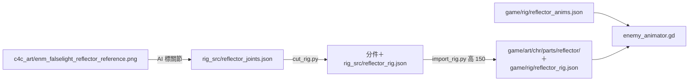

# MV-SLICE-001c4c2 反光型的美術與動作

更新時間：2026-10-16

## 基本資訊

| 項目 | 內容 |
|------|------|
| 分支 | `feature/MV-SLICE-001c4c2_反光型美術與動作`（從 `develop` `297d57b` 開） |
| 影響範圍 | `tools/rig_src/reflector_joints.json`（新）、`tools/import_rig.py`、`tools/import_art.py`；`game/rig/reflector_rig.json`、`reflector_anims.json`（新）、`game/art/chr/parts/reflector/`（新）；`game/world/enemy_animator.gd`（反光型的動作對應、轉身、擋下一震、光點）、`game/world/fx/beam_fx.gd`（也能讀反光型）、`game/world/room.gd`（拿掉佔位例外）、`game/world/rig_showcase.gd`；必要時 `game/core/enemies/reflector.gd`（判定大小） |
| 上層 | [MV-SLICE-001 總規格](MV-SLICE-001_垂直切片.md)：c4c 拆成 [c4c1 行為](MV-SLICE-001c4c1_反光型行為.md)（已合併）→ c4c2（本文件） |
| 前置 | MV-SLICE-001c4c1（PR #23 已合併）、[MV-ASSET-019](../../docs/assets/MV-ASSET-019_素材工單_反光型.md)（基準圖已驗收） |
| 設計依據 | [MV-SLICE-001b2b1](MV-SLICE-001b2b1_敵人與SevenMacaw動作.md)（非人形骨架：資料驅動的骨頭表、`cut_rig.py`、敵人動作對應）；ART_SPEC 第 4 節（分件友善姿勢＋整張切件） |
| 引擎 | Godot 4.7.2 |
| 狀態 | 🔄 實作與最終審查修正完成（Native 執行），待 Brian 看影片、手把試玩 |

## 背景與目的

c4c1 讓反光型的行為上線，外觀是程式畫的佔位（珠寶金方塊＋淺青反光板），轉身時看不出轉向。c4c2 把 MV-ASSET-019 的基準圖切成分件、做骨架與動作，換掉佔位，並讓蓄力光點與光束外觀和 Seven Macaw 的光束一致。

## 盤點（2026-10-16，AI 實查）

- 基準圖：`assets-test/c4c_art/enm_falselight_reflector_reference.png`（1536×1024、洋紅底；矮壯身體、頂端一顆大寶石、兩隻短腳都看得到、左手臂托著橢圓反光面，反光面和身體之間有空隙）。主 checkout 的 `assets-test/c4c_art/` 也有一份。
- 骨架管線（b2b1 建立）：`tools/rig_src/{角色}_joints.json`（關節、骨頭表、多邊形、`cap`、`origin`）→ `tools/cut_rig.py` 切分件 → `tools/import_rig.py`（`TARGETS` 定遊戲高度、`CUT_CHARS` 列角色）→ `game/rig/{角色}_rig.json`＋`game/art/chr/parts/{角色}/`；動作檔 `game/rig/{角色}_anims.json`（`fps` 12、每個動作 `loop`／`frames`：骨頭角度與 `root` 位移）。
- `world/enemy_animator.gd`：`attach(e, char_id)` 在敵人底下建 `RigView`、設 `portrait_drawn = true`；`choose()` 把 TELEGRAPH、ATTACK、RECOVER、STAGGER 對到同名動作，其餘播 `idle`（`clock` 循環）；每幀依 `facing` 翻面、用 `Tint` 上色。
- `world/fx/beam_fx.gd`：Seven Macaw 眼中光束的外觀（蓄力時地上的瞄準虛線、出招時白芯金邊往前流動），讀 `boss.move`。
- 反光型（c4c1）：判定 160×140；`turn_left`（轉身剩餘秒數，0.8 秒）、`spark_left`（擋下火花 0.15 秒）、`beam_rect`（本地座標）；`portrait_drawn` 為 false 時畫佔位與光束、光點。`room.gd` 對 `reflector` 不掛骨架。
- 展示：`world/rig_showcase.gd`（`--rig-view`）依 `CHARS` 順序播放各角色的動作；`--frames <資料夾>` 逐格輸出，ffmpeg 合成影片（b2b1 做法）。

## 定案（Brian，2026-10-16）

| ID | 議題 | 定案 | 理由 |
|---|---|---|---|
| SLICE-c4c2-1 | 骨頭 | 8 根：身體、頭寶石、手臂（1 節）、反光面（獨立）、近側大腿與小腿、遠側大腿與小腿 | 夠做舉起、下蹲、轉身；反光面要能獨立舉起、放下、轉向 |
| SLICE-c4c2-2 | 動作 | 待機（循環）、轉身、前搖、光束、收招、硬直，加上擋下時反光面往後一震（疊加） | 對應 c4c1 的全部狀態；轉身要看得出方向 |
| SLICE-c4c2-3 | 光束外觀 | 沿用 Boss 光束的特效（白芯金邊、往前流動、蓄力時地上的瞄準虛線） | 玩家在森林就認得「這是要跳的光」 |
| SLICE-c4c2-4 | 光點 | 掛在反光面中央的寶石上，跟著反光面骨頭移動 | 舉起、微震時光點和畫面對得上 |
| SLICE-c4c2-5 | 判定框 | 從骨架站姿量「身體＋腳＋反光面」；和 160×140 差超過 20% 才改 | 畫面和判定一致，又不無謂改動已驗收的行為 |
| SLICE-c4c2-6 | 尺寸 | 遊戲裡約 150 px 高 | 比爬行型（70）、飛行型（60）明顯大、比雙胞胎（180）矮 |
| SLICE-c4c2-7 | 驗收 | 錄一段反光型全部動作的展示影片給 Brian 看；之後手把試玩 | 同 b2b1 |

沿用 b2b1 的決定：約 12 fps、不內插；AI 寫關鍵姿勢；執行時從資料組出骨架；骨架畫在敵人節點後面，程式畫的訊號（暗紫鋸齒、硬直色）照舊在上面；被擋住切不出的部分才複製近側、明度 ×0.72（本圖兩隻腳都看得到，預期不用）；行為與數值不改（判定大小例外，見 SLICE-c4c2-5）。

## 範圍

### 分件與匯入

- 骨頭表：`body`（根）、`head`、`arm`、`mirror`（掛在 `arm` 末端）、`thigh_near`、`shin_near`、`thigh_far`、`shin_far`；`origin` 以腳底為準。
- 反光面骨頭上標一個「光點」座標（反光面中央的寶石）。
- `import_rig.py` 的 `TARGETS` 加 `reflector: 150`、`CUT_CHARS` 加 `reflector`；`import_art.py` 視需要加基準圖的縮圖（同爬行型、飛行型）。

### 動作（`reflector_anims.json`，12 fps、不內插）

| 動作 | 對應 | 姿勢要點 |
|---|---|---|
| `idle` | 待機（循環） | 反光面在胸前，身體微微上下 |
| `turn` | 轉身（`turn_left > 0`，0.8 秒） | 前半放低反光面、身體後縮；**到一半時畫面翻向新的一側**，後半抬回胸前 |
| `telegraph` | 前搖（1.0 秒） | 反光面舉高到頭前上方、身體下蹲蓄力 |
| `attack` | 光束（0.5 秒） | 舉著、後座力微震 |
| `recover` | 收招（1.0 秒） | 反光面放低、身體起伏（喘氣） |
| `stagger` | 硬直（0.6 秒） | 後仰、反光面歪掉 |
| 擋下一震 | `spark_left > 0`（0.15 秒） | 疊加在當下的動作上：反光面骨頭往後偏轉幾度 |

### 遊戲整合

- `enemy_animator.gd`：反光型多兩件事——`turn` 依 `turn_left` 決定時間與翻面時機（一般敵人不受影響）；擋下一震用疊加角度。光點：蓄力時在反光面骨頭的光點座標畫由暗到亮的光（取代 c4c1 佔位的光點）。
- `beam_fx.gd`：讓它也能掛在反光型上（讀反光型的 `state`、`state_time`、`beam_rect`），蓄力時畫瞄準虛線、光束時畫白芯金邊；Seven Macaw 的光束外觀不變。
- `room.gd`：反光型也掛骨架（拿掉 c4c1 的例外）；`reflector.gd` 的佔位繪圖保留給沒有場景的測試房間（`portrait_drawn` 為 false 時）。
- 判定：從骨架站姿量範圍，寫成常數並由自測核對；和 160×140 差超過 20% 才改 `size`，改了的話 c4c1 的光束起點、正上方寬度測試照數字跟著核對。
- `rig_showcase.gd`：`CHARS` 加 `reflector`，依序播放全部動作（含轉身與擋下一震）。

### 不做

- 行為、數值（判定大小例外）；擊倒特效（維持現有的碎片光點）。
- 其他角色的骨架與動作。

## 自測

1. 骨架：`reflector_rig.json` 載入、正好 8 根骨頭、分件檔都存在；站姿高約 150（±10）。
2. 動作對應：待機、前搖、光束、收招、硬直播對應的動作；轉身中播 `turn`，翻面時機在轉身一半（`turn_left` 小於 0.4 時畫面已翻）；擋下時反光面骨頭有偏轉、0.15 秒後恢復。
3. 光點：蓄力時光點位置等於反光面骨頭上的光點座標（反光面舉起時跟著移動）。
4. 光束特效：掛在反光型上，蓄力時畫瞄準虛線、光束時畫光束，範圍等於 `beam_rect`；Seven Macaw 的光束特效照舊（既有自測）。
5. 判定：骨架站姿範圍與判定的關係符合 SLICE-c4c2-5（自測核對寫進的常數）。
6. 房間：森林房間生成的反光型有骨架（`portrait_drawn` 為 true）；沒有場景的測試房間仍畫佔位。
7. `--rig-view` 展示含反光型；全套自測全過（基準 558＋新增），沒有 `SCRIPT ERROR`／`Parse Error`／`flushing queries`；`import_art.py --check`、`import_rig.py --check` 結束碼 0。

## 風險與退路

| 風險 | 退路 |
|---|---|
| 反光面和手臂、身體的接縫在舉高時露出洋紅或空洞 | 兩端關節多帶一圈重疊（`cap`）；抽格檢查；不好看再開工單請 Codex 補一張分件友善姿勢 |
| 基準圖的反光面是斜的，翻面後看起來像朝錯方向 | 截圖與影片檢查；必要時反光面骨頭在翻面時加角度補償 |
| 量出來的判定和 160×140 差超過 20%，改了會動到 c4c1 已驗收的手感 | 只在差超過 20% 時改，並重跑 c4c1 的測試；手把試玩再確認 |
| 光束特效改成共用後影響 Boss 光束 | Seven Macaw 的光束自測與截圖照舊核對 |

## 驗收標準

實作完成（AI）：

- [x] 自測全部通過（審查修正後 570 項：558＋新增 12），沒有 `SCRIPT ERROR`／`Parse Error`／`flushing queries`；`import_art.py --check`、`import_rig.py --check` 結束碼 0
- [x] `--shots` 每個畫面平均 60 fps（重拍 33 個畫面 16.16～16.31 ms；第一次 `forest_c_right` 17.32 ms 為偶發，重拍 16.20）；森林 3、5、6 的截圖（`assets-test/c4c2_shots/c4c2_check.jpg`），AI 檢查骨架的位置、接縫、朝向、蓄力時的瞄準虛線
- [x] 動作展示影片（`assets-test/c4c2_video/reflector_rig.mp4`、`reflector_rig_gray.mp4`；抽格 `reflector_poses.jpg`），AI 抽格檢查：接縫沒有露洋紅；第一版前搖時反光面幾乎沒有抬高，手臂角度加到 70 度後重錄，舉起明顯

驗收（Brian）：

- [ ] 看動作展示影片
- [ ] 手把試玩（含 c4c1 跳過的部分：反光型好不好讀、繞背與吹箭打斷、森林 3、5、6 會不會太擠）

## Git Commit

分支 `feature/MV-SLICE-001c4c2_反光型美術與動作`（從 `develop` `297d57b` 開）：

| Commit | 內容 |
|---|---|
| `7ffe550`、`6751ecf` | 規格書、實作計畫 |
| `12092a1` | Task 1：分件、骨架與動作檔 |
| `7ca85e8` | Task 2：動作接上遊戲（判定改 250×150） |
| `f3cbaf7` | Task 3：展示、影片、截圖、文件 |
| 審查修正＋文件 commit | 擋下一震畫面上會動、光束畫在本體後面、出招截圖、重錄影片 |
